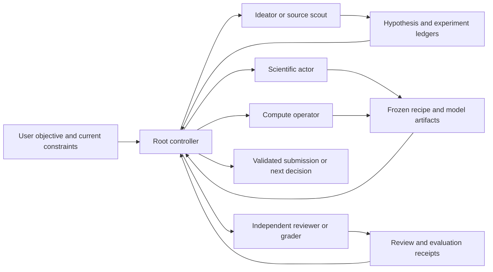

# Wunder Connectome Challenge 2

This repository combines the competition starterpack with our private model research. The competition asks for causal, row-by-row predictions of two future movement targets from a sequence of market-book features. A submission is a Python callback and its model files, packaged as a ZIP; the scorer runs it offline on CPU.

The starterpack data, metric, and submission contract are documented under [`docs/`](docs/). The current research objective and evidence are separate: start with [`specs/current-state.md`](specs/current-state.md), then use the [research index](RESEARCH.md) to find the relevant methods, models, validation results, and campaign receipts.

## The competition

Each input row has 112 float32 features. Sequences contain 20,000 ordered rows; steps 0–98 are warm-up, and the callback must return predictions on every row marked `need_prediction`. The model must preserve causal state within a sequence and reset that state when `seq_ix` changes. The two output values are returned in `[t0, t1]` order.

The supplied training set has 10,607 sequences (212.14 million rows); validation has 1,873 sequences (37.46 million rows). The `baseline/` directory contains a runnable stateful CPU reference. See the [quick-start guide](docs/quick_start.md) for its invocation and the data files.

The official score is global weighted Pearson correlation for the two targets, averaged across targets. The scorer uses its fixed prediction mask, clips targets and predictions to ±2, and weights rows by the magnitude of the clipped target. See the [official metric reference](research/unified/methods/COMPETITION_METRIC.md) and [data overview](docs/data_overview.md) for the exact definitions.

The current submission contract allows one CPU, 16 GB RAM, 60 minutes over the full test set, and a 20 MB ZIP. The scoring image uses Python 3.11 and has no internet or GPU access. These are deployment constraints; research-time model scale is governed by the active research allocation. Read the [submission guide](docs/submission_guide.md) and [competition rules](docs/rules.md) before packaging or uploading.

## Set up the repository

The research environment is pinned to Python 3.13; the scorer is Python 3.11. With [`uv`](https://docs.astral.sh/uv/), install the project dependencies and development tools with:

```bash
uv sync --no-default-groups --group dev
uv run pytest
```

For GPU research, install the research group as well. It includes the project’s CUDA-enabled PyTorch source and other analysis packages, so use it only on a machine whose driver and available memory have been checked:

```bash
uv sync --group research --group dev
```

The small [`requirements.txt`](requirements.txt) is for the submission/runtime libraries, not the complete training environment. Dataset-dependent and GPU-dependent checks are marked in `pyproject.toml`; choose tests that match the change and available hardware. Keep downloaded competition data, credentials, model weights, and generated artifacts out of Git unless a specific small receipt or figure is useful to reproduce a claim.

## Agent tools and credentials

Research and implementation agents use the tools already configured on the host. In this workspace on 2026-10-12, `freebuff` 0.2.26, Grok CLI 1.0.50, OpenCode 1.18.35, Kaggle CLI 2.2.4, and Vast.ai CLI 1.8.3 were found. These versions can change; check the installed route and available model before assigning work.

On a new research machine, put Freebuff, Grok, OpenCode, and Kaggle CLI on `PATH`; use host-managed authentication for each provider. Confirm a model route before assigning an external call and confirm Kaggle with the read-only entered-competitions query below. Vast is optional.

| Tool | Use | Safe availability check |
|---|---|---|
| Freebuff | Independent idea generation and reviews | `freebuff --version`; start an interactive isolated workspace with `freebuff --cwd <workspace>` |
| Grok | A separate model family for ideation or criticism | `grok --version` and `grok models` |
| OpenCode | Alternate coding and research routes | `opencode --version` and `opencode models` |
| Kaggle CLI | Private datasets, kernels, and GPU jobs | `kaggle --version` and `kaggle competitions list --group entered --page-size 1` |
| Vast.ai CLI | Optional, paid accelerator execution | `vastai --version`; check the active written allocation before any provider action |

The Kaggle list command completed in this workspace on 2026-10-12, confirming that the CLI could make an authenticated read-only request then. Each machine or account must check its own session before a job. If authentication has expired, use the CLI’s login flow; never paste tokens into source, notes, chat prompts, or command history. Vast is optional and must stay within the current user-approved machine, credit, and spending scope. Installing a CLI does not authorize a run or a purchase.

Keep API keys in host-managed credential stores or protected environment variables. Do not commit `.env`, Kaggle tokens, provider keys, private data, or model weights. For external model calls, send only the context permitted by the current project rules and retain the public prompt, source references, provider/model/version, and result receipt—not private reasoning transcripts.

## How agents work together

[`AGENTS.md`](AGENTS.md) is the shared instruction source. Before taking a task, read it alongside the [objective](specs/research-objective.md), [current state](specs/current-state.md), relevant [decision records](specs/adr/README.md), and any skill that governs the work. The current user instruction and current-state receipt decide whether research or spending is active; old campaign plans are not standing authorization.

The root controller owns scope, resource admission, evidence integration, and final decisions. It assigns bounded roles such as ideator, scientific actor, compute operator, independent critic, or grader. Each assignment names its evidence basis, deliverable, comparison, write boundary, budget, dependencies, and completion evidence using [`specs/agent-contract.md`](specs/agent-contract.md). Keep no more than three subordinate roles active, use the model/provider preference in `AGENTS.md`, and give writers separate branches or worktrees so they do not overwrite one another.

In a Codex session, agents coordinate through the collaboration tools: the controller sends a self-contained task, messages a running agent when scope changes, and follows up with an idle agent when another bounded task is ready. Their durable work belongs in the assigned files and experiment receipts; chat is for handoffs, not the only copy of a result. First proposals stay independent until recorded. A different agent reviews an implementation or grade, and the controller reconciles disagreements against code, hashes, run logs, and the official scorer. Other harnesses should preserve the same boundaries using their own delegation tools.



Agents must report the stage actually reached—proposed, implemented, profiled, fitted, exported, evaluated, packaged, or publicly scored. A code change is not a model result. Preserve failed attempts, give corrected retries new IDs, and distinguish resource failures from scientific outcomes. Teammate code can inform a method, but production implementations and model weights must follow the independent-training rules in `AGENTS.md` and the relevant ADR.

## Where the work lives

- [`RESEARCH.md`](RESEARCH.md) is the root navigation page. Topic READMEs under [`research/unified/`](research/unified/README.md) explain ideas, methods, reviews, sources, model families, validation, submissions, inference, and operations.
- [`research/hypotheses.jsonl`](research/hypotheses.jsonl) and [`research/experiments.jsonl`](research/experiments.jsonl) are append-only scientific records. The bandit tree links hypotheses to experiments and explicit combinations.
- Campaign folders hold frozen recipes, execution logs, resource measurements, predictions, and original receipts. Summaries link to this evidence; they do not replace it.
- [`specs/`](specs/README.md) holds the objective, current status, execution contracts, and decisions. Keep the top-level directory for project instructions and competition entry points, not historical aliases.

The research tree is currently closed to new admission under its [stop receipt](research/campaign_2026-10-12/STOP_NEW_RESEARCH_AND_FINAL_ARCHIVE_20261012_R1.json). This README and file organization do not resume experiments. Check `specs/current-state.md` and the newest receipt before allocating compute.
