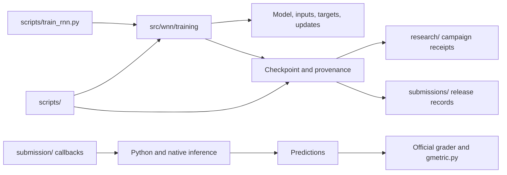

# Software architecture

The repository separates the competition callback, reusable modeling and
training code, experiment tools, and the evidence produced by each run.

## Training path

[scripts/train_rnn.py](../scripts/train_rnn.py) preserves the historical CLI
and packet compatibility. The canonical component guide is
[src/wnn/training/README.md](../src/wnn/training/README.md). It maps the
reusable modules for data loading, causal input assembly, models, targets,
objectives, updates, checkpointing, evaluation and provenance. The runner owns
the ordered training loop; new training logic belongs in the focused package
components.

Shared metric, split, feature and inference modules live in src/wnn/ outside
the training package. In particular, [gmetric.py](../src/wnn/gmetric.py) is
the official pooled weighted-Pearson implementation. Keep research-only
dependencies out of the scorer-facing callback path.

## Serving path

The competition callback interface is documented in
[submission_guide.md](submission_guide.md). Callback implementations and
build inputs are in [submission/](../submission/); the starter reference is
in [baseline/](../baseline/). Native Rust and Python binding sources live in
[native/](../native/). Validate sequence-state reset, deterministic output,
runtime imports and package contents against the exact release manifest before
making claims about a built submission.

## Evidence path

Experiment scripts create receipts, checkpoints, predictions and grades.
Campaign recipes and raw results belong with their campaign in research/;
topic summaries and links belong in research/unified/. Package-specific
source pins, compatibility checks and release receipts belong beside each
dated entry in submissions/. The [research index](../RESEARCH.md) describes
how to trace a claim back to its evidence.

Historical files can still describe old runners, policies or scores. Read the
[current-state note](../specs/current-state.md) before treating a dated record
as active behavior.
