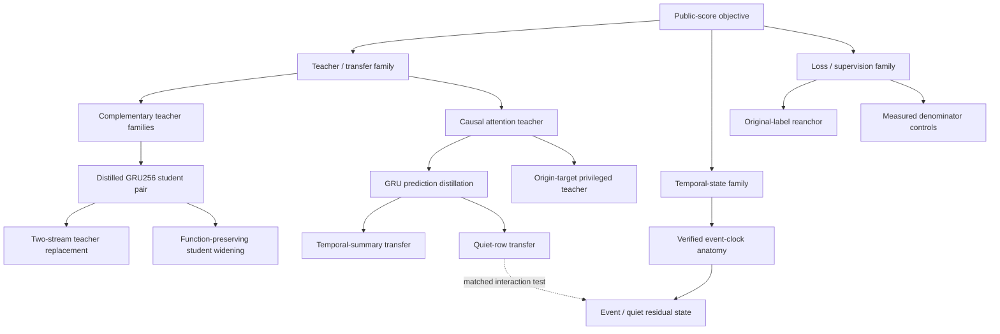

# Extendable bandit research tree

## Interactive view

Open [the HTML research explorer](generated/view.html). It works offline, embeds
every generated node, and provides search, collapsible branches, evidence links,
interaction navigation, and an eligible-frontier filter.

Green/red describe recorded favorable/unfavorable outcomes of exact recipes.
Blue marks open or untested directions; amber marks execution/resource issues;
purple marks validity/ancestry issues; gray marks diagnostic or historical nodes.
Official-metric signed contrasts use stronger tint for larger absolute deltas,
saturating at 0.003. Each delta is relative to its own recorded control, not a
cross-fold ranking or a public prediction. Qualitative statuses are identified
in the detail panel. Priority mode shows manual allocation priorities. Neither
coloring mode infers that a child is bad because its parent failed.

Rebuild after updating ledgers/configuration, inside the campaign boundary:

```sh
WNN_SLICE=wnn-campaign.slice WNN_CPU_QUOTA=100% WNN_THREADS=1 \
WNN_MEM_MAX=1500000000 WNN_RUNTIME_MAX=120s \
scripts/limited .venv/bin/python scripts/research_tree.py --root . build
WNN_SLICE=wnn-campaign.slice WNN_CPU_QUOTA=100% WNN_THREADS=1 \
WNN_MEM_MAX=1500000000 WNN_RUNTIME_MAX=120s \
scripts/limited .venv/bin/python scripts/research_tree_view.py --root .
```

The local web service binds only `127.0.0.1:8765` and runs inside the campaign
slice with 0.5 CPU, 256 MB RAM and no swap. Open
`http://127.0.0.1:8765/research/bandit_tree/generated/view.html`.
Inspect it with `systemctl --user status wnn-research-tree-web.service`.
The HTML snapshot records its source tree SHA-256; rebuild after meaningful updates.

This is an additive navigation and allocation layer for root Challenge 2.
Original ledgers, notes, plots, failed attempts, historical bandit state and raw
artifacts remain in their existing locations. Nothing is merged from the friend’s
branch. The separate Challenge 3 tree is excluded.

Start with [the generated tree](generated/INDEX.md), [current configuration](config.json),
[agent diversity](AGENT_DIVERSITY.md), [teacher-agent brief](TEACHER_AGENT_BRIEF.md)
and [the preservation audit](AUDIT.md). The [machine-readable preservation receipt](PRESERVATION.json)
records the independent byte and filesystem checks.

## What the tree means

The hierarchy is `objective → mechanism family → arm → deeper arm / hypothesis
→ experiment`. A hypothesis can also attach directly to a family when its precise
lineage is unknown. Cross-family interactions use explicit related-node links;
they do not pretend to have a single causal ancestry. Imported experiments keep
all their original ledger rows, source line numbers and hashes. An experiment
linked to several hypotheses has one navigation parent and additional links.



Deepening a branch is encouraged when a child makes a concrete change and yields
new evidence. A parent's weak prior or failed recipe is not a ceiling for every
descendant. Record what the child repairs, its matched comparator and its expected
incremental value. A new implementation, training protocol or teacher can justify
reopening a family; merely renaming the same failed experiment does not add evidence.

## Information preservation

- Original H and E JSONL files are append-only evidence sources. Repeated E IDs
  are separate events, not duplicates to discard. Keep failed and later successful
  attempts together.
- Original documents remain intact. The catalog includes ignored files and
  snapshots; large binary files are inventoried rather than copied or decoded.
- [ORIGINALS.json](ORIGINALS.json) binds the pre-migration bytes of the key ledgers,
  old tree, old bandit and old ranking script. Unknown fields remain attached to
  imported records rather than being reduced to a fixed summary.
- Generated files are reproducible views. Each configuration version is retained
  under `generated/snapshots/` by its content hash. Do not delete these snapshots.
- [journal.jsonl](journal.jsonl) preserves decisions, prior revisions, node splits,
  combinations and reasons for allocation. Amend a decision with another event;
  do not edit away the previous event.
- A recorded ledger status is not automatically a live process status. For example,
  E496 was admitted and later interrupted with no calibration report. Curated
  `evidence_states` distinguish ledger, receipt, packet-version and live-observability
  scope without overwriting any of them. The tool inventories receipts but does
  not infer their scientific meaning; maintain these annotations with source links.

## Maintaining and extending it

From the repository root:

```bash
.venv/bin/python scripts/research_tree.py --root . build
.venv/bin/python scripts/research_tree.py --root . check
.venv/bin/python scripts/research_tree.py --root . rank
```

1. Register an actual hypothesis in the existing hypothesis ledger. A design-only
   tree arm can be added first, with `status: not_tested` and no fabricated H/E ID.
2. Add a node to `config.json` with a permanent unique ID, `parent_id`, the precise
   change, cheapest discriminating test, evidence paths and related nodes. Use the
   same schema for deeper children; no code change is needed to add an arm.
3. Declare the reference recipe, serving endpoint, metric, exposure history,
   seed pairing and stopping rule before a predictive comparison. Public best stays
   0.6660 until an actual new public result is recorded.
4. Append every actual run to `experiments.jsonl`, including failures and retries.
   Store raw outputs and EDA plots beside that experiment's research directory.
5. Append a decision event to `journal.jsonl`, then update the current node's belief,
   cost or next test. Rebuild and check the generated view before using it to allocate.

See [config.schema.json](config.schema.json). Extra metadata fields are allowed so
new mechanisms can retain information that today's schema does not anticipate.
Family keyword classification is only a navigation aid; correct uncertain mappings
with explicit curated membership rather than interpreting a keyword match scientifically.

Example child (fill evidence and measured costs when available):

```json
{
  "id": "arm:transformer-student-new-protocol",
  "parent_id": "arm:transformer-student",
  "title": "A specified improvement to the transfer protocol",
  "kind": "arm",
  "status": "not_tested",
  "hypothesis_ids": [],
  "experiment_ids": [],
  "artifacts": [],
  "next_test": "Paired comparison against the parent protocol",
  "allocation": {"eligible": true, "priority": 3, "launch_authorized": false},
  "belief": {"mu": null, "sd": null, "noise_sd": null,
             "unit": "absolute_global_wp_delta", "reviewed": false},
  "cost_h": null
}
```

Example append-only decision:

```json
{"id":"unique-decision-id","timestamp_utc":"actual UTC timestamp",
 "event_type":"belief_revision","node_id":"arm:transformer-student",
 "evidence_refs":["actual result path"],
 "decision":"What changed, why, and which comparison the revised belief concerns"}
```

## Bandit allocation without inventing evidence

The old 18 arms and their complete historical metadata are retained, but their
October 2 numeric priors are not reused automatically. Current `mu`, `sd` and
measurement noise are in **absolute Global-WP delta units**, unlike the old
`×10^-4` values. Unknown means unknown, not zero.

Use manual next-decision priority until a belief and trial cost are explicitly
reviewed. For a short queue spanning families, use `rank --limit 6 --max-per-family 1`
with the same script and root arguments. With reviewed current estimates, the ranker can use knowledge-gradient
information value per GPU hour. This is a planning model, not a calibrated public
forecast. Document subjective priors as subjective and revise them with evidence.
Do not add parent, child or sibling gains together. A combination needs its own
matched complete-endpoint result.

Allocate across families as well as within promising lineages. Reserve a declared
exploration share for genuinely different arms and vary book/article sources for
ideation. A positive branch can receive several deeper tests; a queue must not loop
indefinitely on one branch because it happens to have the most recent notes.

`allocation.eligible` means eligible for a next research decision or preparation,
**not permission to run a job**. Resource profiles, current provider access and
independent execution review remain separate. There is no automatic launcher here.
Current limits are five aggregate CPU cores, three decimal GB VRAM and 40GB RAM; new local
experiments after October 6 10:00 Kyiv are prohibited. New experiments use Kaggle.

All previously inspected validation and holdout data remain exposed. Different
agents, models, folds or labels do not reset that exposure. Evaluate recipe variation,
sampling variation and public transfer uncertainty separately.

After the remote refresh, the leading independent-builder task is the
[heterogeneous teacher compression brief](HETEROGENEOUS_AGENT_BRIEF.md).
It records the external user-reported0.6674 result, exact protocol distinctions
and matched controls; attention-teacher children remain open.
