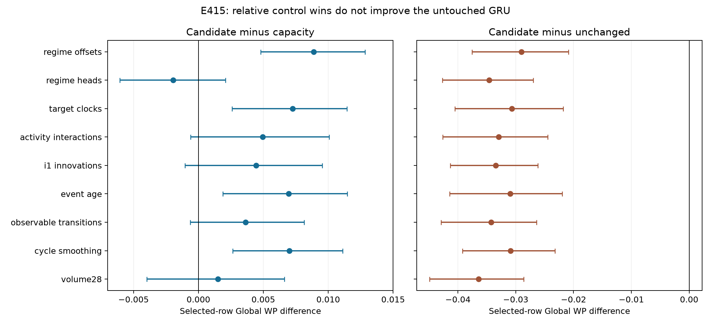

# E415: fixed conditional-feature proxy screen

All 18 fixed fits completed. Every candidate residual head is worse than the untouched GRU on this sample. Several candidates outperform the capacity control, which also harms the score. Those relative wins are not deployable gains.

The screen uses 6,158 preselected scored rows, 460 sequences and 140 connected components from previously exposed fold0. Backbone and learned ancestors exclude the entire fold. Head fitting uses reciprocal component-disjoint halves. No ridge, cue, mixture or checkpoint was selected from these results. Eight planned sequences contribute zero sampled scored rows; their original samples were retained and reported.

| Proxy family | Candidate minus untouched | Candidate minus capacity | Capacity contrast 95% interval |
|---|---:|---:|---|
| regime_offsets | -0.029039 | +0.008873 | [+0.004796, +0.012837] |
| regime_heads | -0.034592 | -0.001941 | [-0.006047, +0.002084] |
| target_clocks | -0.030656 | +0.007255 | [+0.002596, +0.011438] |
| activity_interactions | -0.032952 | +0.004959 | [-0.000596, +0.010067] |
| i1_innovations | -0.033478 | +0.004433 | [-0.001039, +0.009531] |
| event_age | -0.030966 | +0.006945 | [+0.001891, +0.011458] |
| observable_transitions | -0.034267 | +0.003644 | [-0.000629, +0.008145] |
| cycle_smoothing | -0.030892 | +0.007019 | [+0.002655, +0.011109] |
| volume28 | -0.036412 | +0.001499 | [-0.003971, +0.006617] |

Intervals condition on these fitted backbones and reciprocal heads; they do not cover head fitting, seed or search uncertainty. The row sample is small and the metric is nonlinear; this is not the full-validation or public score. Labels such as target_clocks and cycle_smoothing here denote proxies, explicitly enumerated in `kaggle/FEATURE_SCREEN.md`. Four-regime routing, target-specific row/event EMAs, actual cycle averaging and learned conditional i1 innovations remain separate, unfinished experiments. The negative head results do not close those mechanisms.

All head jobs used one CPU and a 2 GiB limit; measured head peaks stayed below 100 MiB. No OOM occurred. Initial extraction failed on an empty sampled sequence and globally interrupted E412; sampling-preserving recovery is documented in `E415_EMPTY_SAMPLE_INCIDENT.md`.

Source: `scripts/feature_synthesis.py`; frozen specifications in `specs/e415_*.sealed.json`; raw heads and predictions in `feature_results/`; pooled numerical evidence in `checks/e415_pooled_v1.json`.

