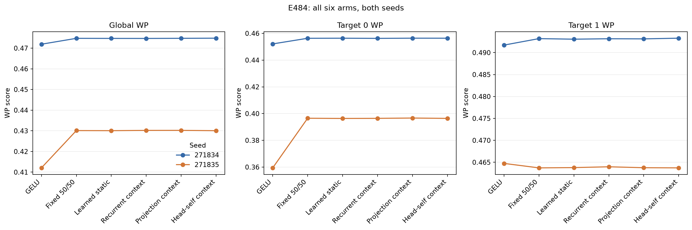
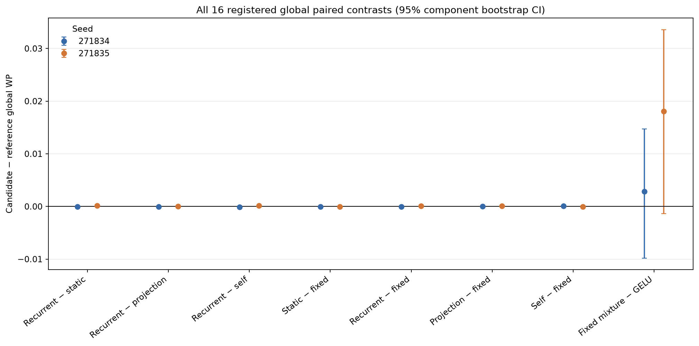
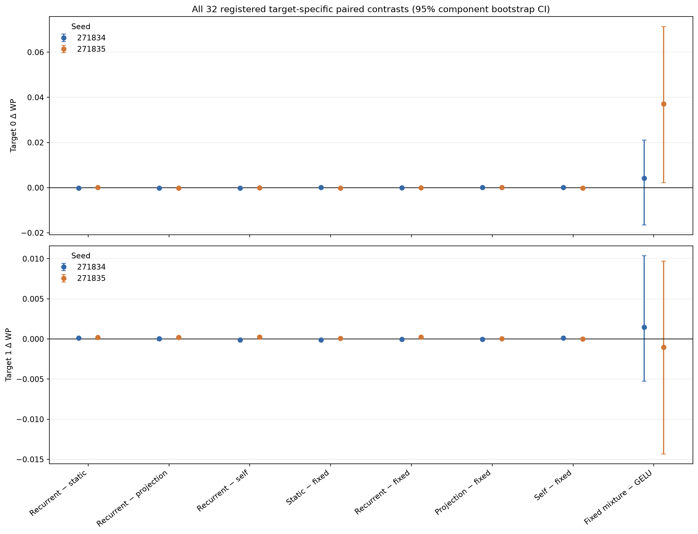

# E484 causal context-mixture grade

This report displays the frozen independent V2 grade for 12 registered fits, 16 global contrasts, and 32 target-specific contrasts. It keeps both seeds separate and retains all six arms. The raw-export reproducer matched all 12 arms and all 48 registered contrasts with maximum absolute error **3.531e-14**. It checks arithmetic on saved exports; it is not a second inference run.

This is a two-seed, one-epoch, H64 exposed-panel diagnostic over the same 16 previously exposed components. It does not establish an activation mechanism or public score improvement. The grader names the anchor contrast as fixed mixture minus GELU; signs below follow candidate minus reference.

## Run receipts

The 12 fits finished in 29.37s (peak worker RAM 1,375,019,008 bytes; observed GPU peak 390,070,272 bytes). The independent CPU grade finished in 132.865s with peak RAM 995,250,176 bytes, zero worker and parent OOM-counter deltas, no GPU use, and verified teardown. Each fit used 474 updates. No public forecast follows from this panel.

The root raw-export check matched 12 arms, 16 global contrasts, and 32 target contrasts (result SHA 6a4862dd07ef28040e6aefd5ccbe4c68d266acee9cd3b999312ecc6131d13545; export SHA cfd0c4807249ae37e641fe329e8227a6c110990dc22f9c2fd4c94dfa2de81c81).

## All 12 arm scores

| Seed | Arm | Global WP | Target 0 | Target 1 | Updates |
|---:|---|---:|---:|---:|---:|
| 271834 | GELU | 0.471914 | 0.452117 | 0.491711 | 474 |
| 271834 | Fixed 50/50 | 0.474759 | 0.456330 | 0.493188 | 474 |
| 271834 | Learned static | 0.474722 | 0.456385 | 0.493059 | 474 |
| 271834 | Recurrent context | 0.474707 | 0.456256 | 0.493159 | 474 |
| 271834 | Projection context | 0.474768 | 0.456406 | 0.493130 | 474 |
| 271834 | Head-self context | 0.474836 | 0.456383 | 0.493289 | 474 |
| 271835 | GELU | 0.412072 | 0.359398 | 0.464745 | 474 |
| 271835 | Fixed 50/50 | 0.430123 | 0.396518 | 0.463727 | 474 |
| 271835 | Learned static | 0.430079 | 0.396365 | 0.463793 | 474 |
| 271835 | Recurrent context | 0.430209 | 0.396444 | 0.463974 | 474 |
| 271835 | Projection context | 0.430219 | 0.396672 | 0.463766 | 474 |
| 271835 | Head-self context | 0.430069 | 0.396409 | 0.463729 | 474 |

## All 16 global contrasts

| Seed | Contrast | Δ Global WP | Paired component 95% CI |
|---:|---|---:|---:|
| 271834 | Recurrent − static | -0.000014 | [-0.000123, +0.000071] |
| 271834 | Recurrent − projection | -0.000061 | [-0.000207, +0.000033] |
| 271834 | Recurrent − self | -0.000129 | [-0.000246, -0.000058] |
| 271834 | Static − fixed | -0.000037 | [-0.000096, +0.000016] |
| 271834 | Recurrent − fixed | -0.000051 | [-0.000136, +0.000014] |
| 271834 | Projection − fixed | +0.000010 | [-0.000065, +0.000128] |
| 271834 | Self − fixed | +0.000078 | [+0.000030, +0.000150] |
| 271834 | Fixed mixture − GELU | +0.002845 | [-0.009850, +0.014743] |
| 271835 | Recurrent − static | +0.000130 | [-0.000063, +0.000343] |
| 271835 | Recurrent − projection | -0.000009 | [-0.000256, +0.000212] |
| 271835 | Recurrent − self | +0.000140 | [+0.000005, +0.000248] |
| 271835 | Static − fixed | -0.000044 | [-0.000141, +0.000047] |
| 271835 | Recurrent − fixed | +0.000087 | [-0.000119, +0.000290] |
| 271835 | Projection − fixed | +0.000096 | [-0.000003, +0.000199] |
| 271835 | Self − fixed | -0.000054 | [-0.000188, +0.000119] |
| 271835 | Fixed mixture − GELU | +0.018051 | [-0.001356, +0.033590] |

## All 32 target-specific contrasts

| Seed | Contrast | Target | Δ WP | Paired component 95% CI |
|---:|---|---|---:|---:|
| 271834 | Recurrent − static | Target 0 | -0.000129 | [-0.000289, -0.000013] |
| 271834 | Recurrent − static | Target 1 | +0.000100 | [+0.000012, +0.000193] |
| 271834 | Recurrent − projection | Target 0 | -0.000151 | [-0.000292, -0.000066] |
| 271834 | Recurrent − projection | Target 1 | +0.000029 | [-0.000215, +0.000215] |
| 271834 | Recurrent − self | Target 0 | -0.000128 | [-0.000302, -0.000002] |
| 271834 | Recurrent − self | Target 1 | -0.000130 | [-0.000290, -0.000033] |
| 271834 | Static − fixed | Target 0 | +0.000055 | [-0.000006, +0.000135] |
| 271834 | Static − fixed | Target 1 | -0.000129 | [-0.000230, -0.000053] |
| 271834 | Recurrent − fixed | Target 0 | -0.000074 | [-0.000181, +0.000013] |
| 271834 | Recurrent − fixed | Target 1 | -0.000028 | [-0.000134, +0.000057] |
| 271834 | Projection − fixed | Target 0 | +0.000077 | [-0.000020, +0.000196] |
| 271834 | Projection − fixed | Target 1 | -0.000057 | [-0.000209, +0.000127] |
| 271834 | Self − fixed | Target 0 | +0.000054 | [-0.000025, +0.000157] |
| 271834 | Self − fixed | Target 1 | +0.000101 | [+0.000035, +0.000192] |
| 271834 | Fixed mixture − GELU | Target 0 | +0.004213 | [-0.016464, +0.021062] |
| 271834 | Fixed mixture − GELU | Target 1 | +0.001477 | [-0.005281, +0.010367] |
| 271835 | Recurrent − static | Target 0 | +0.000079 | [-0.000237, +0.000451] |
| 271835 | Recurrent − static | Target 1 | +0.000182 | [-0.000020, +0.000335] |
| 271835 | Recurrent − projection | Target 0 | -0.000228 | [-0.000606, +0.000181] |
| 271835 | Recurrent − projection | Target 1 | +0.000209 | [+0.000010, +0.000334] |
| 271835 | Recurrent − self | Target 0 | +0.000035 | [-0.000121, +0.000232] |
| 271835 | Recurrent − self | Target 1 | +0.000245 | [+0.000009, +0.000403] |
| 271835 | Static − fixed | Target 0 | -0.000153 | [-0.000363, +0.000035] |
| 271835 | Static − fixed | Target 1 | +0.000065 | [+0.000008, +0.000124] |
| 271835 | Recurrent − fixed | Target 0 | -0.000073 | [-0.000366, +0.000255] |
| 271835 | Recurrent − fixed | Target 1 | +0.000247 | [+0.000060, +0.000376] |
| 271835 | Projection − fixed | Target 0 | +0.000154 | [+0.000011, +0.000288] |
| 271835 | Projection − fixed | Target 1 | +0.000038 | [-0.000048, +0.000150] |
| 271835 | Self − fixed | Target 0 | -0.000109 | [-0.000408, +0.000203] |
| 271835 | Self − fixed | Target 1 | +0.000002 | [-0.000096, +0.000130] |
| 271835 | Fixed mixture − GELU | Target 0 | +0.037120 | [+0.002234, +0.071326] |
| 271835 | Fixed mixture − GELU | Target 1 | -0.001018 | [-0.014337, +0.009690] |

## What this panel shows

The three primary recurrent-context comparisons against static, projection, and self-context controls remain seed-specific. Recurrent-minus-static intervals cross zero in both seeds. Recurrent-minus-self reverses sign across seeds: seed 271834 is −0.000129 (CI [−0.000246, −0.000058]), while seed 271835 is +0.000140 (CI [+0.000005, +0.000248]). The direction is not stable across seeds.

Fixed-mixture-minus-GELU global point estimates are +0.002845 and +0.018051, but both paired intervals include zero. Target-specific results are heterogeneous; the full 32-row table preserves that variation rather than collapsing targets or selecting an arm.

This report is descriptive for these 12 fits and the previously exposed panel. It does not select a winner, demonstrate that one context contains more information, or imply a public-score gain.

## Provenance

- Score JSON SHA256: 6a4862dd07ef28040e6aefd5ccbe4c68d266acee9cd3b999312ecc6131d13545
- Paired export SHA256: cfd0c4807249ae37e641fe329e8227a6c110990dc22f9c2fd4c94dfa2de81c81
- Official CPU grade attempt SHA256: 9f302e6ad2e18fc3a68932f830bddb7cdcf515e0484a7615e81beab080380623
- Completed fit attempt SHA256: 1fa8d74b94b37f76dc0b2bd8410919a40bff7ade234d36131334f88628ad8bf2
- Independent arithmetic receipt SHA256: 63ca3ec2e7f9ceff15b6c791b034e4e9f0b0d2012c7ebf2c560fd69e5596359a

The renderer validates and displays frozen machine outputs. It does not call the grader, inspect checkpoints, or recompute scores, contrasts, or bootstrap statistics.
