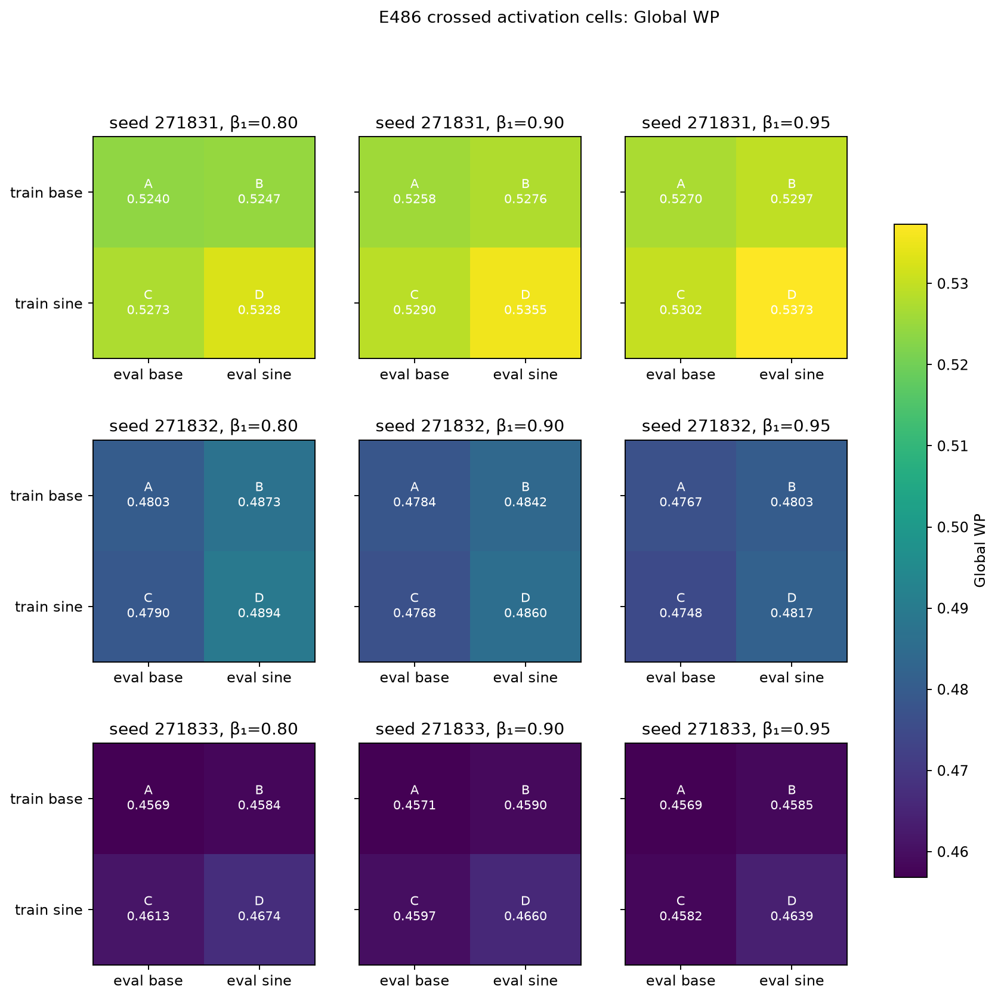
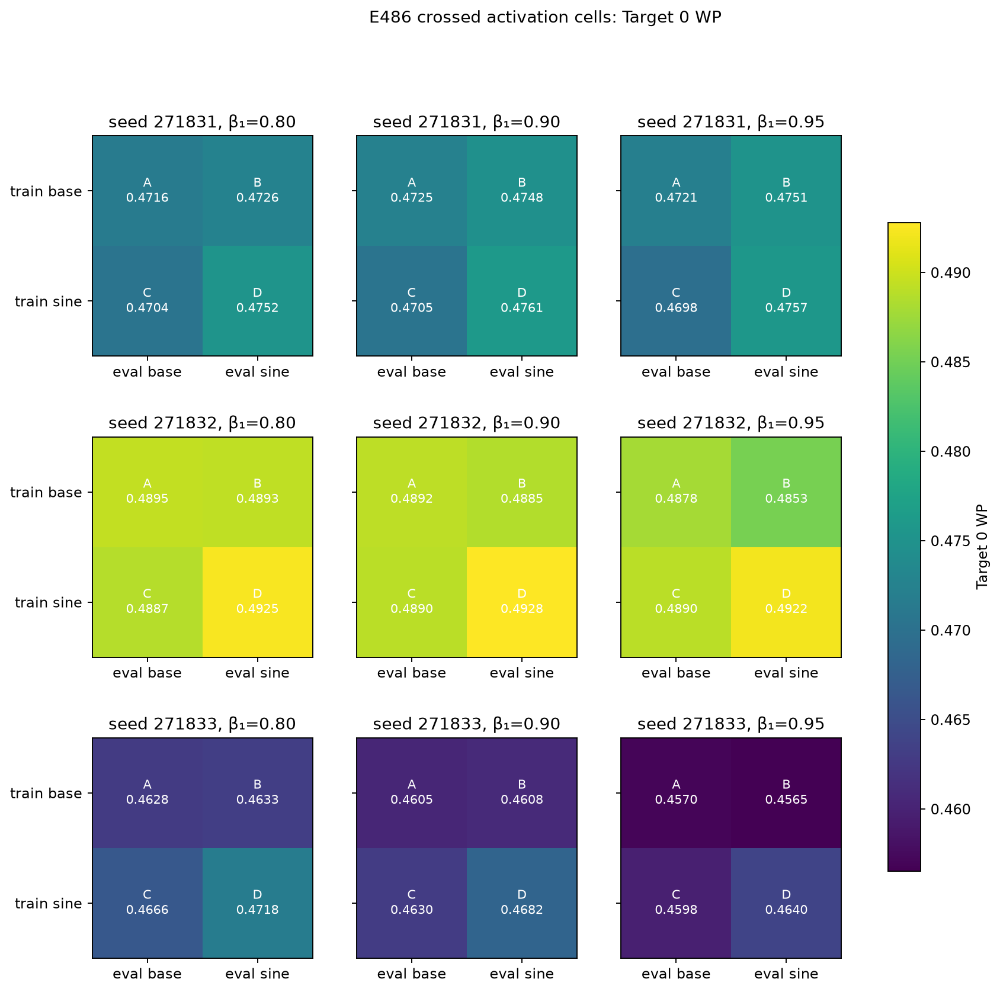
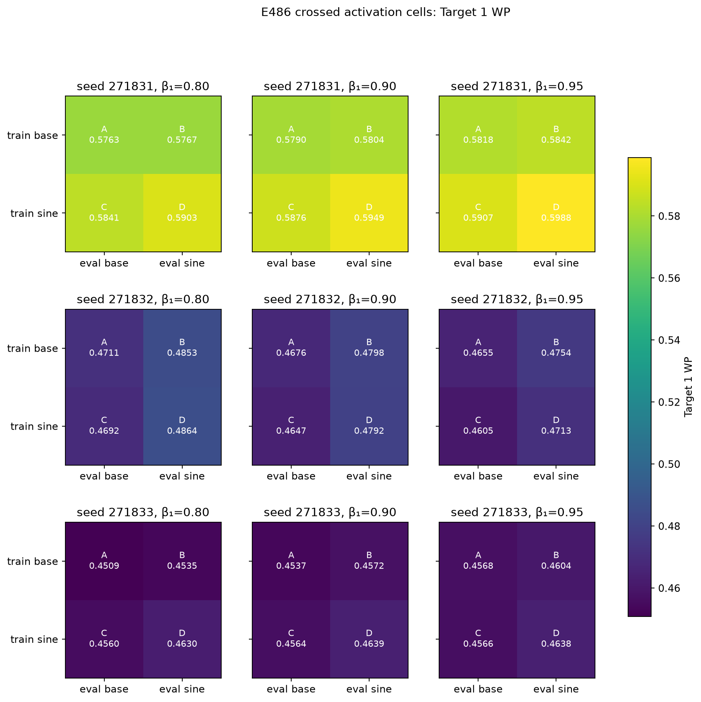
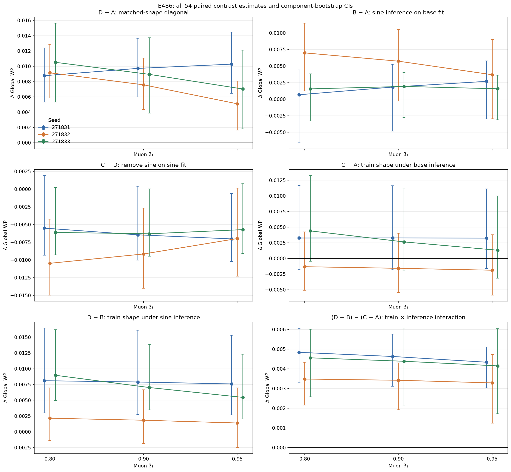

# E486 crossed training and inference activation shapes

This CPU-only diagnostic re-evaluates all 18 completed E483 checkpoints under both their trained and swapped activation equations. It contains 36 scored cells and all 54 registered global paired contrasts, with each seed and Muon momentum kept separate. It adds no fitted model or checkpoint. The independent raw-export arithmetic check matches all 36 cells and 54 contrasts to maximum absolute error **1.116e−14**; it does not rerun inference.

The 16 historically exposed components are reused. A diagonal D−A cell pair repeats the earlier matched-shape E483 comparison; it is a consistency check, not new evidence. Swapping the activation changes the causal hidden trajectory, output amplitude, and clipping, so the interaction is a training-shape × inference-shape diagnostic. It does not isolate pure optimization or prove a representation mechanism.

## Run receipt

The frozen CPU grade finished in 95.46s with peak worker RAM 669,925,376 bytes, zero GPU memory, no worker or parent OOM-counter increase, and verified teardown. It scored existing checkpoints only; no fit was repeated.

Root's raw-export reproducer checked 36 cells and 54 global contrasts (maximum absolute error 1.116e-14). The result and selected-export files are byte-bound below.

## All 36 cells

A = train baseline / infer baseline; B = train baseline / infer sine; C = train sine / infer baseline; D = train sine / infer sine. Each row shows the global WP plus both target slices.

| Seed | Muon β₁ | Cell | Global WP | Target 0 | Target 1 | Selected rows |
|---:|---:|---|---:|---:|---:|---:|
| 271831 | 0.80 | A | 0.523996 | 0.471643 | 0.576348 | 26990 |
| 271831 | 0.80 | B | 0.524664 | 0.472619 | 0.576709 | 26990 |
| 271831 | 0.80 | C | 0.527258 | 0.470424 | 0.584093 | 26990 |
| 271831 | 0.80 | D | 0.532764 | 0.475239 | 0.590290 | 26990 |
| 271831 | 0.90 | A | 0.525764 | 0.472508 | 0.579020 | 26990 |
| 271831 | 0.90 | B | 0.527590 | 0.474769 | 0.580411 | 26990 |
| 271831 | 0.90 | C | 0.529036 | 0.470459 | 0.587613 | 26990 |
| 271831 | 0.90 | D | 0.535490 | 0.476126 | 0.594853 | 26990 |
| 271831 | 0.95 | A | 0.526982 | 0.472140 | 0.581823 | 26990 |
| 271831 | 0.95 | B | 0.529671 | 0.475121 | 0.584222 | 26990 |
| 271831 | 0.95 | C | 0.530234 | 0.469767 | 0.590701 | 26990 |
| 271831 | 0.95 | D | 0.537261 | 0.475725 | 0.598796 | 26990 |
| 271832 | 0.80 | A | 0.480293 | 0.489488 | 0.471097 | 26990 |
| 271832 | 0.80 | B | 0.487283 | 0.489313 | 0.485252 | 26990 |
| 271832 | 0.80 | C | 0.478968 | 0.488740 | 0.469196 | 26990 |
| 271832 | 0.80 | D | 0.489440 | 0.492478 | 0.486403 | 26990 |
| 271832 | 0.90 | A | 0.478415 | 0.489189 | 0.467640 | 26990 |
| 271832 | 0.90 | B | 0.484151 | 0.488543 | 0.479760 | 26990 |
| 271832 | 0.90 | C | 0.476833 | 0.488990 | 0.464677 | 26990 |
| 271832 | 0.90 | D | 0.485991 | 0.492773 | 0.479208 | 26990 |
| 271832 | 0.95 | A | 0.476652 | 0.487842 | 0.465462 | 26990 |
| 271832 | 0.95 | B | 0.480345 | 0.485297 | 0.475393 | 26990 |
| 271832 | 0.95 | C | 0.474766 | 0.488994 | 0.460538 | 26990 |
| 271832 | 0.95 | D | 0.481745 | 0.492184 | 0.471307 | 26990 |
| 271833 | 0.80 | A | 0.456850 | 0.462838 | 0.450862 | 26990 |
| 271833 | 0.80 | B | 0.458406 | 0.463278 | 0.453535 | 26990 |
| 271833 | 0.80 | C | 0.461253 | 0.466554 | 0.455952 | 26990 |
| 271833 | 0.80 | D | 0.467369 | 0.471751 | 0.462986 | 26990 |
| 271833 | 0.90 | A | 0.457101 | 0.460483 | 0.453719 | 26990 |
| 271833 | 0.90 | B | 0.459022 | 0.460798 | 0.457245 | 26990 |
| 271833 | 0.90 | C | 0.459741 | 0.463037 | 0.456445 | 26990 |
| 271833 | 0.90 | D | 0.466047 | 0.468178 | 0.463915 | 26990 |
| 271833 | 0.95 | A | 0.456891 | 0.457006 | 0.456775 | 26990 |
| 271833 | 0.95 | B | 0.458461 | 0.456535 | 0.460386 | 26990 |
| 271833 | 0.95 | C | 0.458199 | 0.459783 | 0.456614 | 26990 |
| 271833 | 0.95 | D | 0.463919 | 0.464015 | 0.463823 | 26990 |

## All 54 paired global contrasts

Intervals are paired component-bootstrap 95% CIs over 16 components, 2,000 common draws per seed/momentum pair (bootstrap seed 271828). Contrasts are dependent by construction; the training-by-inference term reuses the same four crossed cells.

| Seed | Muon β₁ | Contrast | Δ Global WP | Paired 95% CI |
|---:|---:|---|---:|---:|
| 271831 | 0.80 | D − A: matched-shape diagonal | +0.008769 | [+0.005325, +0.012403] |
| 271831 | 0.80 | B − A: sine inference on base fit | +0.000668 | [-0.006580, +0.004401] |
| 271831 | 0.80 | C − D: remove sine on sine fit | -0.005506 | [-0.009324, +0.001905] |
| 271831 | 0.80 | C − A: train shape under base inference | +0.003263 | [-0.001760, +0.011667] |
| 271831 | 0.80 | D − B: train shape under sine inference | +0.008100 | [+0.003009, +0.016448] |
| 271831 | 0.80 | (D − B) − (C − A): train × inference interaction | +0.004838 | [+0.003322, +0.006038] |
| 271831 | 0.90 | D − A: matched-shape diagonal | +0.009726 | [+0.005992, +0.013662] |
| 271831 | 0.90 | B − A: sine inference on base fit | +0.001826 | [-0.004820, +0.005275] |
| 271831 | 0.90 | C − D: remove sine on sine fit | -0.006453 | [-0.010025, +0.000408] |
| 271831 | 0.90 | C − A: train shape under base inference | +0.003272 | [-0.001820, +0.011628] |
| 271831 | 0.90 | D − B: train shape under sine inference | +0.007900 | [+0.002733, +0.016100] |
| 271831 | 0.90 | (D − B) − (C − A): train × inference interaction | +0.004628 | [+0.003115, +0.005765] |
| 271831 | 0.95 | D − A: matched-shape diagonal | +0.010279 | [+0.006463, +0.014486] |
| 271831 | 0.95 | B − A: sine inference on base fit | +0.002690 | [-0.002982, +0.005793] |
| 271831 | 0.95 | C − D: remove sine on sine fit | -0.007026 | [-0.010219, -0.000613] |
| 271831 | 0.95 | C − A: train shape under base inference | +0.003253 | [-0.001631, +0.011117] |
| 271831 | 0.95 | D − B: train shape under sine inference | +0.007589 | [+0.002684, +0.015311] |
| 271831 | 0.95 | (D − B) − (C − A): train × inference interaction | +0.004337 | [+0.003033, +0.005111] |
| 271832 | 0.80 | D − A: matched-shape diagonal | +0.009148 | [+0.005846, +0.012865] |
| 271832 | 0.80 | B − A: sine inference on base fit | +0.006990 | [+0.001249, +0.011477] |
| 271832 | 0.80 | C − D: remove sine on sine fit | -0.010472 | [-0.014971, -0.004230] |
| 271832 | 0.80 | C − A: train shape under base inference | -0.001325 | [-0.005120, +0.004234] |
| 271832 | 0.80 | D − B: train shape under sine inference | +0.002158 | [-0.001378, +0.006967] |
| 271832 | 0.80 | (D − B) − (C − A): train × inference interaction | +0.003482 | [+0.002158, +0.004328] |
| 271832 | 0.90 | D − A: matched-shape diagonal | +0.007576 | [+0.004340, +0.011063] |
| 271832 | 0.90 | B − A: sine inference on base fit | +0.005737 | [-0.000284, +0.010537] |
| 271832 | 0.90 | C − D: remove sine on sine fit | -0.009157 | [-0.013996, -0.002678] |
| 271832 | 0.90 | C − A: train shape under base inference | -0.001581 | [-0.005466, +0.004007] |
| 271832 | 0.90 | D − B: train shape under sine inference | +0.001839 | [-0.001869, +0.006662] |
| 271832 | 0.90 | (D − B) − (C − A): train × inference interaction | +0.003420 | [+0.001922, +0.004298] |
| 271832 | 0.95 | D − A: matched-shape diagonal | +0.005093 | [+0.001652, +0.008064] |
| 271832 | 0.95 | B − A: sine inference on base fit | +0.003693 | [-0.002957, +0.009007] |
| 271832 | 0.95 | C − D: remove sine on sine fit | -0.006980 | [-0.012294, +0.000146] |
| 271832 | 0.95 | C − A: train shape under base inference | -0.001886 | [-0.005878, +0.003785] |
| 271832 | 0.95 | D − B: train shape under sine inference | +0.001400 | [-0.002501, +0.006946] |
| 271832 | 0.95 | (D − B) − (C − A): train × inference interaction | +0.003287 | [+0.001241, +0.004734] |
| 271833 | 0.80 | D − A: matched-shape diagonal | +0.010519 | [+0.005333, +0.015639] |
| 271833 | 0.80 | B − A: sine inference on base fit | +0.001556 | [-0.003301, +0.003838] |
| 271833 | 0.80 | C − D: remove sine on sine fit | -0.006116 | [-0.009283, +0.000221] |
| 271833 | 0.80 | C − A: train shape under base inference | +0.004403 | [-0.000460, +0.013241] |
| 271833 | 0.80 | D − B: train shape under sine inference | +0.008962 | [+0.004964, +0.016198] |
| 271833 | 0.80 | (D − B) − (C − A): train × inference interaction | +0.004560 | [+0.002577, +0.006011] |
| 271833 | 0.90 | D − A: matched-shape diagonal | +0.008946 | [+0.003884, +0.013726] |
| 271833 | 0.90 | B − A: sine inference on base fit | +0.001921 | [-0.002766, +0.004000] |
| 271833 | 0.90 | C − D: remove sine on sine fit | -0.006306 | [-0.009477, +0.000034] |
| 271833 | 0.90 | C − A: train shape under base inference | +0.002640 | [-0.001869, +0.011128] |
| 271833 | 0.90 | D − B: train shape under sine inference | +0.007025 | [+0.003484, +0.013851] |
| 271833 | 0.90 | (D − B) − (C − A): train × inference interaction | +0.004385 | [+0.002160, +0.006071] |
| 271833 | 0.95 | D − A: matched-shape diagonal | +0.007028 | [+0.001820, +0.012094] |
| 271833 | 0.95 | B − A: sine inference on base fit | +0.001570 | [-0.003108, +0.003604] |
| 271833 | 0.95 | C − D: remove sine on sine fit | -0.005720 | [-0.009084, +0.000770] |
| 271833 | 0.95 | C − A: train shape under base inference | +0.001308 | [-0.003157, +0.009984] |
| 271833 | 0.95 | D − B: train shape under sine inference | +0.005458 | [+0.002024, +0.012290] |
| 271833 | 0.95 | (D − B) − (C − A): train × inference interaction | +0.004150 | [+0.001718, +0.006041] |

## Interpretation limits

The nine D−A comparisons reproduce E483's diagonal matched-shape comparison from the same checkpoints and exposed rows. B−A and C−D measure the immediate consequence of changing inference activation on fixed parameters; C−A and D−B compare trained shapes under each inference activation. The difference-in-differences asks whether that training-shape gap changes when the inference activation changes.

Because swapping activation changes the recurrent dynamics and prediction/clipping distribution, a nonzero interaction is not a clean estimate of optimization alone. It shows a dependency between the trained shape and inference transform for these frozen checkpoints. The contrasts are not independent replications, the three seeds are not pooled, and this exposed-panel diagnostic does not support public-score claims or new candidate selection.

## Provenance

- Score JSON SHA256: 52c0f1edb1ef74b07aa79bf0d7dd16e8ab559692bb44d60b35fc14ab2e17ff40
- Selected raw-export NPZ SHA256: c5b67506da03dc2f5c014d0a3a99c5bdd4df12a31fd64bf172b07dd2d7dc5b26
- Sealed specification SHA256: 2f6f533c0c6863943670974012a9fbfc326d542d68aeb118ee80af187727d910
- CPU grade attempt SHA256: 0b697c23db1c7090582d21dec7e92f39cac8d86597a7ce1a7a1feca3df2036e2
- Independent arithmetic reproduction SHA256: 35218d0b08b8f3ad3297f72e66e7db6cee4ab5d7ddefb7c13f5a5cc3b2f0ef0c

This renderer checks and displays saved JSON and receipt metadata. It hashes but does not load the selected-export NPZ, reload test rows, run the scorer, or recompute any score or bootstrap statistic.
