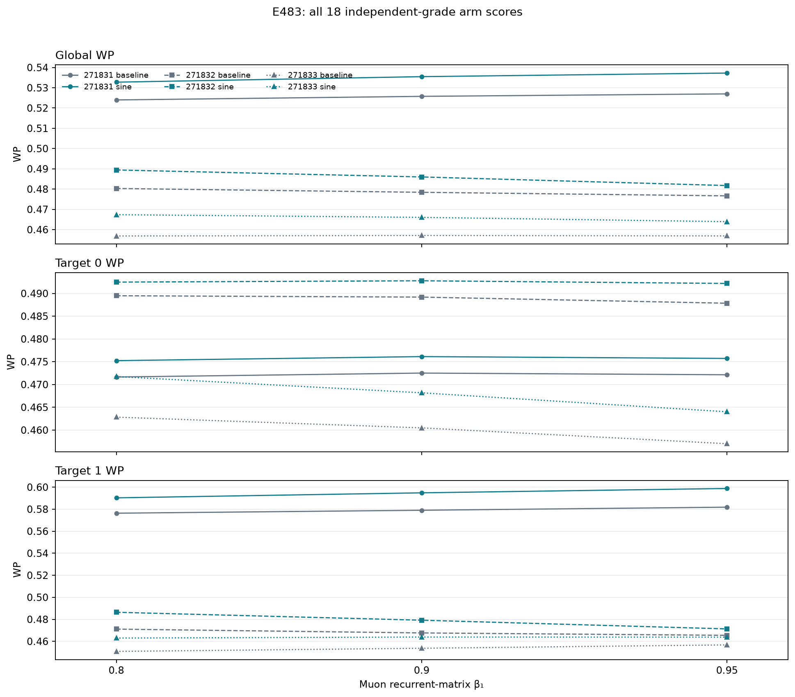
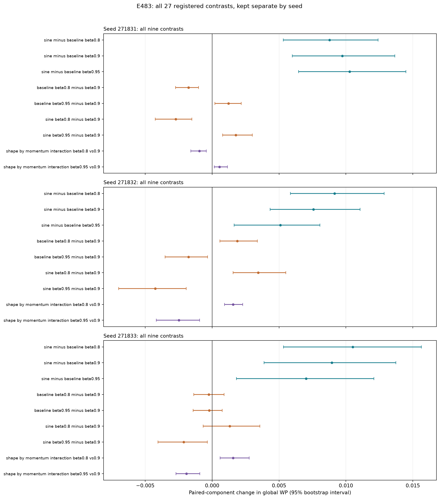
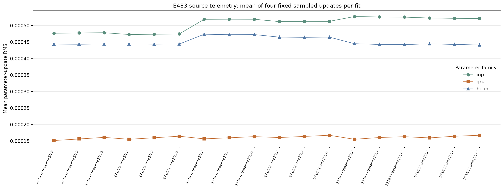

# E483 recurrent Muon momentum: independent V3 grade

The independent grader reports **18/18** fixed fits and **27/27** registered contrasts on the same 16 previously exposed components, with the same 24 fit-role components for each model. It keeps the three fit seeds separate. This is a bounded H64, one-epoch exposed-panel experiment; it does not establish a mechanism or forecast the public score.

Root's separate raw-export arithmetic receipt matches all 18 arm scores and 27 contrasts with maximum absolute error **1.110e-14**. That checks arithmetic on saved exports; it is not a second grader or fresh inference. The recorded public best remains **0.6660**.

## Run receipts

The full-fit attempt finished with exit status zero and verified teardown in 1908.07 seconds. Peak worker RAM was 1,532,981,248 bytes and peak observed physical GPU use was 516,947,968 bytes. Worker and parent OOM counters did not increase. The independent CPU grade finished in 48.258293 seconds at 664,092,672 bytes peak RAM, with no worker OOM and verified teardown. The fit manifest records 474 updates per arm and `test_rows_loaded: false` during fitting.

## All 18 arm scores

| Seed | Shape | Muon β₁ | Global WP | Target 0 | Target 1 | Clipped updates |
|---:|---|---:|---:|---:|---:|---:|
| 271831 | baseline | 0.80 | 0.523996 | 0.471643 | 0.576348 | 275/474 |
| 271831 | baseline | 0.90 | 0.525764 | 0.472508 | 0.579020 | 275/474 |
| 271831 | baseline | 0.95 | 0.526982 | 0.472140 | 0.581823 | 275/474 |
| 271831 | sine | 0.80 | 0.532764 | 0.475239 | 0.590290 | 304/474 |
| 271831 | sine | 0.90 | 0.535490 | 0.476126 | 0.594853 | 304/474 |
| 271831 | sine | 0.95 | 0.537261 | 0.475725 | 0.598796 | 304/474 |
| 271832 | baseline | 0.80 | 0.480293 | 0.489488 | 0.471097 | 305/474 |
| 271832 | baseline | 0.90 | 0.478415 | 0.489189 | 0.467640 | 302/474 |
| 271832 | baseline | 0.95 | 0.476652 | 0.487842 | 0.465462 | 300/474 |
| 271832 | sine | 0.80 | 0.489440 | 0.492478 | 0.486403 | 331/474 |
| 271832 | sine | 0.90 | 0.485991 | 0.492773 | 0.479208 | 333/474 |
| 271832 | sine | 0.95 | 0.481745 | 0.492184 | 0.471307 | 330/474 |
| 271833 | baseline | 0.80 | 0.456850 | 0.462838 | 0.450862 | 288/474 |
| 271833 | baseline | 0.90 | 0.457101 | 0.460483 | 0.453719 | 282/474 |
| 271833 | baseline | 0.95 | 0.456891 | 0.457006 | 0.456775 | 282/474 |
| 271833 | sine | 0.80 | 0.467369 | 0.471751 | 0.462986 | 318/474 |
| 271833 | sine | 0.90 | 0.466047 | 0.468178 | 0.463915 | 318/474 |
| 271833 | sine | 0.95 | 0.463919 | 0.464015 | 0.463823 | 313/474 |

## Sine-minus-baseline at each momentum

All nine seed-specific sine-minus-baseline intervals are positive. This consistency applies to this fixed exposed panel and these three seeds only.

| Seed | Muon β₁ | Δ global WP | Paired-component 95% CI |
|---:|---:|---:|---:|
| 271831 | 0.80 | +0.008769 | [+0.005325, +0.012403] |
| 271831 | 0.90 | +0.009726 | [+0.005992, +0.013662] |
| 271831 | 0.95 | +0.010279 | [+0.006463, +0.014486] |
| 271832 | 0.80 | +0.009148 | [+0.005846, +0.012865] |
| 271832 | 0.90 | +0.007576 | [+0.004340, +0.011063] |
| 271832 | 0.95 | +0.005093 | [+0.001652, +0.008064] |
| 271833 | 0.80 | +0.010519 | [+0.005333, +0.015639] |
| 271833 | 0.90 | +0.008946 | [+0.003884, +0.013726] |
| 271833 | 0.95 | +0.007028 | [+0.001820, +0.012094] |

## All 27 registered contrasts

Intervals are paired bootstrap intervals over the same 16 numeric-sorted components; no seed pooling is performed. Momentum rankings and interaction signs vary by seed.

| Seed | Contrast | Δ global WP | Paired-component 95% CI | Family |
|---:|---|---:|---:|---|
| 271831 | sine minus baseline beta0.8 | +0.008769 | [+0.005325, +0.012403] | shape_at_momentum |
| 271831 | sine minus baseline beta0.9 | +0.009726 | [+0.005992, +0.013662] | shape_at_momentum |
| 271831 | sine minus baseline beta0.95 | +0.010279 | [+0.006463, +0.014486] | shape_at_momentum |
| 271831 | baseline beta0.8 minus beta0.9 | -0.001769 | [-0.002739, -0.001020] | momentum_within_shape |
| 271831 | baseline beta0.95 minus beta0.9 | +0.001217 | [+0.000209, +0.002178] | momentum_within_shape |
| 271831 | sine beta0.8 minus beta0.9 | -0.002726 | [-0.004256, -0.001507] | momentum_within_shape |
| 271831 | sine beta0.95 minus beta0.9 | +0.001771 | [+0.000789, +0.003003] | momentum_within_shape |
| 271831 | shape by momentum interaction beta0.8 vs0.9 | -0.000957 | [-0.001592, -0.000435] | shape_by_momentum_interaction |
| 271831 | shape by momentum interaction beta0.95 vs0.9 | +0.000553 | [+0.000164, +0.001151] | shape_by_momentum_interaction |
| 271832 | sine minus baseline beta0.8 | +0.009148 | [+0.005846, +0.012865] | shape_at_momentum |
| 271832 | sine minus baseline beta0.9 | +0.007576 | [+0.004340, +0.011063] | shape_at_momentum |
| 271832 | sine minus baseline beta0.95 | +0.005093 | [+0.001652, +0.008064] | shape_at_momentum |
| 271832 | baseline beta0.8 minus beta0.9 | +0.001878 | [+0.000575, +0.003379] | momentum_within_shape |
| 271832 | baseline beta0.95 minus beta0.9 | -0.001763 | [-0.003520, -0.000338] | momentum_within_shape |
| 271832 | sine beta0.8 minus beta0.9 | +0.003450 | [+0.001567, +0.005504] | momentum_within_shape |
| 271832 | sine beta0.95 minus beta0.9 | -0.004245 | [-0.006989, -0.001935] | momentum_within_shape |
| 271832 | shape by momentum interaction beta0.8 vs0.9 | +0.001572 | [+0.000930, +0.002284] | shape_by_momentum_interaction |
| 271832 | shape by momentum interaction beta0.95 vs0.9 | -0.002482 | [-0.004173, -0.000935] | shape_by_momentum_interaction |
| 271833 | sine minus baseline beta0.8 | +0.010519 | [+0.005333, +0.015639] | shape_at_momentum |
| 271833 | sine minus baseline beta0.9 | +0.008946 | [+0.003884, +0.013726] | shape_at_momentum |
| 271833 | sine minus baseline beta0.95 | +0.007028 | [+0.001820, +0.012094] | shape_at_momentum |
| 271833 | baseline beta0.8 minus beta0.9 | -0.000251 | [-0.001380, +0.000898] | momentum_within_shape |
| 271833 | baseline beta0.95 minus beta0.9 | -0.000210 | [-0.001428, +0.000748] | momentum_within_shape |
| 271833 | sine beta0.8 minus beta0.9 | +0.001322 | [-0.000663, +0.003567] | momentum_within_shape |
| 271833 | sine beta0.95 minus beta0.9 | -0.002128 | [-0.004051, -0.000359] | momentum_within_shape |
| 271833 | shape by momentum interaction beta0.8 vs0.9 | +0.001573 | [+0.000601, +0.002769] | shape_by_momentum_interaction |
| 271833 | shape by momentum interaction beta0.95 vs0.9 | -0.001918 | [-0.002701, -0.000924] | shape_by_momentum_interaction |

Best point-estimate β₁ varies across seed and shape:

| Seed | Shape | Highest point-estimate β₁ |
|---:|---|---:|
| 271831 | baseline | 0.95 |
| 271831 | sine | 0.95 |
| 271832 | baseline | 0.80 |
| 271832 | sine | 0.80 |
| 271833 | baseline | 0.90 |
| 271833 | sine | 0.80 |

The two preregistered shape-by-momentum interaction point estimates also change sign:

| Seed | Contrast | Difference-in-differences Δ global WP |
|---:|---|---:|
| 271831 | shape by momentum interaction beta0.8 vs0.9 | -0.000957 |
| 271831 | shape by momentum interaction beta0.95 vs0.9 | +0.000553 |
| 271832 | shape by momentum interaction beta0.8 vs0.9 | +0.001572 |
| 271832 | shape by momentum interaction beta0.95 vs0.9 | -0.002482 |
| 271833 | shape by momentum interaction beta0.8 vs0.9 | +0.001573 |
| 271833 | shape by momentum interaction beta0.95 vs0.9 | -0.001918 |

These changes do not support a universal best momentum value. No optimizer-mechanism or public-score claim follows from this panel.

## Sampled source telemetry means

The values below average each arm's four preregistered telemetry snapshots (updates 0, 46, 236 and 473). Each cell is `mean preclip gradient RMS / mean parameter-update RMS`; `inp`, `gru`, and `head` are the source actor's parameter families. These four samples do not describe the full 474-update trajectory.

| Seed | Shape | β₁ | Clipped updates | Input | GRU | Head |
|---:|---|---:|---:|---:|---:|---:|
| 271831 | baseline | 0.80 | 275 | 1.090e-02 / 4.767e-04 | 2.542e-03 / 1.516e-04 | 1.886e-02 / 4.438e-04 |
| 271831 | baseline | 0.90 | 275 | 1.101e-02 / 4.775e-04 | 2.489e-03 / 1.563e-04 | 1.886e-02 / 4.434e-04 |
| 271831 | baseline | 0.95 | 275 | 1.106e-02 / 4.783e-04 | 2.405e-03 / 1.611e-04 | 1.889e-02 / 4.440e-04 |
| 271831 | sine | 0.80 | 304 | 1.177e-02 / 4.729e-04 | 3.840e-03 / 1.554e-04 | 1.959e-02 / 4.440e-04 |
| 271831 | sine | 0.90 | 304 | 1.190e-02 / 4.737e-04 | 3.718e-03 / 1.600e-04 | 1.954e-02 / 4.436e-04 |
| 271831 | sine | 0.95 | 304 | 1.189e-02 / 4.745e-04 | 3.548e-03 / 1.646e-04 | 1.956e-02 / 4.439e-04 |
| 271832 | baseline | 0.80 | 305 | 1.049e-02 / 5.190e-04 | 2.430e-03 / 1.567e-04 | 1.895e-02 / 4.737e-04 |
| 271832 | baseline | 0.90 | 302 | 1.057e-02 / 5.192e-04 | 2.379e-03 / 1.599e-04 | 1.892e-02 / 4.724e-04 |
| 271832 | baseline | 0.95 | 300 | 1.071e-02 / 5.191e-04 | 2.352e-03 / 1.634e-04 | 1.894e-02 / 4.727e-04 |
| 271832 | sine | 0.80 | 331 | 1.139e-02 / 5.120e-04 | 3.625e-03 / 1.607e-04 | 1.991e-02 / 4.649e-04 |
| 271832 | sine | 0.90 | 333 | 1.152e-02 / 5.129e-04 | 3.546e-03 / 1.640e-04 | 1.987e-02 / 4.643e-04 |
| 271832 | sine | 0.95 | 330 | 1.169e-02 / 5.128e-04 | 3.477e-03 / 1.675e-04 | 1.990e-02 / 4.650e-04 |
| 271833 | baseline | 0.80 | 288 | 6.422e-03 / 5.272e-04 | 1.393e-03 / 1.554e-04 | 9.471e-03 / 4.451e-04 |
| 271833 | baseline | 0.90 | 282 | 6.407e-03 / 5.262e-04 | 1.353e-03 / 1.607e-04 | 9.428e-03 / 4.428e-04 |
| 271833 | baseline | 0.95 | 282 | 6.391e-03 / 5.255e-04 | 1.316e-03 / 1.632e-04 | 9.376e-03 / 4.425e-04 |
| 271833 | sine | 0.80 | 318 | 6.705e-03 / 5.229e-04 | 2.032e-03 / 1.596e-04 | 9.873e-03 / 4.446e-04 |
| 271833 | sine | 0.90 | 318 | 6.677e-03 / 5.219e-04 | 1.946e-03 / 1.646e-04 | 9.813e-03 / 4.428e-04 |
| 271833 | sine | 0.95 | 313 | 6.667e-03 / 5.216e-04 | 1.866e-03 / 1.674e-04 | 9.695e-03 / 4.411e-04 |

The independent score/export are `eda/eighteen_v3/scores.json` and `selected_exports.npz`; root's arithmetic proof is `checks/momentum_activation_export_reproduction.json`. This report displays those receipts and the fit manifest telemetry; it does not rerun scoring.
