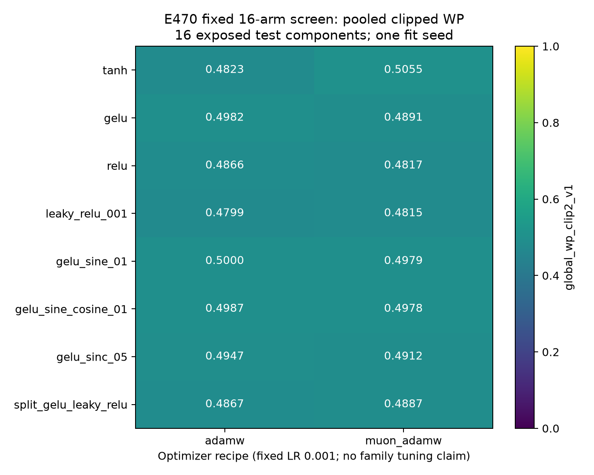
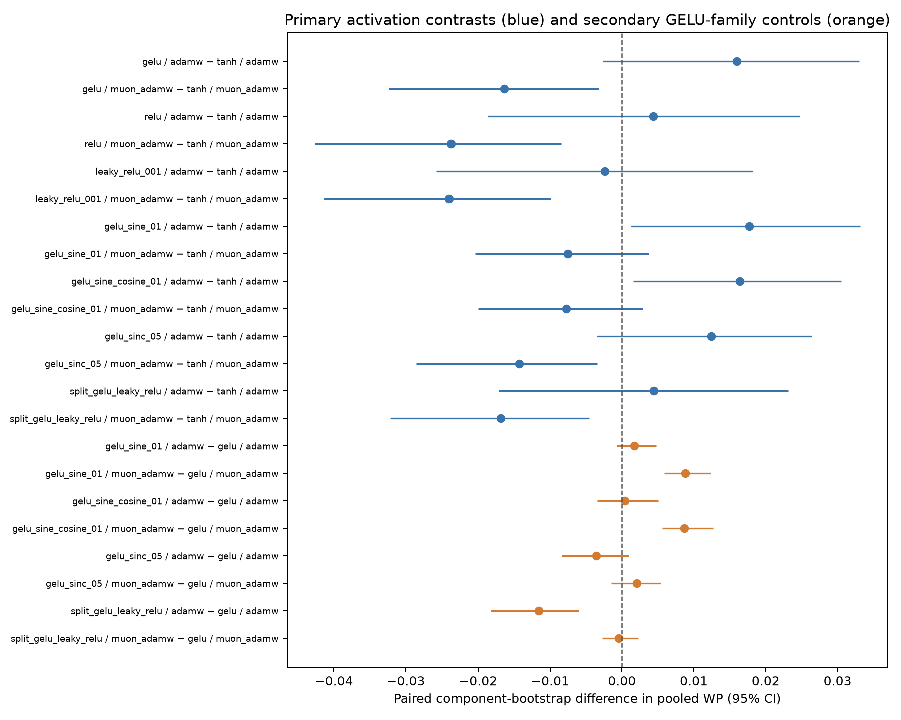
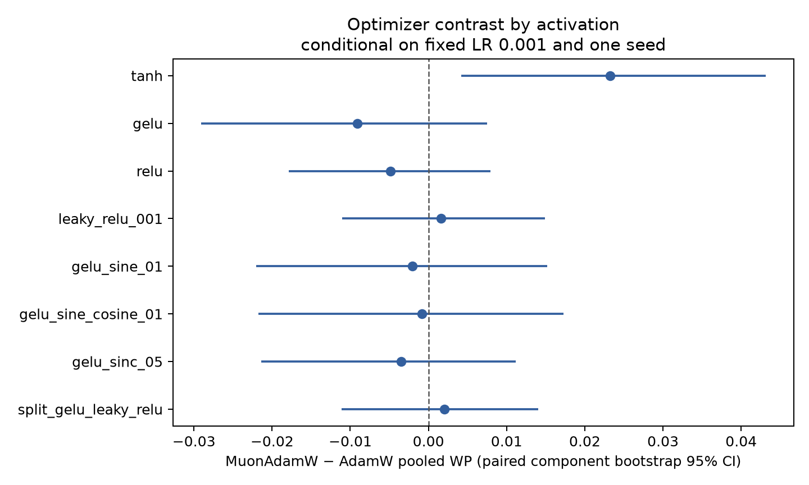
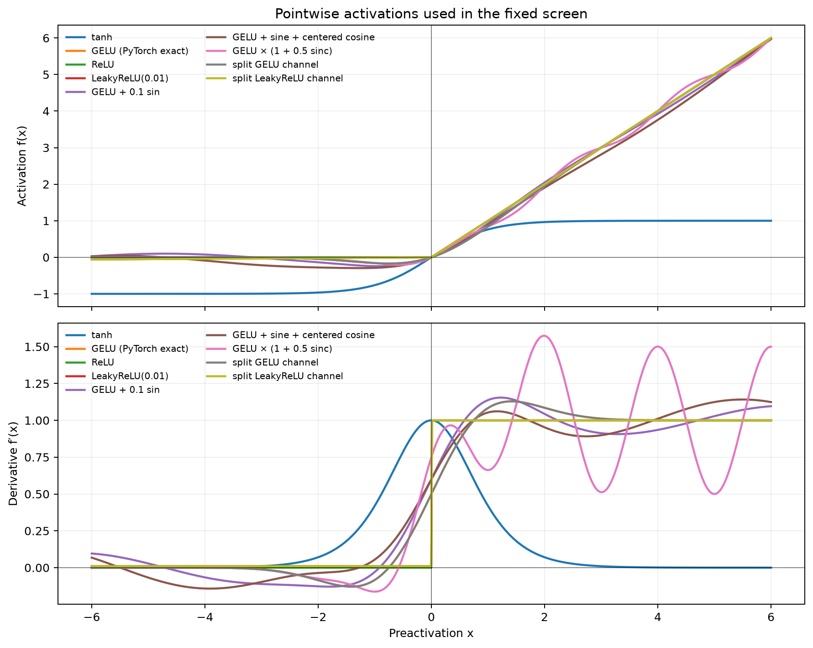
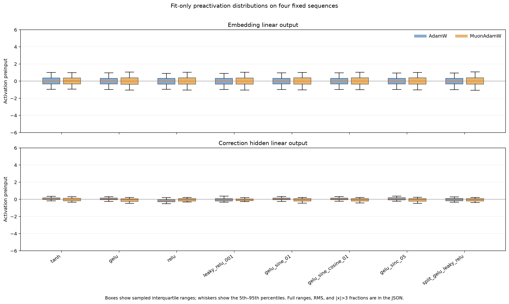

# E470: activation × optimizer results

All **16 fixed GPU fits completed**, following a successful 16-arm real-data
GPU update probe. No arm was removed because of an earlier negative result.
All models have 8,235 parameters and receive the same 474 updates. Activation
changes affect the input embedding and residual MLP together; internal GRU
sigmoid/tanh gates remain unchanged. See `PREREG.md` for the frozen recipe.

These are small, one-epoch models fitted on 24 sequences and evaluated on
16 previously exposed components, with 26,990 selected rows and one training
seed. They are not continuations of the current public winner. Their scores
cannot be compared numerically with 0.6660 or used to forecast 0.7000.

| Activation | AdamW WP | MuonAdamW WP |
|---|---:|---:|
| tanh | 0.482259 | 0.505498 |
| exact GELU | 0.498239 | 0.489122 |
| ReLU | 0.486599 | 0.481744 |
| LeakyReLU, slope 0.01 | 0.479897 | 0.481479 |
| GELU + 0.1 sin(x) | 0.499963 | 0.497938 |
| GELU + 0.1 sin(x) + 0.1(cos(x) − 1) | 0.498653 | 0.497789 |
| GELU × (1 + 0.5 sinc(x)) | 0.494680 | 0.491209 |
| Split-channel GELU/LeakyReLU | 0.486659 | 0.488666 |

The activation ranking changes with the optimizer recipe. Under AdamW,
GELU-plus-sine exceeds tanh by +0.017704, with conditional component-bootstrap
95% interval [+0.001263, +0.033122]. However, its advantage over plain GELU is
only +0.001724, interval [−0.000699, +0.004763]. This does not establish that a
periodic addition caused the AdamW improvement.

Under MuonAdamW, adding sine to GELU gives +0.008816 relative to plain GELU,
interval [+0.005879, +0.012325], but remains below tanh. MuonAdamW exceeds
AdamW for tanh by +0.023239, interval [+0.004164, +0.043127]. Equal nominal
LR 0.001 does not equalize effective updates or tuning budgets. These results
compare fixed recipes, not the best achievable performance of either family.

All 22 planned contrasts and eight clearly secondary GELU-relative controls
are retained in `eda/sixteen_v2/paired_components.json`. The secondary controls
were specified after reading point scores. Intervals resample the same
16 components conditional on one fitted seed; they omit training-seed and
search uncertainty. Thirty exploratory comparisons have no multiplicity
correction. None is a fresh-validation or public-improvement claim.

## Evidence and implementation checks

The official scorer independently recomputed every score, verified exported
targets against parquet labels and selection masks, checked component/sequence
alignment, and verified sealed source identities. `FIT_RESULT.json` retains
the numerical output and complete guarded-worker receipt. The full fit used
38.394 seconds, peaked at 383,778,816 observed GPU bytes and 1,701,834,752
worker RAM bytes, exited zero and verified teardown. The preceding GPU probe
used 7.981 seconds. There were no worker OOM events or new parent OOM events.
Aggregate local limits remain 12 CPUs, 30 decimal GB RAM, and 5 decimal GB VRAM.

Independent review found that the unlaunched v1 code could hide infinite values
by clipping before its finite check. V2 rejects raw NaN/±Inf before clipping
and checks complete-sequence predictions. Regression checks, baseline parity,
CPU updates for all sixteen arms, and the real GPU probe passed before fitting.
Original v1 source and unlaunched sealed specs are preserved; no grader changed.
An initial plotting error was confined to analysis rendering. Its partial
outputs remain in `eda/sixteen_v2_incomplete_plot_attempt`; fits were not rerun.
Final plots draw percentile intervals and point estimates independently.

## Fit-only activation measurements

`activation_telemetry.py` streamed four fixed fit sequences through all sixteen
checkpoints, with no updates and no test row groups opened. Inputs to the
embedding activation had RMS roughly 0.60–0.65; inputs to the head activation
had RMS roughly 0.18–0.22. Values beyond ±3 were rare in the embedding and
absent at the head in this sample. The sine contribution is therefore often
near its locally linear regime. A fixed `GELU(x) + 0.1*x` control should
separate a slope/amplitude effect from periodic curvature. This is a proposed
control, not a fitted result or proof of the current effect's cause. Checkpoint
hashes, finite derivative statistics and exact scope are retained in
`ACTIVATION_TELEMETRY.json`.

## Interpretation and next controls

[Mining Generalizable Activation Functions](https://arxiv.org/abs/2602.05688)
motivates the sine/sinc formulas, but this pilot uses exact PyTorch GELU, while
the appendix uses JAX's approximate default. It is a formula-inspired study,
not a bit-exact paper reproduction. Other primary literature and this nuance
are recorded in `LITERATURE.md`.

The current screen changes two activation locations at once. Next comparisons
should isolate embedding versus head, exact versus approximate GELU, fixed
versus learned mixtures, and activation amplitude. Locked input dropout and
row-wise dropout need separate controls. Scheduling and optimizer LR controls
should report actual recurrent update magnitudes, not only nominal LR.
`ACTIVATION_MECHANISM_CRITIQUE.md` and `INDEPENDENT_REVIEW.md` retain independent
proposals and their limitations. These follow-ups are proposals, not completed
fits. A stronger-data, predeclared component comparison and fixed-seed
replication are needed before any deployment recommendation.
