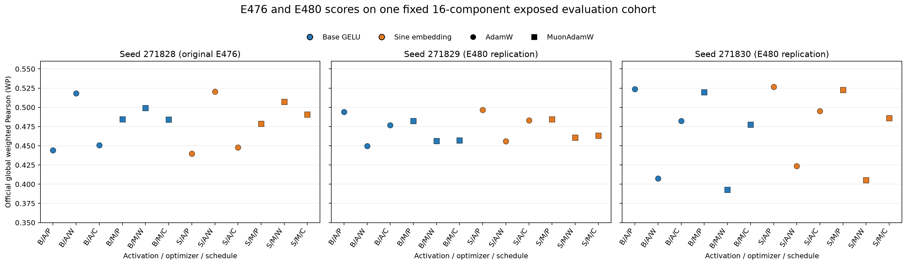
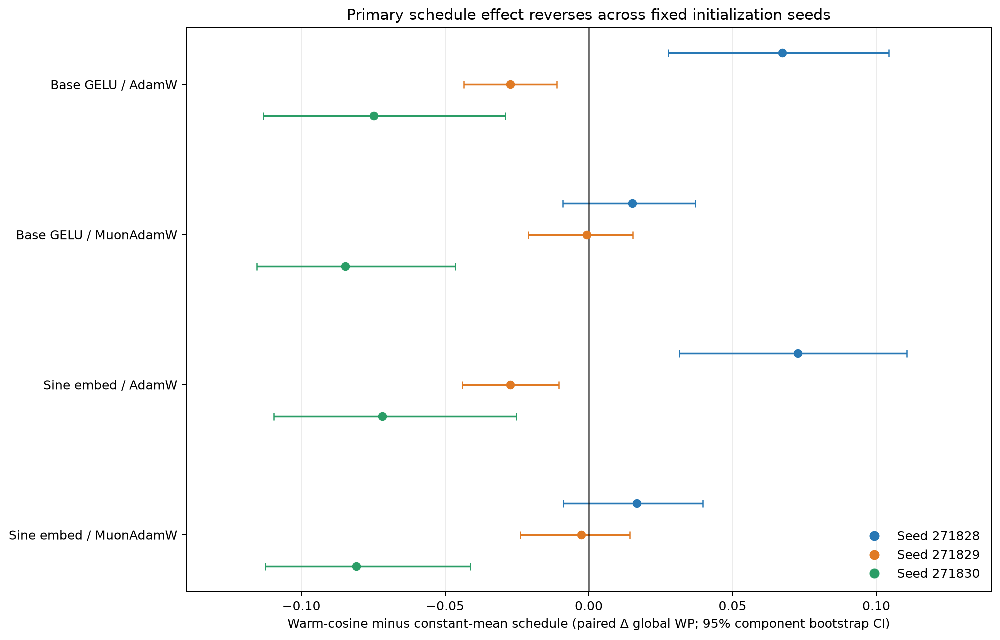

# Three-seed activation and schedule results

E480's independent CPU scoring attempt finished with exit code 0, no signals,
verified teardown, and successful systemd result. The sealed grade spec and
runtime hashes match; both output files match the runner's path, SHA-256, and
size inventory. The saved attempt snapshot listed `ActiveState=activating`; a fresh unit query showed `inactive/dead`, with `Result=success` and `ExecMainStatus=0`. The fit receipt also binds the completed
two-seed E480 training artifacts. Receipt summary: `{"artifact_receipts": [{"path": "research/campaign_2026-10-05/activation_schedule_replication/eda/twentyfour_v1/scores.json", "sha256": "6b4d95c5e198b0e3b6e45f769ce920fe5ceeae006cb791e6c76810e3d527aef5", "size": 56097}, {"path": "research/campaign_2026-10-05/activation_schedule_replication/eda/twentyfour_v1/selected_exports.npz", "sha256": "54f1ad878b467c15ad6db291267b4583f5a059b24e04ec6eee63e1b684a9e088", "size": 4784714}], "elapsed_seconds": 276.52293429599376, "exit_code": 0, "fit_attempt_id": "e480-activation-schedule-replication-twentyfour-fit-v1", "fit_attempt_sha256": "8588a2147bce30a8fd54b13a4e017a9c78bab5acbeee5a2599ecdc4736bfb44f", "parent_oom_counters_unchanged": true, "peak_observed_vram_bytes": 0, "peak_ram_bytes": 1086980096, "score_grade_attempt_id": "e480-activation-schedule-replication-cpu-test-grade-v1", "score_grade_attempt_sha256": "180f3b945ac9067626d294bb98326f057ecddc0b1e5b78b8181f2f2dba22b3de", "score_grade_spec_sha256": "c63aca57ae7acfa5830aa169c6793a2a708cc3aa363a8a7f40eb26708816d36b", "signals": [], "status": "finished", "stored_unit_active_state": "activating", "teardown_verified": true, "unit_exit_code": "0", "unit_result": "success", "worker_oom_counters_unchanged": true}`.

E476's original seed 271828 is shown next to the two fixed E480 replication
seeds 271829 and 271830. All 36 arms use the same exposed 16-component
evaluation cohort and `global_wp_clip2_v1`; this is a paired diagnostic, not a
fresh holdout or public-score estimate. The E480 scorer reports 40 paired
effects, four joint interactions, and eight primary warm-cosine-minus-
constant-mean effects, separately by seed. This report includes every one of
the 44 new E480 contrasts and all 12 primary effects across the three seeds.

## Main finding

The original seed's four primary schedule effects are positive. Both AdamW
effects have intervals above zero; the two MuonAdamW intervals include zero.
In E480's two new seeds, **all eight primary point estimates are negative**,
and **six of their eight 95% component-bootstrap intervals lie below zero**.
Seed 271829 has two negative intervals (both AdamW) and two Muon intervals
that cross zero. Seed 271830 has all four intervals below zero. The sign
reversal across fixed seeds is the main result: the first-seed warm-cosine
advantage did not replicate, so these runs do not support a seed-robust claim
that the warm-cosine schedule helps.

An independent pure-NumPy reconstruction also matched all 24 E480 arm scores
and all 44 global contrasts from the selected exports. Its maximum absolute
numerical difference was 3e-15
(tolerance 1e-10); it reused exports and
did not refit, rerun inference, or inspect public results.

The 36 global-WP scores range from 0.39294 to 0.52686 across these same exposed components. Initialization-to-initialization
variation is large relative to many schedule contrasts. There are only three
fit initializations, so these seed-specific results characterize instability;
they do not estimate a population distribution over seeds. The component
bootstrap conditions on each fitted seed and resamples the same 16 previously
exposed components. It does not account for seed search, architecture or
schedule selection, training randomness beyond these three seeds, or transfer
to the competition's unseen public period. Do not pool the three seed scores
## Primary paired effects

Positive values favor warm-cosine; negative values favor the constant-mean
schedule. Intervals are the registered 2,000-resample paired component
bootstrap intervals.

| Seed | Run | Activation / optimizer | Δ global WP | 95% CI | P(Δ ≤ 0) |
|---:|---|---|---:|---:|---:|
| 271828 | E476 original | Base GELU / AdamW | +0.06733 | [+0.02757, +0.10439] | 0.001 |
| 271828 | E476 original | Base GELU / MuonAdamW | +0.01506 | [-0.00911, +0.03706] | 0.100 |
| 271828 | E476 original | Sine embed / AdamW | +0.07270 | [+0.03151, +0.11065] | 0.000 |
| 271828 | E476 original | Sine embed / MuonAdamW | +0.01669 | [-0.00893, +0.03968] | 0.087 |
| 271829 | E480 replication | Base GELU / AdamW | -0.02730 | [-0.04346, -0.01115] | 1.000 |
| 271829 | E480 replication | Base GELU / MuonAdamW | -0.00074 | [-0.02111, +0.01529] | 0.566 |
| 271829 | E480 replication | Sine embed / AdamW | -0.02727 | [-0.04401, -0.01045] | 1.000 |
| 271829 | E480 replication | Sine embed / MuonAdamW | -0.00255 | [-0.02388, +0.01429] | 0.624 |
| 271830 | E480 replication | Base GELU / AdamW | -0.07476 | [-0.11330, -0.02905] | 0.999 |
| 271830 | E480 replication | Base GELU / MuonAdamW | -0.08467 | [-0.11545, -0.04649] | 1.000 |
| 271830 | E480 replication | Sine embed / AdamW | -0.07177 | [-0.10962, -0.02516] | 0.999 |
| 271830 | E480 replication | Sine embed / MuonAdamW | -0.08082 | [-0.11252, -0.04115] | 1.000 |

## All 36 official arm scores

| Seed | Run | Activation | Optimizer | Schedule | Global WP | t0 | t1 |
|---:|---|---|---|---|---:|---:|---:|
| 271828 | E476 | base | adamw | constant_peak | 0.44418 | 0.51222 | 0.37615 |
| 271828 | E476 | base | adamw | warmcos_47_427 | 0.51818 | 0.49963 | 0.53673 |
| 271828 | E476 | base | adamw | constant_mean_warmcos | 0.45086 | 0.51462 | 0.38709 |
| 271828 | E476 | base | muon_adamw | constant_peak | 0.48469 | 0.51238 | 0.45699 |
| 271828 | E476 | base | muon_adamw | warmcos_47_427 | 0.49906 | 0.47402 | 0.52411 |
| 271828 | E476 | base | muon_adamw | constant_mean_warmcos | 0.48400 | 0.49995 | 0.46805 |
| 271828 | E476 | sine_embed | adamw | constant_peak | 0.43968 | 0.50973 | 0.36963 |
| 271828 | E476 | sine_embed | adamw | warmcos_47_427 | 0.52055 | 0.49969 | 0.54141 |
| 271828 | E476 | sine_embed | adamw | constant_mean_warmcos | 0.44785 | 0.50874 | 0.38697 |
| 271828 | E476 | sine_embed | muon_adamw | constant_peak | 0.47860 | 0.50864 | 0.44855 |
| 271828 | E476 | sine_embed | muon_adamw | warmcos_47_427 | 0.50727 | 0.47876 | 0.53578 |
| 271828 | E476 | sine_embed | muon_adamw | constant_mean_warmcos | 0.49058 | 0.50255 | 0.47861 |
| 271829 | E480 | base | adamw | constant_peak | 0.49402 | 0.49125 | 0.49680 |
| 271829 | E480 | base | adamw | warmcos_47_427 | 0.44951 | 0.49956 | 0.39946 |
| 271829 | E480 | base | adamw | constant_mean_warmcos | 0.47681 | 0.49549 | 0.45814 |
| 271829 | E480 | base | muon_adamw | constant_peak | 0.48234 | 0.49140 | 0.47329 |
| 271829 | E480 | base | muon_adamw | warmcos_47_427 | 0.45634 | 0.46253 | 0.45015 |
| 271829 | E480 | base | muon_adamw | constant_mean_warmcos | 0.45707 | 0.48514 | 0.42901 |
| 271829 | E480 | sine_embed | adamw | constant_peak | 0.49650 | 0.49153 | 0.50146 |
| 271829 | E480 | sine_embed | adamw | warmcos_47_427 | 0.45576 | 0.50308 | 0.40844 |
| 271829 | E480 | sine_embed | adamw | constant_mean_warmcos | 0.48303 | 0.49769 | 0.46836 |
| 271829 | E480 | sine_embed | muon_adamw | constant_peak | 0.48465 | 0.49177 | 0.47753 |
| 271829 | E480 | sine_embed | muon_adamw | warmcos_47_427 | 0.46060 | 0.47013 | 0.45106 |
| 271829 | E480 | sine_embed | muon_adamw | constant_mean_warmcos | 0.46315 | 0.49056 | 0.43574 |
| 271830 | E480 | base | adamw | constant_peak | 0.52385 | 0.50779 | 0.53990 |
| 271830 | E480 | base | adamw | warmcos_47_427 | 0.40740 | 0.45487 | 0.35993 |
| 271830 | E480 | base | adamw | constant_mean_warmcos | 0.48216 | 0.49893 | 0.46539 |
| 271830 | E480 | base | muon_adamw | constant_peak | 0.51973 | 0.50290 | 0.53657 |
| 271830 | E480 | base | muon_adamw | warmcos_47_427 | 0.39294 | 0.44263 | 0.34324 |
| 271830 | E480 | base | muon_adamw | constant_mean_warmcos | 0.47760 | 0.47858 | 0.47663 |
| 271830 | E480 | sine_embed | adamw | constant_peak | 0.52686 | 0.50927 | 0.54444 |
| 271830 | E480 | sine_embed | adamw | warmcos_47_427 | 0.42352 | 0.46272 | 0.38432 |
| 271830 | E480 | sine_embed | adamw | constant_mean_warmcos | 0.49528 | 0.50364 | 0.48693 |
| 271830 | E480 | sine_embed | muon_adamw | constant_peak | 0.52263 | 0.50512 | 0.54014 |
| 271830 | E480 | sine_embed | muon_adamw | warmcos_47_427 | 0.40510 | 0.44666 | 0.36354 |
| 271830 | E480 | sine_embed | muon_adamw | constant_mean_warmcos | 0.48592 | 0.48239 | 0.48945 |

In the score panels, `B/S` denote base GELU/sine embedding, `A/M` denote
AdamW/MuonAdamW, and `P/W/C` denote constant-peak/warm-cosine/constant-mean.

## All 44 E480 registered contrasts

The table is reported separately by replication seed. Percentile intervals are
component-resampling intervals over the same fixed 16 components; they are not
seed-level uncertainty intervals. For interactions the candidate column
contains the full difference-in-differences expression.

| Seed | Family | Contrast | Δ global WP | 95% CI | P(Δ ≤ 0) |
|---:|---|---|---:|---:|---:|
| 271829 | activation_by_schedule_shape_interaction | `sine_activation_x_warmcos_shape__adamw` | +0.00003 | [-0.00365, +0.00451] | 0.423 |
| 271829 | activation_by_schedule_shape_interaction | `sine_activation_x_warmcos_shape__muon_adamw` | -0.00182 | [-0.00545, +0.00180] | 0.809 |
| 271829 | constant_peak_minus_constant_mean | `base__adamw__constant_peak_minus_base__adamw__constant_mean_warmcos` | +0.01721 | [+0.00615, +0.02608] | 0.001 |
| 271829 | constant_peak_minus_constant_mean | `base__muon_adamw__constant_peak_minus_base__muon_adamw__constant_mean_warmcos` | +0.02527 | [+0.01360, +0.03599] | 0.000 |
| 271829 | constant_peak_minus_constant_mean | `sine_embed__adamw__constant_peak_minus_sine_embed__adamw__constant_mean_warmcos` | +0.01347 | [+0.00273, +0.02188] | 0.007 |
| 271829 | constant_peak_minus_constant_mean | `sine_embed__muon_adamw__constant_peak_minus_sine_embed__muon_adamw__constant_mean_warmcos` | +0.02150 | [+0.00994, +0.03243] | 0.000 |
| 271829 | muon_adamw_minus_adamw | `base__muon_adamw__constant_mean_warmcos_minus_base__adamw__constant_mean_warmcos` | -0.01974 | [-0.02799, -0.00756] | 0.997 |
| 271829 | muon_adamw_minus_adamw | `base__muon_adamw__constant_peak_minus_base__adamw__constant_peak` | -0.01168 | [-0.01706, -0.00110] | 0.983 |
| 271829 | muon_adamw_minus_adamw | `base__muon_adamw__warmcos_47_427_minus_base__adamw__warmcos_47_427` | +0.00683 | [-0.00891, +0.02438] | 0.188 |
| 271829 | muon_adamw_minus_adamw | `sine_embed__muon_adamw__constant_mean_warmcos_minus_sine_embed__adamw__constant_mean_warmcos` | -0.01988 | [-0.02779, -0.00821] | 0.997 |
| 271829 | muon_adamw_minus_adamw | `sine_embed__muon_adamw__constant_peak_minus_sine_embed__adamw__constant_peak` | -0.01185 | [-0.01702, -0.00188] | 0.987 |
| 271829 | muon_adamw_minus_adamw | `sine_embed__muon_adamw__warmcos_47_427_minus_sine_embed__adamw__warmcos_47_427` | +0.00484 | [-0.01001, +0.02061] | 0.244 |
| 271829 | sine_embed_minus_base | `sine_embed__adamw__constant_mean_warmcos_minus_base__adamw__constant_mean_warmcos` | +0.00621 | [+0.00371, +0.00845] | 0.001 |
| 271829 | sine_embed_minus_base | `sine_embed__adamw__constant_peak_minus_base__adamw__constant_peak` | +0.00248 | [-0.00008, +0.00494] | 0.032 |
| 271829 | sine_embed_minus_base | `sine_embed__adamw__warmcos_47_427_minus_base__adamw__warmcos_47_427` | +0.00625 | [+0.00217, +0.01124] | 0.001 |
| 271829 | sine_embed_minus_base | `sine_embed__muon_adamw__constant_mean_warmcos_minus_base__muon_adamw__constant_mean_warmcos` | +0.00608 | [+0.00346, +0.00875] | 0.000 |
| 271829 | sine_embed_minus_base | `sine_embed__muon_adamw__constant_peak_minus_base__muon_adamw__constant_peak` | +0.00231 | [-0.00039, +0.00482] | 0.052 |
| 271829 | sine_embed_minus_base | `sine_embed__muon_adamw__warmcos_47_427_minus_base__muon_adamw__warmcos_47_427` | +0.00426 | [+0.00034, +0.00885] | 0.018 |
| 271829 | warmcos_minus_constant_mean | `base__adamw__warmcos_47_427_minus_base__adamw__constant_mean_warmcos` | -0.02730 | [-0.04346, -0.01115] | 1.000 |
| 271829 | warmcos_minus_constant_mean | `base__muon_adamw__warmcos_47_427_minus_base__muon_adamw__constant_mean_warmcos` | -0.00074 | [-0.02111, +0.01529] | 0.566 |
| 271829 | warmcos_minus_constant_mean | `sine_embed__adamw__warmcos_47_427_minus_sine_embed__adamw__constant_mean_warmcos` | -0.02727 | [-0.04401, -0.01045] | 1.000 |
| 271829 | warmcos_minus_constant_mean | `sine_embed__muon_adamw__warmcos_47_427_minus_sine_embed__muon_adamw__constant_mean_warmcos` | -0.00255 | [-0.02388, +0.01429] | 0.624 |
| 271830 | activation_by_schedule_shape_interaction | `sine_activation_x_warmcos_shape__adamw` | +0.00300 | [+0.00039, +0.00697] | 0.013 |
| 271830 | activation_by_schedule_shape_interaction | `sine_activation_x_warmcos_shape__muon_adamw` | +0.00385 | [+0.00093, +0.00771] | 0.002 |
| 271830 | constant_peak_minus_constant_mean | `base__adamw__constant_peak_minus_base__adamw__constant_mean_warmcos` | +0.04169 | [+0.02465, +0.06161] | 0.000 |
| 271830 | constant_peak_minus_constant_mean | `base__muon_adamw__constant_peak_minus_base__muon_adamw__constant_mean_warmcos` | +0.04213 | [+0.02116, +0.06354] | 0.000 |
| 271830 | constant_peak_minus_constant_mean | `sine_embed__adamw__constant_peak_minus_sine_embed__adamw__constant_mean_warmcos` | +0.03157 | [+0.01768, +0.04720] | 0.000 |
| 271830 | constant_peak_minus_constant_mean | `sine_embed__muon_adamw__constant_peak_minus_sine_embed__muon_adamw__constant_mean_warmcos` | +0.03671 | [+0.01693, +0.05669] | 0.000 |
| 271830 | muon_adamw_minus_adamw | `base__muon_adamw__constant_mean_warmcos_minus_base__adamw__constant_mean_warmcos` | -0.00456 | [-0.01934, +0.01363] | 0.675 |
| 271830 | muon_adamw_minus_adamw | `base__muon_adamw__constant_peak_minus_base__adamw__constant_peak` | -0.00411 | [-0.00798, +0.00014] | 0.972 |
| 271830 | muon_adamw_minus_adamw | `base__muon_adamw__warmcos_47_427_minus_base__adamw__warmcos_47_427` | -0.01447 | [-0.02060, -0.00832] | 1.000 |
| 271830 | muon_adamw_minus_adamw | `sine_embed__muon_adamw__constant_mean_warmcos_minus_sine_embed__adamw__constant_mean_warmcos` | -0.00936 | [-0.02302, +0.00702] | 0.870 |
| 271830 | muon_adamw_minus_adamw | `sine_embed__muon_adamw__constant_peak_minus_sine_embed__adamw__constant_peak` | -0.00423 | [-0.00815, -0.00001] | 0.975 |
| 271830 | muon_adamw_minus_adamw | `sine_embed__muon_adamw__warmcos_47_427_minus_sine_embed__adamw__warmcos_47_427` | -0.01842 | [-0.02659, -0.01116] | 1.000 |
| 271830 | sine_embed_minus_base | `sine_embed__adamw__constant_mean_warmcos_minus_base__adamw__constant_mean_warmcos` | +0.01312 | [+0.00766, +0.01928] | 0.000 |
| 271830 | sine_embed_minus_base | `sine_embed__adamw__constant_peak_minus_base__adamw__constant_peak` | +0.00301 | [+0.00080, +0.00521] | 0.004 |
| 271830 | sine_embed_minus_base | `sine_embed__adamw__warmcos_47_427_minus_base__adamw__warmcos_47_427` | +0.01612 | [+0.01059, +0.02271] | 0.000 |
| 271830 | sine_embed_minus_base | `sine_embed__muon_adamw__constant_mean_warmcos_minus_base__muon_adamw__constant_mean_warmcos` | +0.00832 | [+0.00478, +0.01196] | 0.000 |
| 271830 | sine_embed_minus_base | `sine_embed__muon_adamw__constant_peak_minus_base__muon_adamw__constant_peak` | +0.00289 | [+0.00035, +0.00511] | 0.013 |
| 271830 | sine_embed_minus_base | `sine_embed__muon_adamw__warmcos_47_427_minus_base__muon_adamw__warmcos_47_427` | +0.01217 | [+0.00854, +0.01621] | 0.000 |
| 271830 | warmcos_minus_constant_mean | `base__adamw__warmcos_47_427_minus_base__adamw__constant_mean_warmcos` | -0.07476 | [-0.11330, -0.02905] | 0.999 |
| 271830 | warmcos_minus_constant_mean | `base__muon_adamw__warmcos_47_427_minus_base__muon_adamw__constant_mean_warmcos` | -0.08467 | [-0.11545, -0.04649] | 1.000 |
| 271830 | warmcos_minus_constant_mean | `sine_embed__adamw__warmcos_47_427_minus_sine_embed__adamw__constant_mean_warmcos` | -0.07177 | [-0.10962, -0.02516] | 0.999 |
| 271830 | warmcos_minus_constant_mean | `sine_embed__muon_adamw__warmcos_47_427_minus_sine_embed__muon_adamw__constant_mean_warmcos` | -0.08082 | [-0.11252, -0.04115] | 1.000 |

## Provenance and limits

- E476 score file SHA-256: `3a18a8a58c3e65bdb0b768c98ea255967ed9c95a0f64db9317256eba8a72ecce`; its selected-export SHA-256: `49e6a36713bb55b7abd70dd46630d36ebfc1397251ceb577e86f7eec60b72ae9`.
- E480 score file SHA-256: `6b4d95c5e198b0e3b6e45f769ce920fe5ceeae006cb791e6c76810e3d527aef5`; selected-export SHA-256: `54f1ad878b467c15ad6db291267b4583f5a059b24e04ec6eee63e1b684a9e088`.
- E480 grade attempt SHA-256: `180f3b945ac9067626d294bb98326f057ecddc0b1e5b78b8181f2f2dba22b3de`; sealed grade-spec digest: `c63aca57ae7acfa5830aa169c6793a2a708cc3aa363a8a7f40eb26708816d36b`.
- Independent NumPy reproduction source SHA-256: `a7ba0ceaa435ec9b2b6e7b935f0796c896c4fbc8b6f80774b8d3575e084e3121`; maximum absolute error: `2.9976021664879227e-15`.
- Metric: `global_wp_clip2_v1`; fit seeds: `271828, 271829, 271830`; each seed is kept separate.
- E480's bootstrap generator seed is 271828; it is distinct from the model initialization seeds 271829 and 271830.
- Each component had prior exposure. These scores are descriptive paired diagnostics, not generalization evidence.
- The seed-271828 E476 run was the motivating result. Its positive direction is retained; it was not omitted after opposite replications.
