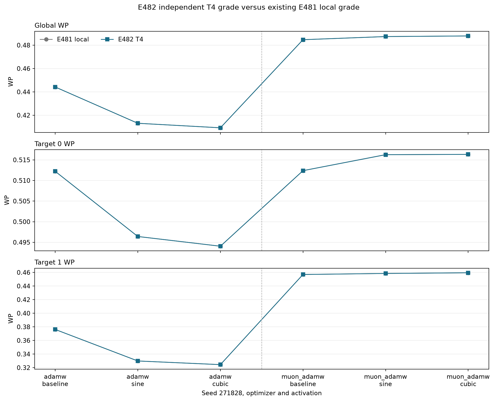
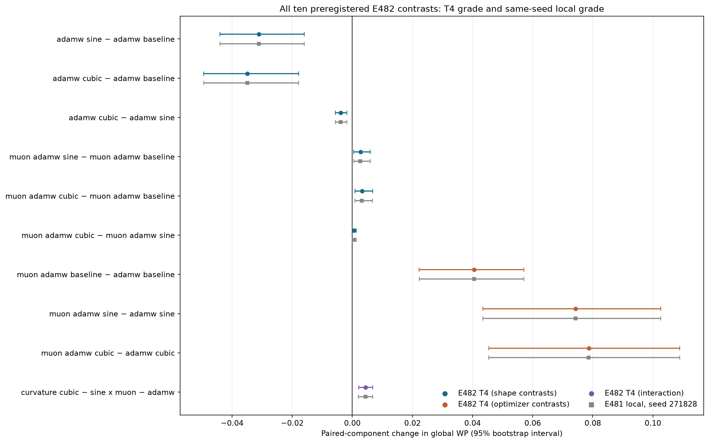

# E482 private T4 replication: independent grade

The six preregistered seed-271828 fits completed on two T4 workers and were graded by the frozen independent scorer on the same 16 previously exposed components. This remains an exploratory, same-panel hardware replication: it is not new-market confirmation, and it does not change the recorded public best of 0.6660 or forecast a public score.

The root raw-sum reproduction independently matched all six arm scores and ten global contrasts to the saved grade, with maximum absolute error **1.144e-14**. This is an arithmetic reproduction of the saved exports, not a second grader or a new inference.

## Runtime and resource receipts

Provider status was COMPLETE at 2026-10-05T04:48:23.342284+00:00. All six fits used 474 updates and 61,058 parameters; both T4 worker OOM counters remained zero. Fit time summed to 1,430.661 seconds. The independent CPU grade completed in 137.7826 seconds with 1,146,732,544 bytes peak RAM and zero worker memory-event increments. See `REMOTE_FIT_RESULT.md` and the fit-only attempt receipt for detailed provenance.

## Six arm scores

All arms are retained. The final column is the simple difference from the existing local E481 score for the exact same seed; it is a hardware comparison, not an added statistical test.

| Optimizer | Shape | T4 global WP | T4 target 0 | T4 target 1 | T4 − local global WP |
|---|---:|---:|---:|---:|---:|
| adamw | baseline | 0.444184 | 0.512219 | 0.376148 | +1.78e-09 |
| adamw | sine | 0.413105 | 0.496409 | 0.329800 | +1.05e-08 |
| adamw | cubic | 0.409232 | 0.494049 | 0.324416 | -1.57e-09 |
| muon_adamw | baseline | 0.484664 | 0.512383 | 0.456946 | -1.65e-05 |
| muon_adamw | sine | 0.487364 | 0.516252 | 0.458477 | -6.89e-06 |
| muon_adamw | cubic | 0.487904 | 0.516332 | 0.459476 | +1.93e-05 |

## Ten preregistered contrasts

Intervals use paired bootstrap resampling over the same 16 exposed components. T4 and local intervals are displayed side by side from their existing graders; they are not pooled. The cubic-minus-sine Muon contrast has a small positive T4 interval (+0.0000168 to +0.0012976), while the same-seed local interval crosses zero (-0.0000053 to +0.0012634). This narrow difference is hardware/optimizer numerical sensitivity, not a new seed or market confirmation. All ten contrasts remain visible.

| Contrast | T4 change [95% CI] | E481 local same-seed change [95% CI] |
|---|---:|---:|
| adamw sine minus adamw baseline | -0.031079 [-0.044033, -0.015963] | -0.031079 [-0.044033, -0.015963] |
| adamw cubic minus adamw baseline | -0.034952 [-0.049418, -0.017843] | -0.034952 [-0.049418, -0.017843] |
| adamw cubic minus adamw sine | -0.003872 [-0.005679, -0.001795] | -0.003872 [-0.005679, -0.001795] |
| muon adamw sine minus muon adamw baseline | +0.002700 [+0.000506, +0.005910] | +0.002691 [+0.000489, +0.005917] |
| muon adamw cubic minus muon adamw baseline | +0.003240 [+0.000901, +0.006745] | +0.003204 [+0.000865, +0.006721] |
| muon adamw cubic minus muon adamw sine | +0.000539 [+0.000017, +0.001298] | +0.000513 [-0.000005, +0.001263] |
| muon adamw baseline minus adamw baseline | +0.040480 [+0.022253, +0.057063] | +0.040497 [+0.022257, +0.057093] |
| muon adamw sine minus adamw sine | +0.074260 [+0.043455, +0.102590] | +0.074267 [+0.043471, +0.102606] |
| muon adamw cubic minus adamw cubic | +0.078671 [+0.045441, +0.108993] | +0.078652 [+0.045421, +0.108970] |
| curvature cubic minus sine x muon minus adamw | +0.004412 [+0.002086, +0.006797] | +0.004386 [+0.002070, +0.006779] |

The independent score file is `eda/six_v2/scores.json`; root's reproduction receipt is `checks/t4_activation_export_reproduction.json`. The report and plots display those receipts and do not independently score predictions.
