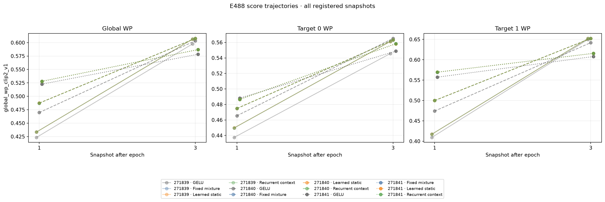
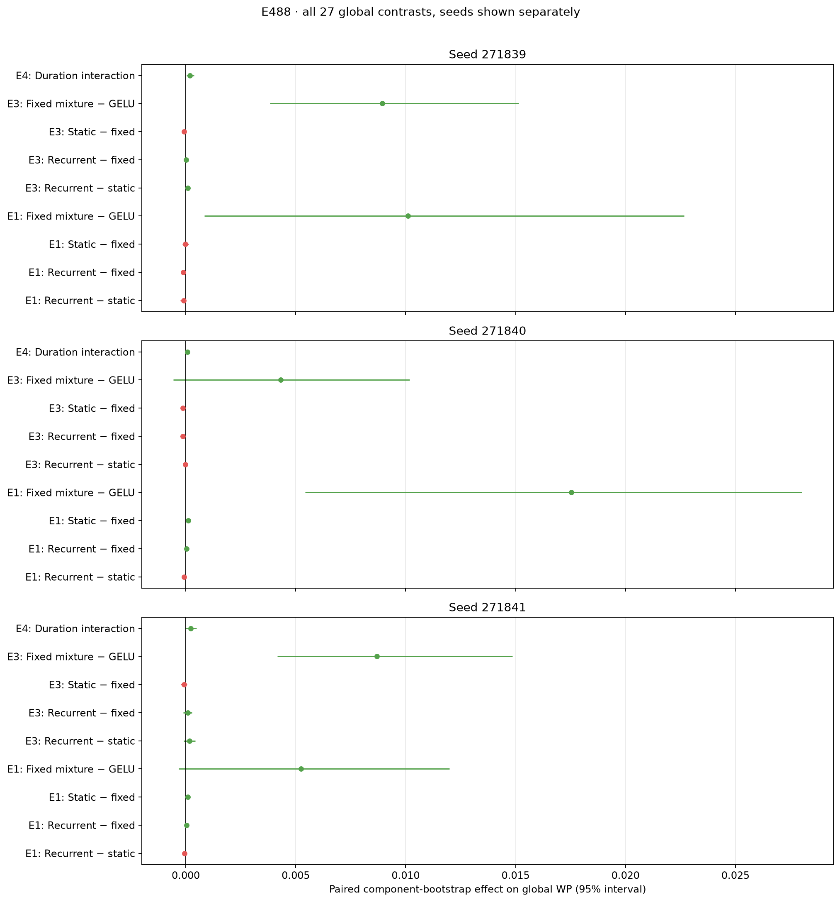
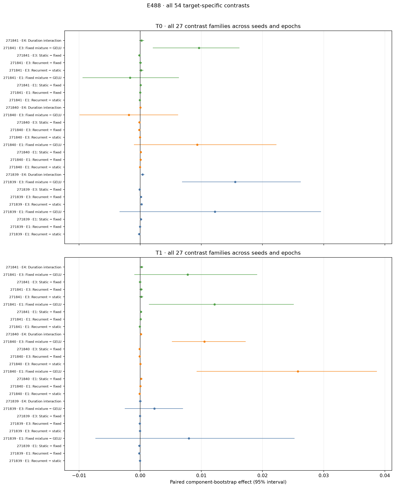

> **Display incident, preserved for provenance:** this v4 renderer report was generated before the raw-receipt schema fix. Its maximum-error line rendered `nan` because it read the wrapper field name from the raw receipt, and its duration-interaction plot used an incorrect E4 tick. The score tables and saved values were not changed; independent arithmetic later verified all results with maximum absolute difference 4.771e-15. See the canonical corrected [E488 report](REPORT.md), which uses E3−E1 labels and both receipt bindings.

# E488: context-mixture effects across training duration

This report displays all 24 saved snapshots from 12 continuous three-epoch fits, with all 27 registered global contrasts and 54 target-specific contrast values. The score is `global_wp_clip2_v1` on the same 16 historically exposed evaluation components. Seeds remain separate; no seed pooling or checkpoint selection is performed here.

The report is descriptive for this fixed panel. Component-bootstrap intervals condition on the fitted checkpoints and do not include run-to-run seed variation, search uncertainty, or multiplicity correction. It does not establish that a context gate improves generalization or predict a public score.

## Receipts

The 12 fits completed in 114.37s; fit peak RAM was 1376923648 bytes and peak observed GPU memory was 387973120 bytes. The independent grade completed in 282.41s with 806473728 bytes peak RAM. The root saved-export arithmetic reproduction matched 24 snapshots, 27 global contrasts, and 54 target values; maximum absolute difference was nan.

Bound score SHA-256: `a570770f2d2af6369043182da1168859218445ee50d8c5562514194a69aca809`. Selected-export SHA-256: `277b702e81c27dcd3b832a38fbd1392faf7229a0f46358b9a7844165c193601c`. Independent root receipt SHA-256: `d94a44ed9eca5435db07c7b0a8e4b046bb6b5700412550edc23513b9df6281f6`.

## All 24 arm snapshots

| Seed | Epoch | Arm | Global WP | Target 0 | Target 1 | Updates |
|---:|---:|---|---:|---:|---:|---:|
| 271839 | 1 | GELU | 0.423437 | 0.437489 | 0.409385 | 474 |
| 271839 | 1 | Fixed mixture | 0.433534 | 0.449719 | 0.417348 | 474 |
| 271839 | 1 | Learned static | 0.433512 | 0.449827 | 0.417198 | 474 |
| 271839 | 1 | Recurrent context | 0.433418 | 0.449665 | 0.417171 | 474 |
| 271839 | 3 | GELU | 0.597717 | 0.545648 | 0.649786 | 1422 |
| 271839 | 3 | Fixed mixture | 0.606647 | 0.561188 | 0.652106 | 1422 |
| 271839 | 3 | Learned static | 0.606577 | 0.561081 | 0.652073 | 1422 |
| 271839 | 3 | Recurrent context | 0.606661 | 0.561293 | 0.652029 | 1422 |
| 271840 | 1 | GELU | 0.469742 | 0.465452 | 0.474032 | 474 |
| 271840 | 1 | Fixed mixture | 0.487285 | 0.474769 | 0.499801 | 474 |
| 271840 | 1 | Learned static | 0.487406 | 0.474865 | 0.499948 | 474 |
| 271840 | 1 | Recurrent context | 0.487325 | 0.474813 | 0.499838 | 474 |
| 271840 | 3 | GELU | 0.603587 | 0.565203 | 0.641971 | 1422 |
| 271840 | 3 | Fixed mixture | 0.607895 | 0.563334 | 0.652456 | 1422 |
| 271840 | 3 | Learned static | 0.607770 | 0.563190 | 0.652350 | 1422 |
| 271840 | 3 | Recurrent context | 0.607757 | 0.563155 | 0.652360 | 1422 |
| 271841 | 1 | GELU | 0.522706 | 0.488147 | 0.557264 | 474 |
| 271841 | 1 | Fixed mixture | 0.527952 | 0.486471 | 0.569433 | 474 |
| 271841 | 1 | Learned static | 0.528043 | 0.486530 | 0.569555 | 474 |
| 271841 | 1 | Recurrent context | 0.527983 | 0.486468 | 0.569499 | 474 |
| 271841 | 3 | GELU | 0.578325 | 0.548713 | 0.607938 | 1422 |
| 271841 | 3 | Fixed mixture | 0.587015 | 0.558326 | 0.615704 | 1422 |
| 271841 | 3 | Learned static | 0.586936 | 0.558191 | 0.615681 | 1422 |
| 271841 | 3 | Recurrent context | 0.587102 | 0.558349 | 0.615854 | 1422 |

## All 27 global contrasts

| Seed | Epoch / contrast | Contrast | Difference | Paired component 95% interval |
|---:|---|---|---:|---:|
| 271839 | duration interaction | (recurrent_3 - static_3) - (recurrent_1 - static_1) | +0.000179 | [+0.000036, +0.000373] |
| 271839 | 1 | fixed_minus_gelu | +0.010097 | [+0.000843, +0.022674] |
| 271839 | 1 | recurrent_minus_fixed | -0.000116 | [-0.000221, -0.000037] |
| 271839 | 1 | recurrent_minus_static | -0.000095 | [-0.000241, -0.000004] |
| 271839 | 1 | static_minus_fixed | -0.000021 | [-0.000148, +0.000132] |
| 271839 | 3 | fixed_minus_gelu | +0.008930 | [+0.003819, +0.015150] |
| 271839 | 3 | recurrent_minus_fixed | +0.000014 | [-0.000074, +0.000094] |
| 271839 | 3 | recurrent_minus_static | +0.000084 | [-0.000022, +0.000186] |
| 271839 | 3 | static_minus_fixed | -0.000070 | [-0.000139, -0.000017] |
| 271840 | duration interaction | (recurrent_3 - static_3) - (recurrent_1 - static_1) | +0.000068 | [-0.000037, +0.000137] |
| 271840 | 1 | fixed_minus_gelu | +0.017543 | [+0.005427, +0.028018] |
| 271840 | 1 | recurrent_minus_fixed | +0.000040 | [-0.000007, +0.000089] |
| 271840 | 1 | recurrent_minus_static | -0.000081 | [-0.000149, -0.000018] |
| 271840 | 1 | static_minus_fixed | +0.000121 | [+0.000041, +0.000217] |
| 271840 | 3 | fixed_minus_gelu | +0.004308 | [-0.000564, +0.010188] |
| 271840 | 3 | recurrent_minus_fixed | -0.000137 | [-0.000257, -0.000057] |
| 271840 | 3 | recurrent_minus_static | -0.000013 | [-0.000108, +0.000060] |
| 271840 | 3 | static_minus_fixed | -0.000125 | [-0.000230, -0.000041] |
| 271841 | duration interaction | (recurrent_3 - static_3) - (recurrent_1 - static_1) | +0.000225 | [-0.000039, +0.000497] |
| 271841 | 1 | fixed_minus_gelu | +0.005247 | [-0.000329, +0.011986] |
| 271841 | 1 | recurrent_minus_fixed | +0.000031 | [-0.000001, +0.000079] |
| 271841 | 1 | recurrent_minus_static | -0.000059 | [-0.000125, -0.000008] |
| 271841 | 1 | static_minus_fixed | +0.000090 | [+0.000025, +0.000180] |
| 271841 | 3 | fixed_minus_gelu | +0.008690 | [+0.004168, +0.014861] |
| 271841 | 3 | recurrent_minus_fixed | +0.000087 | [-0.000111, +0.000280] |
| 271841 | 3 | recurrent_minus_static | +0.000166 | [-0.000098, +0.000440] |
| 271841 | 3 | static_minus_fixed | -0.000079 | [-0.000227, +0.000065] |

## All 54 target-specific contrasts

| Seed | Epoch / contrast | Contrast | Target | Difference | Paired component 95% interval |
|---:|---|---|---|---:|---:|
| 271839 | duration interaction | (recurrent_3 - static_3) - (recurrent_1 - static_1) | t0 | +0.000374 | [+0.000134, +0.000690] |
| 271839 | duration interaction | (recurrent_3 - static_3) - (recurrent_1 - static_1) | t1 | -0.000017 | [-0.000223, +0.000232] |
| 271839 | 1 | fixed_minus_gelu | t0 | +0.012230 | [-0.003383, +0.029575] |
| 271839 | 1 | fixed_minus_gelu | t1 | +0.007964 | [-0.007343, +0.025237] |
| 271839 | 1 | recurrent_minus_fixed | t0 | -0.000055 | [-0.000181, +0.000029] |
| 271839 | 1 | recurrent_minus_fixed | t1 | -0.000178 | [-0.000340, -0.000031] |
| 271839 | 1 | recurrent_minus_static | t0 | -0.000162 | [-0.000397, -0.000005] |
| 271839 | 1 | recurrent_minus_static | t1 | -0.000028 | [-0.000218, +0.000091] |
| 271839 | 1 | static_minus_fixed | t0 | +0.000107 | [-0.000043, +0.000312] |
| 271839 | 1 | static_minus_fixed | t1 | -0.000150 | [-0.000356, +0.000113] |
| 271839 | 3 | fixed_minus_gelu | t0 | +0.015540 | [+0.006847, +0.026252] |
| 271839 | 3 | fixed_minus_gelu | t1 | +0.002319 | [-0.002520, +0.007010] |
| 271839 | 3 | recurrent_minus_fixed | t0 | +0.000105 | [-0.000041, +0.000252] |
| 271839 | 3 | recurrent_minus_fixed | t1 | -0.000077 | [-0.000251, +0.000036] |
| 271839 | 3 | recurrent_minus_static | t0 | +0.000212 | [+0.000048, +0.000352] |
| 271839 | 3 | recurrent_minus_static | t1 | -0.000044 | [-0.000245, +0.000131] |
| 271839 | 3 | static_minus_fixed | t0 | -0.000107 | [-0.000222, -0.000005] |
| 271839 | 3 | static_minus_fixed | t1 | -0.000033 | [-0.000145, +0.000066] |
| 271840 | duration interaction | (recurrent_3 - static_3) - (recurrent_1 - static_1) | t0 | +0.000016 | [-0.000147, +0.000155] |
| 271840 | duration interaction | (recurrent_3 - static_3) - (recurrent_1 - static_1) | t1 | +0.000120 | [-0.000064, +0.000266] |
| 271840 | 1 | fixed_minus_gelu | t0 | +0.009317 | [-0.001029, +0.022290] |
| 271840 | 1 | fixed_minus_gelu | t1 | +0.025769 | [+0.009237, +0.038721] |
| 271840 | 1 | recurrent_minus_fixed | t0 | +0.000044 | [-0.000014, +0.000123] |
| 271840 | 1 | recurrent_minus_fixed | t1 | +0.000036 | [-0.000050, +0.000140] |
| 271840 | 1 | recurrent_minus_static | t0 | -0.000052 | [-0.000158, +0.000039] |
| 271840 | 1 | recurrent_minus_static | t1 | -0.000110 | [-0.000221, -0.000004] |
| 271840 | 1 | static_minus_fixed | t0 | +0.000096 | [-0.000034, +0.000265] |
| 271840 | 1 | static_minus_fixed | t1 | +0.000146 | [+0.000040, +0.000270] |
| 271840 | 3 | fixed_minus_gelu | t0 | -0.001869 | [-0.009939, +0.006189] |
| 271840 | 3 | fixed_minus_gelu | t1 | +0.010484 | [+0.005182, +0.017237] |
| 271840 | 3 | recurrent_minus_fixed | t0 | -0.000179 | [-0.000286, -0.000076] |
| 271840 | 3 | recurrent_minus_fixed | t1 | -0.000096 | [-0.000263, +0.000001] |
| 271840 | 3 | recurrent_minus_static | t0 | -0.000035 | [-0.000183, +0.000126] |
| 271840 | 3 | recurrent_minus_static | t1 | +0.000010 | [-0.000150, +0.000115] |
| 271840 | 3 | static_minus_fixed | t0 | -0.000143 | [-0.000324, +0.000015] |
| 271840 | 3 | static_minus_fixed | t1 | -0.000106 | [-0.000263, +0.000014] |
| 271841 | duration interaction | (recurrent_3 - static_3) - (recurrent_1 - static_1) | t0 | +0.000221 | [-0.000158, +0.000644] |
| 271841 | duration interaction | (recurrent_3 - static_3) - (recurrent_1 - static_1) | t1 | +0.000229 | [-0.000115, +0.000496] |
| 271841 | 1 | fixed_minus_gelu | t0 | -0.001676 | [-0.009419, +0.006317] |
| 271841 | 1 | fixed_minus_gelu | t1 | +0.012169 | [+0.001424, +0.025119] |
| 271841 | 1 | recurrent_minus_fixed | t0 | -0.000004 | [-0.000048, +0.000060] |
| 271841 | 1 | recurrent_minus_fixed | t1 | +0.000066 | [-0.000003, +0.000163] |
| 271841 | 1 | recurrent_minus_static | t0 | -0.000063 | [-0.000139, +0.000004] |
| 271841 | 1 | recurrent_minus_static | t1 | -0.000055 | [-0.000210, +0.000088] |
| 271841 | 1 | static_minus_fixed | t0 | +0.000059 | [-0.000019, +0.000164] |
| 271841 | 1 | static_minus_fixed | t1 | +0.000121 | [-0.000030, +0.000321] |
| 271841 | 3 | fixed_minus_gelu | t0 | +0.009614 | [+0.002046, +0.016227] |
| 271841 | 3 | fixed_minus_gelu | t1 | +0.007766 | [-0.000969, +0.019135] |
| 271841 | 3 | recurrent_minus_fixed | t0 | +0.000023 | [-0.000196, +0.000266] |
| 271841 | 3 | recurrent_minus_fixed | t1 | +0.000150 | [-0.000148, +0.000402] |
| 271841 | 3 | recurrent_minus_static | t0 | +0.000158 | [-0.000179, +0.000521] |
| 271841 | 3 | recurrent_minus_static | t1 | +0.000174 | [-0.000212, +0.000487] |
| 271841 | 3 | static_minus_fixed | t0 | -0.000135 | [-0.000353, +0.000047] |
| 271841 | 3 | static_minus_fixed | t1 | -0.000024 | [-0.000219, +0.000212] |

## Interpretation boundary

The registered question is whether the recurrent-minus-static contrast changes from epoch 1 to epoch 3 for this architecture, optimizer, data recipe, and exposed component panel. A positive duration interaction would support a duration-dependent effect in this experiment; it would not show that context provides new information or that the result transfers to a larger teacher/EMA model. The four model arms and both snapshots per arm are retained regardless of direction.

The independent renderer reads saved score/receipt JSON and hashes the selected export without opening its NPZ contents, checkpoints, or parquet rows. It recomputes no score or bootstrap statistic.
