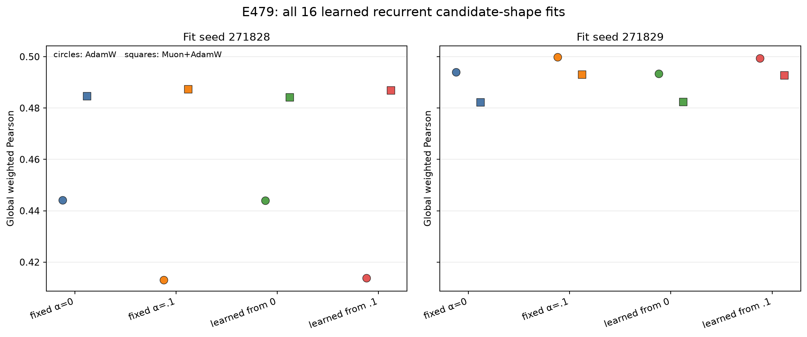
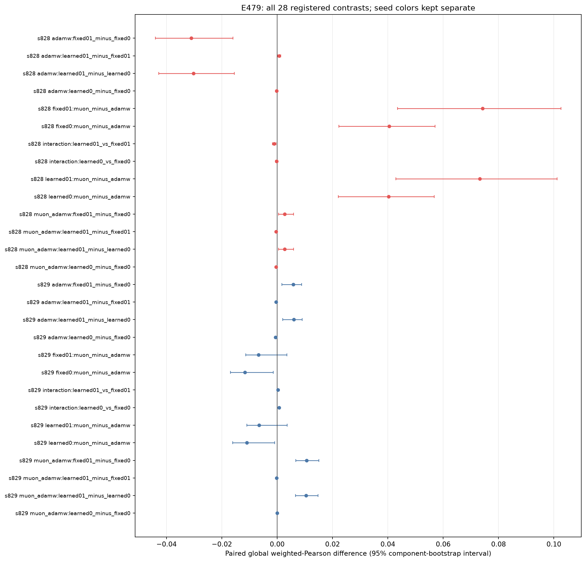
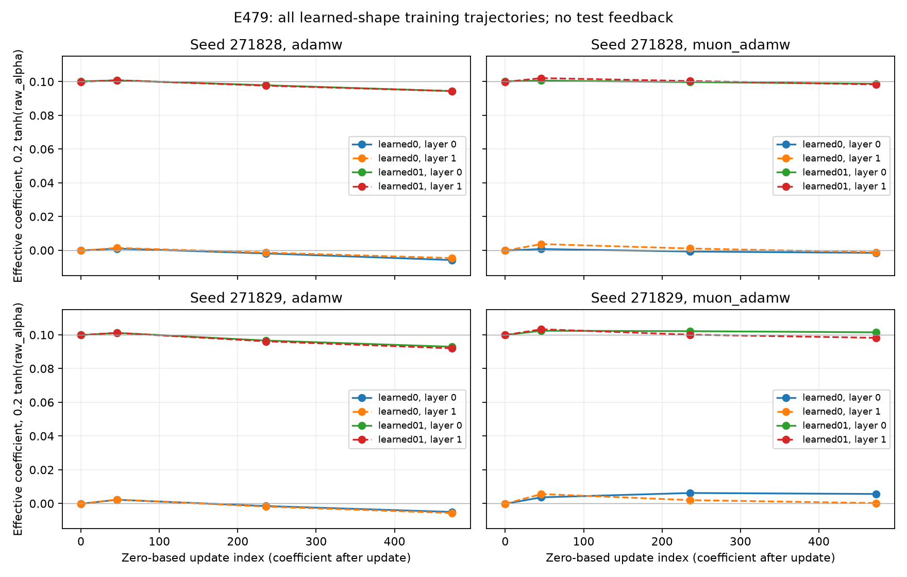

# E479: learned bounded recurrent candidate activation

E479 tests a per-layer learned coefficient in the reset-after GRU candidate map `u + α sin(πu)`, where `u=tanh(v)`. It completed all 16 registered fits (two fit seeds × two optimizers × four fixed/learned initialization conditions). Each score is on the same previously exposed set of 16 components. These results are descriptive; they do not establish a public-score gain or seed-population uncertainty.

## Arm scores

| Fit seed | Optimizer | Candidate coefficient condition | Global WP | t0 WP | t1 WP |
|---:|---|---|---:|---:|---:|
| 271828 | adamw | fixed α=0 | 0.444184 | 0.512219 | 0.376148 |
| 271828 | adamw | fixed α=0.1 | 0.413105 | 0.496409 | 0.329800 |
| 271828 | adamw | learned, initialized α=0 | 0.444023 | 0.512171 | 0.375876 |
| 271828 | adamw | learned, initialized α=0.1 | 0.413754 | 0.496926 | 0.330583 |
| 271828 | muon_adamw | fixed α=0 | 0.484668 | 0.512374 | 0.456961 |
| 271828 | muon_adamw | fixed α=0.1 | 0.487380 | 0.516265 | 0.458494 |
| 271828 | muon_adamw | learned, initialized α=0 | 0.484285 | 0.512244 | 0.456327 |
| 271828 | muon_adamw | learned, initialized α=0.1 | 0.486964 | 0.516156 | 0.457772 |
| 271829 | adamw | fixed α=0 | 0.494020 | 0.491245 | 0.496796 |
| 271829 | adamw | fixed α=0.1 | 0.499802 | 0.495465 | 0.504140 |
| 271829 | adamw | learned, initialized α=0 | 0.493380 | 0.491277 | 0.495484 |
| 271829 | adamw | learned, initialized α=0.1 | 0.499385 | 0.495435 | 0.503334 |
| 271829 | muon_adamw | fixed α=0 | 0.482353 | 0.491420 | 0.473287 |
| 271829 | muon_adamw | fixed α=0.1 | 0.493028 | 0.494939 | 0.491118 |
| 271829 | muon_adamw | learned, initialized α=0 | 0.482397 | 0.491493 | 0.473302 |
| 271829 | muon_adamw | learned, initialized α=0.1 | 0.492868 | 0.494921 | 0.490816 |

## All registered paired contrasts

Differences are left condition minus right condition, using shared component resampling within a fit seed. Positive favors the left condition. Intervals condition on the fitted checkpoints and these 16 components.

| Contrast | Difference | 95% interval | Components |
|---|---:|---:|---:|
| `seed271828:adamw:fixed01_minus_fixed0` | -0.031079 | [-0.044033, -0.015963] | 16 |
| `seed271828:adamw:learned01_minus_fixed01` | +0.000650 | [+0.000061, +0.001260] | 16 |
| `seed271828:adamw:learned01_minus_learned0` | -0.030269 | [-0.042846, -0.015498] | 16 |
| `seed271828:adamw:learned0_minus_fixed0` | -0.000161 | [-0.000491, +0.000173] | 16 |
| `seed271828:fixed01:muon_minus_adamw` | +0.074275 | [+0.043477, +0.102593] | 16 |
| `seed271828:fixed0:muon_minus_adamw` | +0.040484 | [+0.022261, +0.057065] | 16 |
| `seed271828:interaction:learned01_vs_fixed01` | -0.001065 | [-0.001741, -0.000418] | 16 |
| `seed271828:interaction:learned0_vs_fixed0` | -0.000222 | [-0.000559, +0.000105] | 16 |
| `seed271828:learned01:muon_minus_adamw` | +0.073210 | [+0.042903, +0.101146] | 16 |
| `seed271828:learned0:muon_minus_adamw` | +0.040262 | [+0.022119, +0.056801] | 16 |
| `seed271828:muon_adamw:fixed01_minus_fixed0` | +0.002712 | [+0.000518, +0.005928] | 16 |
| `seed271828:muon_adamw:learned01_minus_fixed01` | -0.000415 | [-0.000523, -0.000320] | 16 |
| `seed271828:muon_adamw:learned01_minus_learned0` | +0.002679 | [+0.000501, +0.005917] | 16 |
| `seed271828:muon_adamw:learned0_minus_fixed0` | -0.000382 | [-0.000503, -0.000283] | 16 |
| `seed271829:adamw:fixed01_minus_fixed0` | +0.005782 | [+0.001691, +0.008882] | 16 |
| `seed271829:adamw:learned01_minus_fixed01` | -0.000417 | [-0.000576, -0.000074] | 16 |
| `seed271829:adamw:learned01_minus_learned0` | +0.006005 | [+0.002049, +0.009018] | 16 |
| `seed271829:adamw:learned0_minus_fixed0` | -0.000640 | [-0.000793, -0.000344] | 16 |
| `seed271829:fixed01:muon_minus_adamw` | -0.006774 | [-0.011310, +0.003555] | 16 |
| `seed271829:fixed0:muon_minus_adamw` | -0.011667 | [-0.016854, -0.001420] | 16 |
| `seed271829:interaction:learned01_vs_fixed01` | +0.000257 | [-0.000047, +0.000426] | 16 |
| `seed271829:interaction:learned0_vs_fixed0` | +0.000684 | [+0.000369, +0.000904] | 16 |
| `seed271829:learned01:muon_minus_adamw` | -0.006516 | [-0.010954, +0.003632] | 16 |
| `seed271829:learned0:muon_minus_adamw` | -0.010983 | [-0.016053, -0.000874] | 16 |
| `seed271829:muon_adamw:fixed01_minus_fixed0` | +0.010675 | [+0.006730, +0.015066] | 16 |
| `seed271829:muon_adamw:learned01_minus_fixed01` | -0.000160 | [-0.000226, -0.000083] | 16 |
| `seed271829:muon_adamw:learned01_minus_learned0` | +0.010471 | [+0.006625, +0.014740] | 16 |
| `seed271829:muon_adamw:learned0_minus_fixed0` | +0.000044 | [-0.000042, +0.000180] | 16 |

## Interpretation

Learned-versus-fixed effects are small in absolute terms and depend on optimizer and seed. For seed 271828 with AdamW, learning from α=0.1 exceeds the fixed α=0.1 control by **+0.000650** global WP (95% component interval [ +0.000061, +0.001260 ]). This is the notable positive learned-shape contrast, but it does not repeat: seed 271829 AdamW is −0.000417, while Muon+AdamW is negative for both seeds at the α=0.1 start (−0.000415 and −0.000160). At the zero start, three of four within-seed/optimizer contrasts are negative; the remaining seed-271829 Muon contrast is near zero (+0.000044).

The fixed α=0.1 shape itself has mixed effects: it is negative versus fixed zero for seed-271828 AdamW (−0.031079), but positive for the other three seed/optimizer pairs (+0.002712, +0.005782, +0.010675). Optimizer contrasts reverse sign across seeds: Muon+AdamW leads for each shape under seed 271828, while it trails AdamW for seed 271829. The learned coefficient is therefore not a stable optimizer-independent improvement in this small two-seed study.

The training-only trajectory figure below shows the learned-from-zero coefficients staying close to zero and learned-from-0.1 coefficients remaining near 0.09–0.10, with modest layer/optimizer/seed-dependent movement. That is consistent with learned-vs-fixed performance gaps generally being small; it is not evidence that coefficients are causally irrelevant. The scalar bound applies to the candidate map, not to the full recurrent system.

## Reproduction and provenance

- Frozen score artifact SHA-256: `da2981305af77864ee63b9307d712043a5f49de7e192ca5ef28db395eb2712c4`.
- Paired raw prediction export SHA-256: `f5de8fe3fc73fe47d9ee2a5b524e179291e4f7df021f1f49bbf57196239b78be`.
- Registered fit source SHA-256: `6a11025735bb8df7d88b08bdcf7dfd9d8879992a82c1c64d40b43ada7456c7bf`; seal `e479_learned_candidate_sixteen_fit_v2` (`68fe5e9187051e6ec59afa93ddb15cde46fd962ba896f70207ce9d5cf1caf058`).
- Independent pure-NumPy recomputation: all_checked_values_match; checked 16 arm scores and 28 contrasts, maximum absolute discrepancy `2.44e-15`. It uses the existing raw export and an independent raw-sum computation; no refit or grader import.
- Bootstrap resampling unit: numeric-sorted test component; 2,000 shared draws within each seed. No pooling across fit seeds.
- Limitations: only two fit seeds and 16 exposed components; intervals quantify component resampling conditional on these checkpoints, not run-to-run or seed uncertainty. This exploratory proxy result does not forecast public performance.
