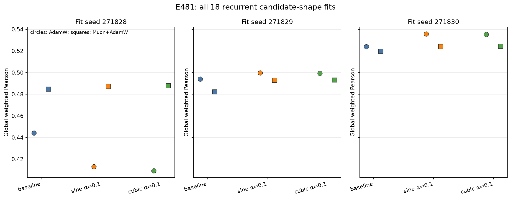
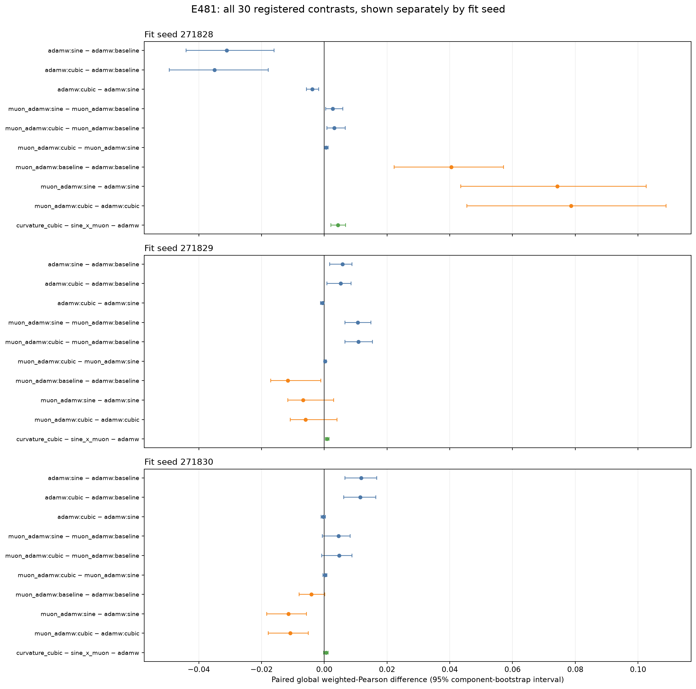

# E481: recurrent candidate curvature and optimizer interaction

E481 compares the baseline candidate `u`, bounded sine `u + 0.1 sin(πu)`, and matched-center cubic `u + 0.1πu(1−u²)` in a two-layer reset-after GRU. The experiment contains three fixed fit seeds, two optimizers, and all three shapes (18 completed fits). It reuses the same 16 previously exposed components; this is descriptive proxy evidence, not new holdout evidence or a public forecast.

## Arm scores

| Fit seed | Optimizer | Candidate | Global WP | t0 WP | t1 WP |
|---:|---|---|---:|---:|---:|
| 271828 | adamw | baseline | 0.444184 | 0.512219 | 0.376148 |
| 271828 | adamw | sine | 0.413105 | 0.496409 | 0.329800 |
| 271828 | adamw | cubic | 0.409232 | 0.494049 | 0.324416 |
| 271828 | muon_adamw | baseline | 0.484681 | 0.512377 | 0.456984 |
| 271828 | muon_adamw | sine | 0.487371 | 0.516269 | 0.458473 |
| 271828 | muon_adamw | cubic | 0.487884 | 0.516338 | 0.459431 |
| 271829 | adamw | baseline | 0.494020 | 0.491245 | 0.496796 |
| 271829 | adamw | sine | 0.499802 | 0.495465 | 0.504140 |
| 271829 | adamw | cubic | 0.499226 | 0.495555 | 0.502898 |
| 271829 | muon_adamw | baseline | 0.482358 | 0.491408 | 0.473308 |
| 271829 | muon_adamw | sine | 0.493009 | 0.494934 | 0.491084 |
| 271829 | muon_adamw | cubic | 0.493278 | 0.495200 | 0.491355 |
| 271830 | adamw | baseline | 0.523847 | 0.507791 | 0.539903 |
| 271830 | adamw | sine | 0.535624 | 0.515459 | 0.555788 |
| 271830 | adamw | cubic | 0.535267 | 0.514828 | 0.555705 |
| 271830 | muon_adamw | baseline | 0.519727 | 0.502873 | 0.536580 |
| 271830 | muon_adamw | sine | 0.524227 | 0.506455 | 0.542000 |
| 271830 | muon_adamw | cubic | 0.524442 | 0.506349 | 0.542534 |

## All 30 registered global contrasts

Each difference is candidate minus reference. The 95% intervals use 2,000 shared component-bootstrap draws within the same fit seed; each interval conditions on that seed's fitted checkpoints and the same 16 components.

| Fit seed | Family | Candidate − reference | Difference | 95% interval |
|---:|---|---|---:|---:|
| 271828 | shape_within_optimizer | `adamw__sine` − `adamw__baseline` | -0.031079 | [-0.044033, -0.015963] |
| 271828 | shape_within_optimizer | `adamw__cubic` − `adamw__baseline` | -0.034952 | [-0.049418, -0.017843] |
| 271828 | shape_within_optimizer | `adamw__cubic` − `adamw__sine` | -0.003872 | [-0.005679, -0.001795] |
| 271828 | shape_within_optimizer | `muon_adamw__sine` − `muon_adamw__baseline` | +0.002691 | [+0.000489, +0.005917] |
| 271828 | shape_within_optimizer | `muon_adamw__cubic` − `muon_adamw__baseline` | +0.003204 | [+0.000865, +0.006721] |
| 271828 | shape_within_optimizer | `muon_adamw__cubic` − `muon_adamw__sine` | +0.000513 | [-0.000005, +0.001263] |
| 271828 | optimizer_within_shape | `muon_adamw__baseline` − `adamw__baseline` | +0.040497 | [+0.022257, +0.057093] |
| 271828 | optimizer_within_shape | `muon_adamw__sine` − `adamw__sine` | +0.074267 | [+0.043471, +0.102606] |
| 271828 | optimizer_within_shape | `muon_adamw__cubic` − `adamw__cubic` | +0.078652 | [+0.045421, +0.108970] |
| 271828 | shape_by_optimizer_interaction | `(muon_adamw:cubic-sine)` − `(adamw:cubic-sine)` | +0.004386 | [+0.002070, +0.006779] |
| 271829 | shape_within_optimizer | `adamw__sine` − `adamw__baseline` | +0.005782 | [+0.001733, +0.008861] |
| 271829 | shape_within_optimizer | `adamw__cubic` − `adamw__baseline` | +0.005206 | [+0.000857, +0.008500] |
| 271829 | shape_within_optimizer | `adamw__cubic` − `adamw__sine` | -0.000576 | [-0.001163, -0.000235] |
| 271829 | shape_within_optimizer | `muon_adamw__sine` − `muon_adamw__baseline` | +0.010651 | [+0.006635, +0.014838] |
| 271829 | shape_within_optimizer | `muon_adamw__cubic` − `muon_adamw__baseline` | +0.010920 | [+0.006614, +0.015309] |
| 271829 | shape_within_optimizer | `muon_adamw__cubic` − `muon_adamw__sine` | +0.000269 | [-0.000147, +0.000689] |
| 271829 | optimizer_within_shape | `muon_adamw__baseline` − `adamw__baseline` | -0.011663 | [-0.017034, -0.001087] |
| 271829 | optimizer_within_shape | `muon_adamw__sine` − `adamw__sine` | -0.006793 | [-0.011626, +0.003034] |
| 271829 | optimizer_within_shape | `muon_adamw__cubic` − `adamw__cubic` | -0.005949 | [-0.010884, +0.004046] |
| 271829 | shape_by_optimizer_interaction | `(muon_adamw:cubic-sine)` − `(adamw:cubic-sine)` | +0.000845 | [+0.000397, +0.001522] |
| 271830 | shape_within_optimizer | `adamw__sine` − `adamw__baseline` | +0.011777 | [+0.006603, +0.016744] |
| 271830 | shape_within_optimizer | `adamw__cubic` − `adamw__baseline` | +0.011420 | [+0.006201, +0.016400] |
| 271830 | shape_within_optimizer | `adamw__cubic` − `adamw__sine` | -0.000357 | [-0.001013, +0.000367] |
| 271830 | shape_within_optimizer | `muon_adamw__sine` − `muon_adamw__baseline` | +0.004501 | [-0.000659, +0.008237] |
| 271830 | shape_within_optimizer | `muon_adamw__cubic` − `muon_adamw__baseline` | +0.004715 | [-0.000799, +0.008857] |
| 271830 | shape_within_optimizer | `muon_adamw__cubic` − `muon_adamw__sine` | +0.000214 | [-0.000393, +0.000835] |
| 271830 | optimizer_within_shape | `muon_adamw__baseline` − `adamw__baseline` | -0.004120 | [-0.007992, +0.000133] |
| 271830 | optimizer_within_shape | `muon_adamw__sine` − `adamw__sine` | -0.011396 | [-0.018346, -0.005652] |
| 271830 | optimizer_within_shape | `muon_adamw__cubic` − `adamw__cubic` | -0.010825 | [-0.017868, -0.005063] |
| 271830 | shape_by_optimizer_interaction | `(muon_adamw:cubic-sine)` − `(adamw:cubic-sine)` | +0.000571 | [-0.000212, +0.001244] |

## What changed across shapes

The sine and cubic candidates move together relative to baseline within each optimizer/seed more often than they differ from each other. The key departure is seed 271828 with AdamW: sine and cubic are respectively −0.031079 (95% CI [−0.044033, −0.015963]) and −0.034952 ( [−0.049418, −0.017843]) versus baseline. Under Muon+AdamW for the same seed, both are modestly positive: +0.002691 ([+0.000489, +0.005917]) for sine and +0.003204 ([+0.000865, +0.006721]) for cubic. Thus the fitted response to candidate shape depends strongly on optimizer in that seed.

For seeds 271829 and 271830, both candidate shapes have positive point estimates over baseline under both optimizers. Among the four sine-versus-baseline comparisons for seeds 271829 and 271830, three intervals are above zero; the Muon+AdamW interval at seed 271830 crosses zero. Cubic-versus-baseline has the same pattern. Cubic-minus-sine differences are much smaller: under AdamW they are negative at seeds 271828 and 271829 (the latter interval excludes zero), while seed 271830 is uncertain; all three Muon+AdamW cubic-minus-sine intervals cross zero. This suggests optimizer-conditioned shape effects in the proxy, but does not establish a stable winner or a causal mechanistic explanation.

The registered cubic-minus-sine-by-optimizer interaction is positive with intervals above zero for seeds 271828 and 271829, and crosses zero for 271830. This is consistent with the cubic being relatively less unfavorable under Muon than under AdamW for the first two seeds. The result is seed-sensitive and is based on three predeclared fits per condition, not an estimate over a population of training seeds.

## Grade and limits

- Independent CPU grade attempt: `e481-candidate-curvature-cpu-test-grade-v2` finished with exit code 0, no signals, and verified teardown; elapsed 369.8 s, peak RAM 920,653,824 bytes, observed VRAM 0 bytes.
- Worker OOM counters did not increase. Parent counters were nonzero before this attempt and remained unchanged.
- The v1 grader stopped at fit-only proof validation due to an unavailable helper API before test scoring; the successful score is from the independently reviewed v2 grader. The underlying fit attempt completed normally.
- Score JSON SHA-256: `e8a405add6bd104fda17978feb2abead5310346d6c006de8da53ad720cfec217`; paired selected-export SHA-256: `6645cb5c57486b0d90406212957f3e93fe7b5fa363b01e657dc98fe08f260c1c`; grade attempt SHA-256: `eb6010d7efad4c335a6c29e102207c033bf48a37b7050b6013744ead0cda819d`.
- Bootstrap unit is one numeric-sorted component, with shared component draws across arms and contrasts within each seed. No seeds are pooled; component intervals do not include training-seed or model-selection uncertainty.
- The candidate-map interval bound is an amplitude invariant for the exact reset-after recurrence, not a gradient-stability guarantee. These proxy scores do not establish public leaderboard performance.
