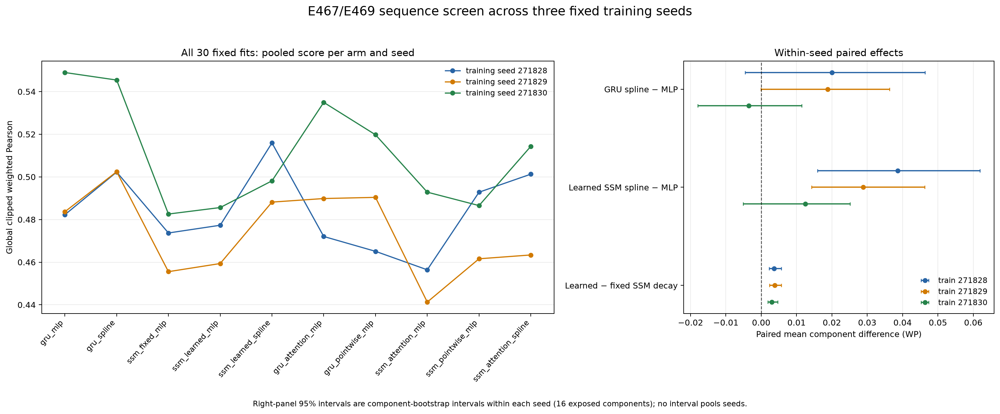

# Three-seed synthesis: E467/E469 sequence component screen

All **30 fits** are included: ten fixed arms at each training seed 271828, 271829, and 271830. Every fit used 474 updates, the same 24-fit/16-exposed-component cohort, and the unchanged `global_wp_clip2_v1` metric. The output is descriptive of this repeatedly used diagnostic panel; it is neither a fresh holdout nor a public-score forecast.

No confidence interval is pooled across training seeds. The reported paired intervals are the original 2,000-resample bootstrap intervals over the same 16 test components, conditional on each fitted seed. Cross-seed means, standard deviations and ranges are descriptive summaries of these three fixed fits.

## Pooled WP by arm and training seed

| Arm | Parameters | Seed 271828 | Seed 271829 | Seed 271830 | Three-seed mean (descriptive) | Across-seed SD | Range |
|---|---:|---:|---:|---:|---:|---:|---:|
| gru_mlp | 8,235 | 0.482259 | 0.483661 | 0.548964 | 0.504962 | 0.038114 | 0.066704 |
| gru_spline | 8,226 | 0.502267 | 0.502440 | 0.545431 | 0.516713 | 0.024871 | 0.043164 |
| ssm_fixed_mlp | 2,955 | 0.473689 | 0.455542 | 0.482578 | 0.470603 | 0.013779 | 0.027035 |
| ssm_learned_mlp | 2,987 | 0.477319 | 0.459359 | 0.485621 | 0.474100 | 0.013424 | 0.026262 |
| ssm_learned_spline | 2,978 | 0.515935 | 0.488176 | 0.498141 | 0.500751 | 0.014062 | 0.027759 |
| gru_attention_mlp | 9,148 | 0.472050 | 0.489850 | 0.534960 | 0.498953 | 0.032428 | 0.062911 |
| gru_pointwise_mlp | 9,142 | 0.465084 | 0.490400 | 0.519764 | 0.491750 | 0.027365 | 0.054680 |
| ssm_attention_mlp | 3,900 | 0.456415 | 0.441282 | 0.492841 | 0.463513 | 0.026502 | 0.051559 |
| ssm_pointwise_mlp | 3,894 | 0.492819 | 0.461588 | 0.486540 | 0.480315 | 0.016520 | 0.031231 |
| ssm_attention_spline | 3,899 | 0.501282 | 0.463378 | 0.514333 | 0.492998 | 0.026468 | 0.050955 |

## Paired effects within each training seed

Positive differences favor the named candidate. Each interval is conditional on one training seed and resamples the fixed 16 test components; intervals do not capture training-seed uncertainty.

| Contrast (candidate − reference) | Seed 271828: effect [95% component CI] | Seed 271829: effect [95% component CI] | Seed 271830: effect [95% component CI] |
|---|---:|---:|---:|
| `gru_spline_minus_gru_mlp` | +0.020008 [-0.004540, +0.046376] | +0.018779 [-0.000080, +0.036291] | -0.003533 [-0.017956, +0.011434] |
| `ssm_learned_mlp_minus_ssm_fixed_mlp` | +0.003630 [+0.002256, +0.005663] | +0.003816 [+0.002360, +0.005715] | +0.003043 [+0.001838, +0.004640] |
| `ssm_learned_spline_minus_ssm_learned_mlp` | +0.038616 [+0.015913, +0.061933] | +0.028818 [+0.014263, +0.046304] | +0.012520 [-0.005120, +0.025173] |
| `gru_attention_mlp_minus_gru_pointwise_mlp` | +0.006965 [-0.003804, +0.018977] | -0.000551 [-0.007056, +0.004221] | +0.015196 [+0.004982, +0.026778] |
| `ssm_attention_mlp_minus_ssm_pointwise_mlp` | -0.036404 [-0.053742, -0.021596] | -0.020306 [-0.027856, -0.011975] | +0.006302 [-0.000466, +0.014034] |
| `ssm_attention_spline_minus_ssm_attention_mlp` | +0.044867 [+0.020323, +0.078345] | +0.022096 [-0.000269, +0.045415] | +0.021492 [+0.001437, +0.039755] |
| `ssm_attention_spline_minus_ssm_learned_spline` | -0.014653 [-0.025239, +0.002446] | -0.024798 [-0.033458, -0.014577] | +0.016192 [-0.000108, +0.035351] |

## What replicated and what moved

The initial seed 271828 gave the learned diagonal-memory spline head a +0.038616 paired lead over the learned-memory MLP (within-seed component-bootstrap 95% CI [+0.015913, +0.061933]). That lead narrowed to +0.028818 at seed 271829 (CI [+0.014263, +0.046304]) and +0.012520 at seed 271830 (CI [−0.005120, +0.025173]). The direction stayed positive, but the size fell by roughly two thirds from the initial estimate and the last conditional interval includes zero. It should be described as a promising but seed-sensitive small-screen effect, not a stable gain.

The GRU spline-minus-MLP effect was +0.020008 at seed 271828, +0.018779 at 271829, then −0.003533 at 271830; all three within-seed intervals include zero. Thus the first two positive estimates did not persist as a consistent advantage across fits.

Learning the diagonal decay instead of fixing it was the most consistent paired effect: +0.003630, +0.003816, and +0.003043 at the three seeds. Each seed’s conditional component-bootstrap interval was positive. This consistency is still conditional on the repeated exposed panel and three specified initializations.

Absolute scores also varied substantially by initialization. For example, GRU+MLP ranged from 0.482259 to 0.548964 (range 0.066704); GRU+spline ranged from 0.502267 to 0.545431. The attention and static-branch contrasts also changed direction between seeds. Comparing the first seed’s ranking alone would overstate the stability of the nonlinear-head result.

The three-seed descriptive mean table is useful for seeing the spread, but it is not a substitute for independent components, and its SD is not a confidence interval. No winner was selected from these scores.

## Provenance

Input files and SHA-256 identities are recorded in `THREE_SEED_RESULT.json`. The seed-271828 fit is `RESULT.json`; seeds 271829 and 271830 are the nested `fit` objects in their corresponding `SEED*_RESULT.json` files, with paired component bootstrap results nested alongside them. The synthesis has no training, provider launch, ledger, or grader changes.
