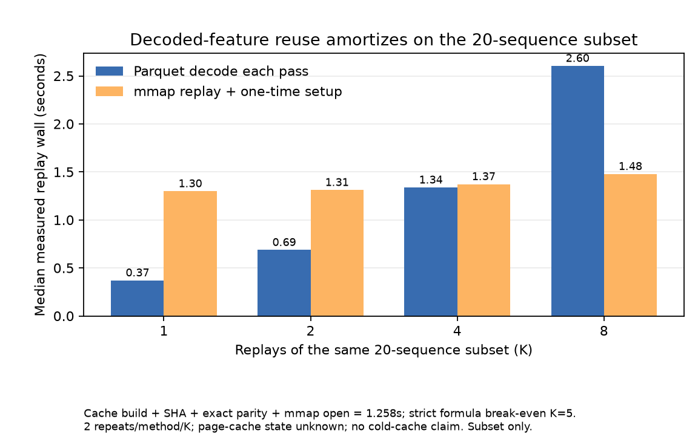

# E528-A2 decoded-feature reuse benchmark

## Result

On the exact 20-sequence `valid_subset20` cohort, the row-major float32 mmap cache passed bitwise parity for all 44,800,000 feature values. Its measured replay was substantially faster per pass, and the measured cache build plus SHA-256 and exact parity cost amortizes at **K=5** replays on this subset. This does not establish a full-training speedup.

| Replays K | Parquet total replay (s) | mmap replay + one-time setup (s) | Parquet fetch + full scan p50/p90 (ms/sequence) | mmap fetch + full scan p50/p90 (ms/sequence) |
|---:|---:|---:|---:|---:|
| 1 | 0.370 | 1.299 | 16.89/23.93 | 1.50/3.10 |
| 2 | 0.687 | 1.311 | 16.34/19.58 | 1.24/1.63 |
| 4 | 1.337 | 1.372 | 16.14/18.77 | 1.33/1.85 |
| 8 | 2.604 | 1.478 | 15.90/18.37 | 1.30/1.68 |

One-time setup in the break-even calculation was 1.258s: cache build 0.561s, cache-file SHA-256 0.135s, full exact parity 0.560s, and reader/mmap opens about 0.0022s. Source identity hashing (0.075s) is reported separately. Break-even uses the frozen formula and is for this subset only.

The cache stores shape `[20, 20000, 112]`, float32 C-order data. Payload SHA-256: `fe45e0f718f8fb1aeef91ba3899ce9924855748f75ca4a39e64fc4203e205c3d`. NPY file plus manifest uses 179,202,948 bytes, within the 250,000,000-byte cap. The full 10,535-sequence raw feature cache would require about 94.4 GB before other arrays, so this run built only the bounded subset.

## Inputs and validity

The Parquet input is `cache/valid_subset20.parquet` (90,874,551 bytes, SHA-256 `cd6a349b3655bb6f98314e5db391e69b1e1ea7f12ab18f1d15c61cefd28daa37`). The run used the training reader `SequenceFile.read(position, targets=False, mask=False)`, preserving the frozen order of 20 original row groups and `seq_ix` values recorded in [the frozen input receipt](E528_FROZEN_INPUT_RECEIPT_V2.json). Its ordered 112-feature list has SHA-256 `9ebf934d940647f8f6dbfc8fe28237ac729ee7d51bc29d6f9a0cc0202fec72f2`; the reader source `src/wnn/data.py` has SHA-256 `a93da840137adbd7afdb79a22687fb73150e77107f91ca2adc5211b854bc7e00`.

The cache matches each decoded row bit-for-bit in uint32 view, has payload SHA-256 `fe45e0f718f8fb1aeef91ba3899ce9924855748f75ca4a39e64fc4203e205c3d`, and paired float64-sum consumer checksums match for every measured K/repetition. Data were read during build and again for full parity before timed replay. No page-cache drop was attempted; the first timed pass has unknown kernel cache state, and later passes follow previous accesses. The labels “cold” and “controlled warm” do not apply.

The attempt completed with exit status 0 in 12.685s under one CPU, 1,000,000,000-byte RSS and 1,500,000,000-byte address-space limits, with CUDA disabled. Kernel `VmHWM` sampled by the external watcher was 339,996,672 bytes; the helper's `ru_maxrss` was 339,906,560 bytes. Peak sampled process-tree RSS sum was 342,147,072 bytes.

**Timing-field caveat:** raw `E528_RESULTS_V2.json` reports `run_wall_seconds_after_frozen_input_checks=0.817` because the helper reuses `run_start` inside the method loop. That is an early snapshot, not total run wall. The separate attempt monitor records the full worker wall as 12.685s. Replay samples, setup timings, parity, hashes and break-even are unaffected. See [the machine-readable reconciliation](E528_TERMINAL_RESULTS_A2.json); raw output was preserved without rewriting.

## Scope and artifacts

This is a CPU storage/decode profile, not a training step: it excludes target/mask decoding, model compute, training-loader workers, optimizer work, transfer and full-train I/O. Each replay touches all values using the same float64 sum. The subset result should not be extrapolated to the full training set or called a competition improvement.

- Frozen V1 failed before cache build due to an incorrect nested receipt lookup; it collected no feature timings and is preserved in [the A1 failure receipt](E528_FAILED_ATTEMPT_A1.json).
- The corrected V2 source, preregistration, input receipt and external attempt monitor are versioned and hash-bound in [the terminal results JSON](E528_TERMINAL_RESULTS_A2.json).
- The timing figure is available as [PNG](plots/E528_cache_break_even_A2.png) and [SVG](plots/E528_cache_break_even_A2.svg).
