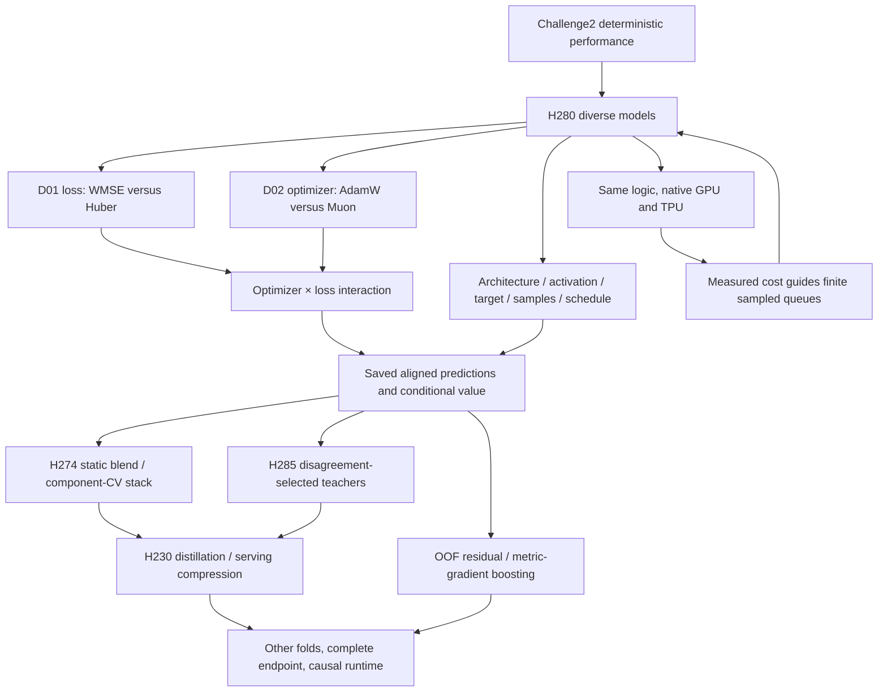

# October12 live continuation

[CPU optimization and serving repair index](ops_continuation_20261011/zen4_cpu_research_20261012_r1/INDEX.md) contains recent sources, both independent Sol reviews, exact-package runtime/PGO evidence, the admitted projection experiment, Claude's comments and the public-fold-affinity diagnostic. ZIP12 timed out and is withdrawn; ZIP11 is the strongest current compact upload candidate after re-audit, with scoring-CPU runtime still unmeasured. Local F1 parent is actually training; corrected Kaggle R5/R9 is completing its bounded dispatch. Vast has zero credit and remains unavailable. Current state overrides the historical October11 snapshot below.

## Historical October11 continuation snapshot

Latest authority and evidence are in [the continuation contract](CONTINUATION_CONTRACT_20261011.md) and [current state](../../../../specs/current-state.md). Local evidence selects submissions; public LB confirms transfer. Own fixed student–scratch pair scores0.67329 on exposed fold1; packaging destination `submissions/10-11-67`. Owned Vast B is active under the user-selected$70 ceiling, Kaggle longv6 and local four-epoch seed confirmations continue. The October9 allocation below is historical.

# Diverse models, combinations and device comparison

Updated October 9, 2026. This is the navigation page for the user's priority direction: independently train diverse teachers/students, retain their predictions, and measure their conditional value in blends, stacks and distillation. All subordinate roles now use Luna/max (ADR0029). Latest user instruction: compare the same mathematical training logic with native GPU and TPU implementations; document all ideas. A possible RTX5090 batch is a planning question only. **No rental is authorized by these notes; Vast remains off.**

## Current evidence and implementation

| Item | State | Evidence |
|---|---|---|
| Four frozen endpoints, equal average | Evaluated on exposed fold0: 0.6825617501 vs strongest member 0.6823084607; delta +0.0002532895 | [Independent bootstrap](../../../../artifacts/analysis/luna_stacking_meta_r2/r2-2291238a-r4-attempt1/combination_evidence_followup_r1/PAIRED_COMPONENT_BOOTSTRAP_R1.json) |
| Component-cross-fitted ridge stack | 0.6824590313, below the equal average | [Independent reconstruction](LUNA_STACKING_ROOT_INDEPENDENT_CHECK_R1.json) |
| D01 AdamW × WMSE/Huber | Graded: WMSE0.606001923, Huber0.601239135, equal0.605480201 on350-sequence exposed screen; equal blend does not improve overall | [Findings and uncertainty](grading_r1/LOSS_PAIR_R5_FINDINGS.md), [primary result](grading_r1/LOSS_PAIR_R5_GRADE_R2.json), [artifact review](ROOT_GPU_R5_TERMINAL_REVIEW_R1.json) |
| D02 Muon × WMSE/Huber | All11fixed endpoints graded; equalAdamW-WMSE/Muon-WMSE .604142139 versusAdamW .606001923. Specificscreen loses; other recipes remain open | [Full findings](grading_r2/D02_QUARTET_FINDINGS_R2.md), [root independent calculation](grading_r2/ROOT_QUARTET_PRIMARY_REVIEW_R1.json) |
| GPU versus TPU | Native FP16GPU COMPLETE, root189-file/state/prediction/control checks passed. TPU BF16 packet ready but old queued probe occupies its slot; ratio unmeasured | [Native terminal review](tpu_gpu_benchmark/native_precision_gpu_admitted_r1/ROOT_NATIVE_FP16_TERMINAL_REVIEW_R1.json), [native comparison protocol](tpu_gpu_benchmark/native_device_comparison_r1/CONTRACT_R2.md) |
| Fold1 baseline diagnostic | Seed3 .657638438, seed4 .656866806, fixed equal blend .659150436; delta+.001511999, interval[-.000366105,+.003279154]. Exposed457groups149components | [Independent grade](../../../../scratch/fold1_gru384_successor_20261009/grading_r1/BASELINE_PAIR_R1.md); all eight exports complete, four-family cache complete and independently validated |
| Z4/Z5 submissions | Technically validated exploratory packages; public quality untested | [Release audit](../../../../scratch/z4z5_independent_package_20261009/RELEASE_AUDIT_20261009.md) |

The equal-blend interval is [-0.0003158723,+0.0008065694], from 2,000 paired whole-component bootstrap draws over 141 components/468 groups. The panel is exposed and the strongest member was selected on it. This supports bounded follow-up; it is neither proof of a public gain nor a reason to reject all uncertain descendants. No local delta is added to a public score.

## Idea and execution notes

- [Combination and sampled-queue design](COMBINATIONS_AND_SAMPLED_QUEUE_R1.md): train once, save predictions, select complementary members, then confirm/compress.
- [Updated combination evidence and next experiments](COMBINATION_EVIDENCE_20261009_R1.md): distinguish the positive but uncertain fold1 seed blend from the losing small optimizer/loss equal blends; retain optimizer-specific tuning and calibrated combination hypotheses.
- [Sampler R3 sealed cohort](experiment_sampler_r3/sealed_admitted_r1/sampled_cohort.packet.json): six fixed arms R/Q/I/U/J/K, three sequential two-T4 waves, reused parsed cache and saved controls; source/startup checks passed independently. Asset upload is being reconciled before dispatch. The [R2 candidate pool](experiment_sampler_r2/README_R2.md) remains historical; its pending-runner label is superseded only for these six implemented recipes. [R1](experiment_sampler_r1/README.md) preserves its earlier source-policy mismatch.
- [GPU-hour and three-hour capacity scenarios](COMPUTE_PLANNING_R1.md): measured anchors, explicit unmeasured 5090 assumptions, combinatorial growth and rental prohibition.
- [Searchable multidimensional matrix](matrix/experiment_matrix.html), [CSV](matrix/planned.csv), [planned cards](matrix/planned_experiments.json): 23 distinct contrasts plus historical runs and reviewed endpoints. The initial snapshot is preserved as `planned_experiments_initial_r1.json`; current execution receipts take precedence over generated snapshot statuses.
- [Artifact retention](ARTIFACT_RETENTION_R1.md): weights, rolling resume state, normalized metadata, dense predictions, optional scored-row Parquet, gradient and schedule diagnostics.
- [Campaign contract](CONTRACT_R1.md), [current allocation](ALLOCATION_R2_LOCAL_KAGGLE.md), [loss recipe audit](LOSS_PAIR_R2_RECIPE_AUDIT.md).

## Preserved independent proposals

Read the original proposals for details and differing views; none is silently replaced by this synthesis.

- [Astra proposal](ASTRA_PROPOSAL_R1.md) and [source/cost receipt](ASTRA_SOURCE_COST_RECEIPT_R1.md); completed historical exception, no new Astra authorization.
- [Luna loss/architecture](LUNA_LOSS_ARCHITECTURE_R1.md), [stacking EDA R1](LUNA_STACKING_EDA_R1.md), [EDA R2](LUNA_STACKING_EDA_R2.md), [serving/compute](LUNA_SERVING_COMPUTE_R1.md).
- [Grok4.7 proposal](GROK47_PROPOSAL_R1.md), [Freebuff public proposal](FREEBUFF_PUBLIC_PROPOSAL_R1.md), [external-provider status](EXTERNAL_IDEATION_STATUS_R1.md). A prompt file or failed provider invocation is not a completed proposal.
- [Earlier controller hypotheses](../controller_claude_20261008/NEW_HYPOTHESES_20261008.md), [full hypothesis ledger](../../../hypotheses.jsonl), [experiment ledger](../../../experiments.jsonl), [generated research tree](../../../bandit_tree/generated/INDEX.md).

## Explicit lineage

Numerical priors for untested nodes remain null. Prepared code, device profiling, training, evaluation and submission validation are separate milestones. The controller owns exact launch admission; an index or tree node never grants compute.
