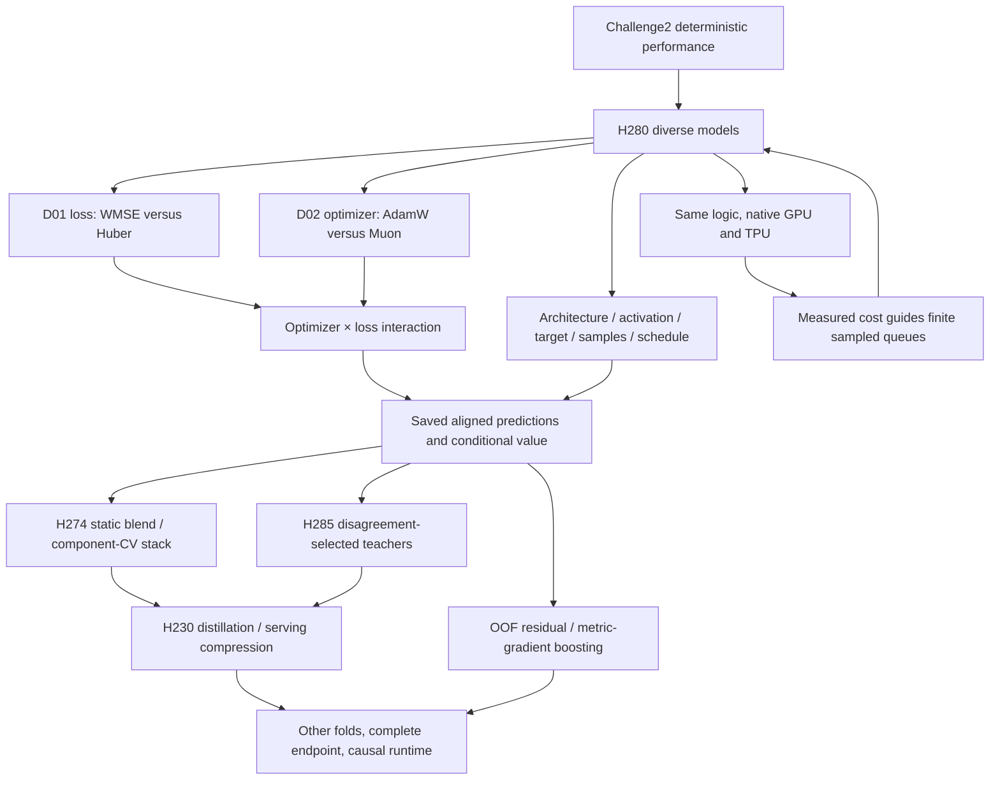

# Diverse models, combinations and device comparison

Updated October 9, 2026. This is the navigation page for the user's priority direction: independently train diverse teachers/students, retain their predictions, and measure their conditional value in blends, stacks and distillation. All subordinate roles now use Luna/max (ADR0029). Latest user instruction: compare the same mathematical training logic with native GPU and TPU implementations; document all ideas. A possible RTX5090 batch is a planning question only. **No rental is authorized by these notes; Vast remains off.**

## Current evidence and implementation

| Item | State | Evidence |
|---|---|---|
| Four frozen endpoints, equal average | Evaluated on exposed fold0: 0.6825617501 vs strongest member 0.6823084607; delta +0.0002532895 | [Independent bootstrap](../../../../artifacts/analysis/luna_stacking_meta_r2/r2-2291238a-r4-attempt1/combination_evidence_followup_r1/PAIRED_COMPONENT_BOOTSTRAP_R1.json) |
| Component-cross-fitted ridge stack | 0.6824590313, below the equal average | [Independent reconstruction](LUNA_STACKING_ROOT_INDEPENDENT_CHECK_R1.json) |
| D01 AdamW × WMSE/Huber | R4 completed220updates per arm; prediction-export CLI failed; export-only recovery owned by cloud operator | [Completed-fit review](ROOT_GPU_R4_COMPLETED_FITS_REVIEW_R1.json), [R3 diagnosis](cloud_delivery/gpu_loss_pair_r3/GPU_R3_TERMINAL_RECONCILIATION_R2.json), [R4 source review](ROOT_GPU_SEALED_REVIEW_R4.json) |
| D02 Muon × WMSE/Huber | R2 source and sealed bootstrap checked; private recovered AdamW controls pending, no fits yet | [Recipe](d02_muon_loss_successor/RECIPE_R1.md), [R2 implementation](d02_muon_loss_successor_r2/IMPLEMENTATION_R2.md) |
| GPU versus TPU | JAX CPU/interface checks pass; actual matched device comparison pending | [Original protocol](tpu_gpu_benchmark/BENCHMARK_PROTOCOL_R1.md), [native successor](tpu_gpu_benchmark/native_device_comparison_r1/CONTRACT_R2.md) |
| Fold1 robustness | Seed3 exact checkpoint recovery active after timeout; reviewed durable seed4 successor installed | [Live state](../../../../specs/current-state.md) |
| Z4/Z5 submissions | Technically validated exploratory packages; public quality untested | [Release audit](../../../../scratch/z4z5_independent_package_20261009/RELEASE_AUDIT_20261009.md) |

The equal-blend interval is [-0.0003158723,+0.0008065694], from 2,000 paired whole-component bootstrap draws over 141 components/468 groups. The panel is exposed and the strongest member was selected on it. This supports bounded follow-up; it is neither proof of a public gain nor a reason to reject all uncertain descendants. No local delta is added to a public score.

## Idea and execution notes

- [Combination and sampled-queue design](COMBINATIONS_AND_SAMPLED_QUEUE_R1.md): train once, save predictions, select complementary members, then confirm/compress.
- [Sampler R1](experiment_sampler_r1/README.md): deterministic bounded proposal manifests, no launch authority. Root found the declared FP32 Muon policy does not match main trainer CUDA BF16 orthogonalization; an identified R2 source binding is required before use.
- [GPU-hour and three-hour capacity scenarios](COMPUTE_PLANNING_R1.md): measured anchors, explicit unmeasured 5090 assumptions, combinatorial growth and rental prohibition.
- [Searchable multidimensional matrix](matrix/experiment_matrix.html), [CSV](matrix/planned.csv), [planned cards](matrix/planned_experiments.json): 23 distinct contrasts plus historical runs and reviewed endpoints. The initial snapshot is preserved as `planned_experiments_initial_r1.json`; current execution receipts take precedence over generated snapshot statuses.
- [Artifact retention](ARTIFACT_RETENTION_R1.md): weights, rolling resume state, normalized metadata, dense predictions, optional scored-row Parquet, gradient and schedule diagnostics.
- [Campaign contract](CONTRACT_R1.md), [current allocation](ALLOCATION_R2_LOCAL_KAGGLE.md), [loss recipe audit](LOSS_PAIR_R2_RECIPE_AUDIT.md).

## Preserved independent proposals

Read the original proposals for details and differing views; none is silently replaced by this synthesis.

- [Astra proposal](ASTRA_PROPOSAL_R1.md) and [source/cost receipt](ASTRA_SOURCE_COST_RECEIPT_R1.md); completed historical exception, no new Astra authorization.
- [Luna loss/architecture](LUNA_LOSS_ARCHITECTURE_R1.md), [stacking EDA R1](LUNA_STACKING_EDA_R1.md), [EDA R2](LUNA_STACKING_EDA_R2.md), [serving/compute](LUNA_SERVING_COMPUTE_R1.md).
- [Grok4.7 proposal](GROK47_PROPOSAL_R1.md), [Freebuff public proposal](FREEBUFF_PUBLIC_PROPOSAL_R1.md), [external-provider status](EXTERNAL_IDEATION_STATUS_R1.md). A prompt file or failed provider invocation is not a completed proposal.
- [Earlier controller hypotheses](../controller_claude_20261008/NEW_HYPOTHESES_20261008.md), [full hypothesis ledger](../../../hypotheses.jsonl), [experiment ledger](../../../experiments.jsonl), [generated research tree](../../../bandit_tree/generated/INDEX.md).

## Explicit lineage

Numerical priors for untested nodes remain null. Prepared code, device profiling, training, evaluation and submission validation are separate milestones. The controller owns exact launch admission; an index or tree node never grants compute.
