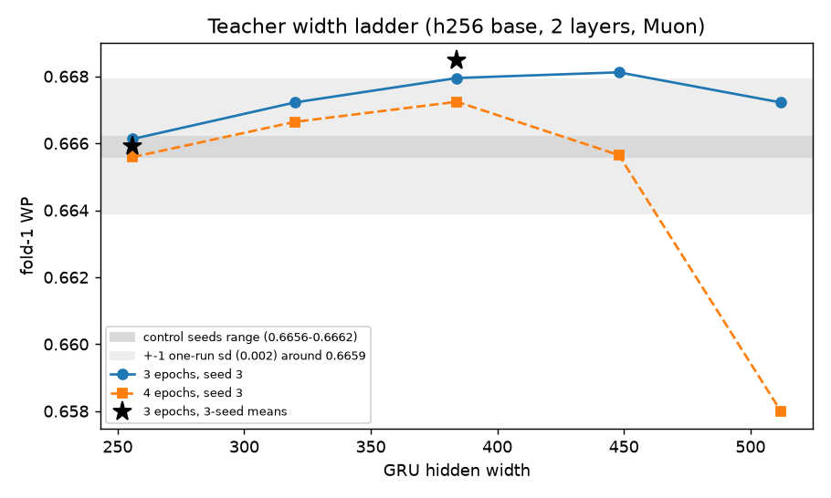
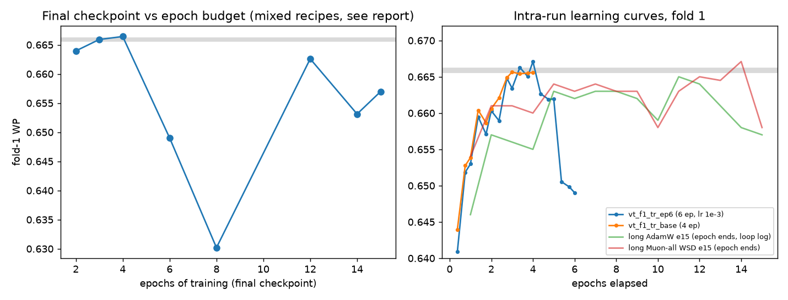
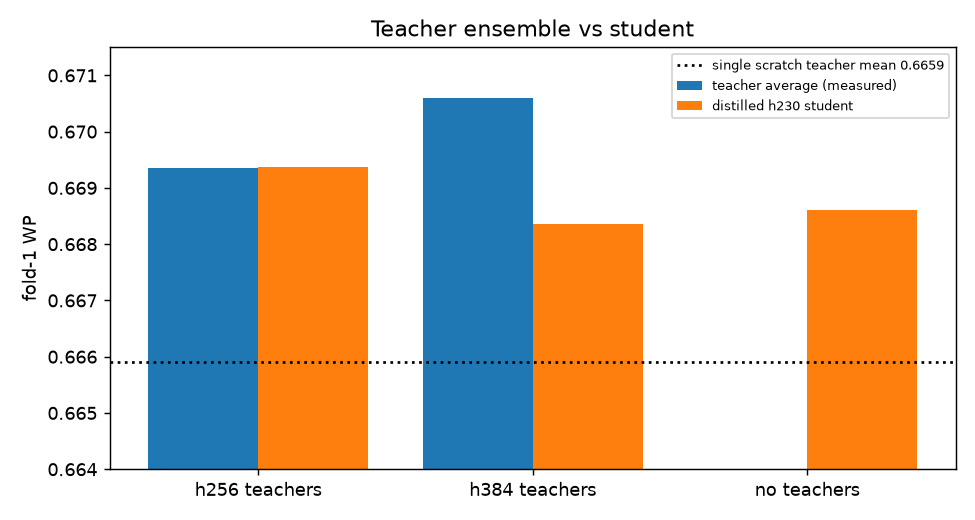
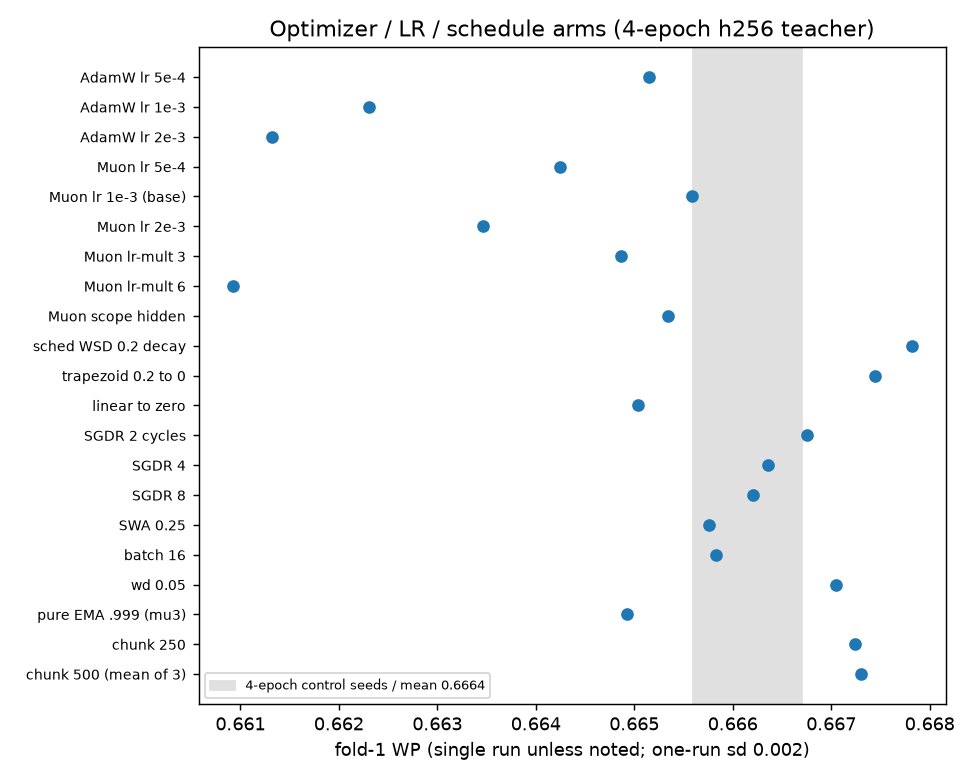

# Scaling deep dive (2026-10-11): why training did not scale, what we tried

Status: draft 1, evidence-based. All WP numbers are official `global_wp_clip2_v1`, fold 1 unless stated, rescored on 2026-10-11 with `scripts/score_prediction_remote.py` (names in backticks are `cache/pred_<name>_valid.npy`) or quoted from [LOOP_LOG_20261010.md](LOOP_LOG_20261010.md) (marked "log"). Noise: control seeds 0.6656-0.6662 (3-epoch h256 seeds 0.66613/0.66578/0.66582, 4-epoch seeds 0.66559/0.66675/0.66778), seed sd ~0.001, one-run comparison sd ~0.0022 ([hpo/VALIDATION_PROTOCOL.md](../../../../hpo/VALIDATION_PROTOCOL.md)). Anything under ~0.002 on one run is not resolved. Exact CLIs: [refill_jobs_b/*.json](../vast_teachers_r1/refill_jobs_b), [make_refill_jobs.py](../vast_teachers_r1/make_refill_jobs.py), base recipe in [build_bundle.py](../vast_teachers_r1/build_bundle.py): 2-layer GRU h256, Muon on recurrent matrices (`--muon-scope rnn`), lr 1e-3, wd 0.01, one-cycle, batch 32, chunk 1000, wmse, prop-power 2, 10,607 training sequences, fp16. Plot script: [scaling_plots/make_plots.py](scaling_plots/make_plots.py).

**Short answer.** The scratch teacher saturates at ~0.667 (3 epochs) / ~0.6664 (4 epochs), and every recipe-level scale lever (width, depth, epochs, lr, schedule, optimizer, chunk, dropout) lands within about +-0.002 of that. The one clearly resolved scaling effect is negative: more epochs or very wide nets overfit (collapse of 0.01-0.03). Ensembling several seeds (+0.002 to +0.004) is worth more than any single-model scaling. The student already matches its teacher ensemble when the teachers are width 256, so teacher scaling does not reach it.

## 1. Teacher scaling

### 1a. Width (fold 1, seed 3 unless noted)

| width | 3 epochs | 4 epochs | notes |
|---|---|---|---|
| 256 | 0.66613 (mean of s3/4/5: 0.66591, sd 0.0002) | 0.66559 (s4 0.66675, s5 0.66778) | base |
| 320 | 0.66722 | 0.66664 | `vt_f1_h320_e3`, `vt_f1_gru320` |
| 384 | 0.66795 (s4 0.66931, s5 0.66816; mean 0.66847, log+scored) | 0.66724 (s4 0.66802, s5 0.66670) | |
| 448 | 0.66812 | 0.66565 | |
| 512 | 0.66722 | 0.65800 (-0.0084) | 512 at 4 epochs also 0.66187 with dropout 0.2 |

Measured: at 3 epochs the curve rises ~+0.002 from 256 to 384-448 and is flat/down at 512. At 4 epochs it peaks at 384 and 512 collapses, so the width optimum shifts with the epoch budget (bigger nets overfit sooner).

Cross-fold confirmation (rescored):

| fold | recipe | h256 | h384 | delta |
|---|---|---|---|---|
| 1 | 3 ep, 3 seeds | 0.66591 | 0.66847 | +0.0026 |
| 0 | 3 ep, **3 seeds** (`combo_scratch_f0ep3s3/4/5` vs `f0h384ep3s3/4/5`) | 0.67881 (0.67779/0.67880/0.67985) | 0.67827 (0.67877/0.67829/0.67776) | **-0.0005** |
| 2 | 3 ep, seed 3 | 0.70283 | 0.70324 | +0.0004 |
| 3 | 3 ep, seed 3 | 0.70676 | 0.70737 | +0.0006 |
| 0 | **4 ep**, seed 3 (`vt_f0_gru256/384/512`) | 0.67762 | 0.66955 | -0.0081 (512: 0.66125, -0.0164) |
| 2 | 4 ep | 0.70101 | 0.69563 | -0.0054 |
| 3 | 4 ep | 0.70208 | 0.69940 | -0.0027 |

Correction to the log: the "+0.0010 on fold 0" came from one seed; with three seeds per side fold 0 shows no width gain (-0.0005). Inferred honest summary: at 3 epochs width 384 is worth 0 to +0.0026 (fold-mean about +0.001, not distinguishable from zero); at 4 epochs it is harmful on three of four folds (fold 1 was the lucky one). Depth: x3 0.66774, x4 0.66699, 320x3 0.66456 at 4 epochs (base 0.66559, mean 0.6664): no gain; HPO depth-3 trials pruned at 0.6655-0.6657 (log).

### 1b. Epoch ladder

| epochs | final WP | run | source |
|---|---|---|---|
| 2 | 0.66395 | HPO anchor | log pass 2 |
| 3 | 0.66591 mean (3 seeds) | `snap_ctrl_e3`, `combo_scratch_ep3s4/s5` | scored |
| 4 | 0.66642 mean (4 seeds) | `vt_f1_tr_base` etc. | log/scored |
| 6 | 0.64903 (peak 0.66709 at end of epoch 4 = 4th snapshot; 0.66194 at 5, 0.649 at 6) | `vt_f1_tr_ep6` | `artifacts/runs/vt_f1_tr_ep6/snapshot_curve.jsonl` |
| 6 + pure EMA, Muon x3 | 0.65361 (raw control 0.65339; with dropout 0.2: 0.65566) | `ema6_mu3`, `raw6_mu3` | scored |
| 8 + EMA, mu3 | 0.63019; h512 mu0.5 EMA 8 ep: 0.58657 | `ep8_mu3_ema`, `gru512_ema_ep8` | scored |
| 12 (Kaggle, stable lr 4e-4 + SWA) | 0.66259 ; thin+Muon e12 0.65547 | Kaggle kernel v2 | log pass 78 |
| 14-15 | AdamW e15 0.65696; Muon-all e15 0.65827; Muon-all WSD e15 0.65844 (peak 0.6671 at epoch 13); Muon rnn e15 0.66053; stable+SWA e14 0.65312 | `vt_f1_long_*` | scored / log pass 60 |

Reading: the intra-epoch curves show learning is essentially complete by epoch 2-3 (0.6606 after epoch 2, 0.6657 after epoch 3 in the 4-epoch run), the 6-epoch run peaks at the epoch-3/4 boundary (0.667) and then falls monotonically, and the 15-epoch runs (lower lr 5e-4, wd 0.1) oscillate in a 0.658-0.665 band and never beat the 3-epoch recipe. The 6-epoch EMA claim from the teammate (+0.0016) did not reproduce (EMA 0.65361 vs raw 0.65339, i.e. no rescue). The decline is in the low-lr tail, consistent with per-sequence memorisation (inferred: not isolated by a mechanism test). Mid-epoch snapshots equal epoch ends (log pass 30), so the sharp one-snapshot peaks are real checkpoint-to-checkpoint variation of ~0.002-0.004, the size of selection noise.

### 1c. Data size
**Not measured.** The dataset ladder arms (`data8400_e3/e4`, `data8400_wd126`, `data_full_wd85`, backlog ids in [IDEA_BACKLOG.json](../backlog/IDEA_BACKLOG.json)) are queued, no predictions exist yet. Indirect facts: ~10.6k sequences of 20,000 strongly autocorrelated rows (labels change every ~9.5 rows, long-run labels persist hundreds of rows); the all-data finals use ~11.9k sequences (+12%); `prop-power 0` (broader training weights, effectively more usable data) gave +0.0015 over 3 seeds on fold 1 and +0.0035 on fold 0 (one seed), the only recipe-level gain that replicated; I read it as weak evidence the teacher is data-limited (inferred).

## 2. Student scaling

Students are the serving-sized h230 2x256-wide-GRU lineage: warm start from the scratch parent, AdamW lr 1e-4 one-cycle, distill alpha 0.7, four-family targets ([solution report](solution_report/CURRENT_BEST_SOLUTION_EXPLAINED.md)). Measured fold 1:

| variant | WP | note |
|---|---|---|
| no teachers (`dsq_none`) | 0.66861 | parent-only warm continuation |
| h256 teachers s4,s5 (`dsq_t256`) | 0.66938 | teacher avg 0.66936 |
| h384 teachers s4,s5 (`dsq_t384`) | 0.66836 | teacher avg 0.67059; **teachers were 4-epoch, not the matched 3-epoch h384** |
| mix 384+448 teachers (`dsq_mix`) | 0.66840 | |
| 2-epoch one-cycle student s3 / s4 | 0.66882 / 0.66913 | seed sd ~0.0003-0.0005 |
| 3-epoch student (best) | 0.66923 | |
| 12-epoch student (lr 4e-4, wd 0.05, SWA) | 0.66843 | 4x longer: -0.0008 |
| alpha 0.5 | 0.66919 | |
| family off / floor / expanded12 / lr 2e-4 / soup / WSD | 0.66888 / 0.66885 / 0.66895 / 0.66907 / 0.66888 / 0.66886 | all within 0.0010 of each other |
| stage order broad2strong / strong2broad / tail p15 | 0.66858 / 0.66838 / 0.66827 | |

Number of teacher seeds: not varied in a controlled student-level ladder (always 2 seeds or four families). Teacher-side ensemble scaling is measured (scored here): 3-epoch h256, 1/2/3 seeds 0.66613 / 0.66712 / 0.66749; h384 3-epoch 1/2 seeds 0.66931 / 0.67020; 4-epoch h256 3 seeds 0.66935; 4-epoch h384 3 seeds 0.67166 (+0.0044 over the single-run mean); 3-seed prop0 0.66924; 320+448+512 widths 0.66968; mix of 3x256+2x384: 0.66925. Student width beyond 230 was never trained (serving limit, native kernel tuned for 256); the wide student path is untested and is the largest missing student-scaling arm. The four family targets correlate 0.95-0.99 and are a fixed linear mix, so family weights cannot move the target by more than a few percent (log pass 14). Transfer efficiency: the h256-teacher student equals the teacher-pair average (0.66938 vs 0.66936); for 384 teachers the student loses 0.0022 against the teacher average, so the h230 student, not the teacher, is the bottleneck (inferred; a matched `w12_t256n`/`t384n` pair is queued and has not landed). Fold 0: `dsq_f0t256` 0.68013, `none` 0.67995, `t384` 0.67791, again flat.

## 3. Optimiser, LR and schedule history

Base is Muon (rnn matrices), lr 1e-3, one-cycle. Findings, 4-epoch teacher, single runs (mean 0.6664, one-run sd 0.0022): AdamW is worse than Muon at all three lrs (0.66515 at 5e-4, 0.66231 at 1e-3, 0.66132 at 2e-3); Muon lr 5e-4 0.66425 and 2e-3 0.66346 (base 1e-3 is at the optimum of a flat ridge); `--muon-lr-mult` 3 / 6 give 0.66487 / 0.66092 (h384: 0.66255 / 0.65650), so the teammate's Muon multiplier hurts here; scope `hidden` 0.66534, `all` at 3 epochs 0.66720 / 0.66605 (control level), h384+all 0.67021 (best scratch single, n=1). Schedules: WSD 0.66782, trapezoid 0.66744, linear-to-zero 0.66504, SGDR (2/4/8 cycles) 0.66675 / 0.66636 / 0.66621, SWA 0.25 0.66576, pure EMA 0.999 (4 ep) 0.66493, batch 16 0.66583, wd 0.05 0.66705 (wd 0.0035 inside HPO trial 52), chunk 250 / 500 0.66724 / 0.6673 (3 seeds), dropout 0.2 / 0.3 at h256 3 epochs 0.6653 / 0.66477 (null/negative), head lr 0.3x / 3x 0.66702 / 0.66659. WSD is the only schedule with two positive reads (+0.0012, +0.0008) but within noise. HPO teacher_v2 (stopped by the user): 24 complete, 32 pruned trials; top objectives 0.6690 (t52), 0.6688 (t35), 0.6682, 0.6678 ... a 0.003 spread equal to the noise, and t35 re-run with seed 4 gave 0.66234 (winner's curse). Long-run regimes (lr 4e-4 to 5e-4, wd 0.03-0.1, Muon all/rnn, AdamW, WSD, stable+SWA, thinning) all ended 0.653-0.661 final.

**Never tested** (arms queued as `scale_b16_lrsqrt/lrlin` (batch 16, lr 7e-4 / 5e-4), `scale_b64_lrsqrt/lrlin` (batch 64, lr 1.4e-3 / 2e-3), `data8400_*`, `data_full_wd85_*`; rationale in [LR_AND_DATA_SCALING_LITERATURE_20261011.md](LR_AND_DATA_SCALING_LITERATURE_20261011.md)): batch-size/lr scaling rules per optimiser (only one batch-16 run at unchanged lr, 0.66583), data-size-aware weight decay (Wang-Aitchison lambda ~ 1/N), epoch-defined EMA/SWA windows, Muon update-RMS convention (Moonlight 0.2 sqrt(max) vs Keller), lr/wd re-tuning per width (the width ladder reused lr 1e-3 for h512, a probable confound for the 512 collapse), warmup fraction. Because lr and wd were tuned at width 256 and 4 epochs only, "wide nets do not help" is partly "untuned wide nets do not help".

## 4. Diagnosis

| hypothesis | for | against / not tested |
|---|---|---|
| Data-limited / memorisation (10.6k autocorrelated sequences) | epoch peak at 3 then monotone decline; all long runs worse; width 512 and 4-epoch 384 collapse on 3 folds; prop-power 0 (+0.0015) helps; dropout does not | data-size ladder not run; dropout/thinning/SWA fail to rescue long runs, so not a pure capacity-regularisation story |
| Label noise / information ceiling | oracle sign gives 0.843; lookahead ladder 0.666 (0) -> 0.680 (2) -> 0.891 (128) -> 0.960 (512): the causal task is forecasting; fields' top is 0.672 | says nothing about how much the past still holds; no ceiling claim |
| Selection noise dominates | one-run sd 0.0022; chunk500 +0.0020 -> +0.0009 over seeds; fold-0 width +0.0010 -> -0.0005 over 3 seeds; hpo35 0.6688 -> 0.6623 | does not explain the large negative effects |
| Ensembling beats scaling single models | 3-4 epoch h384 triple 0.67166, h256 triple 0.66935; pair gains +0.001 to +0.004; student only matches teacher pair | blending gains saturate (greedy 1->2->3 members 0.6711/0.6733/0.6734) and need serving speed |
| Student is the bottleneck (h230, warm start) | 384 teachers avg 0.67059 -> student 0.66836; 256 teachers student = teacher avg | wide student never trained; matched 3-epoch h384 transfer test not landed |
| Hyperparameters are mistuned for scale | lr/wd tuned at h256, 4 ep; 512 uses same lr | HPO over 24 trials showed no structure beyond noise; no per-width tuning done |
| Optimiser is limiting | Muon > AdamW by ~0.003 | Muon scope/multiplier variants null or negative |

**Five most promising scaling directions (predicted gain are my judgement, not measurements):**
1. Serving-size seed ensembles from the fast int8 kernel (3 members, h384 or best h256): +0.002 to +0.004 over a single model (measured teacher-level ensembles above; bounded by saturation).
2. Wide student (h384 warm start from h384 teachers, matched 3-epoch teachers): 0 to +0.002; kills the 0.0022 transfer loss if the student, not the teacher, is the limit.
3. Epoch-coupled width/lr/wd re-tuning (h384-512 at 3 epochs with Wang-Aitchison wd and a lr sweep, queued `scale_*`): 0 to +0.002; low confidence.
4. Data-side scaling: prop-power 0 / label-weight floor (`prop0_lwfloor` 0.66876 single) and the data-size ladder to price more data: +0.001 to +0.002, replicated sign on two folds.
5. Anti-memorisation regimes enabling longer training (row thinning, random-phase windows, chunk cycling with EMA over epochs): 0 to +0.002; current thin/EMA/SWA arms were null, so lowest prior.

Beyond these, larger moves need new information or architecture families, not scale; combined small gains (about +0.004-0.005 if additive) would give ~0.670-0.671, not 0.700.
