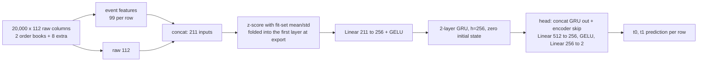
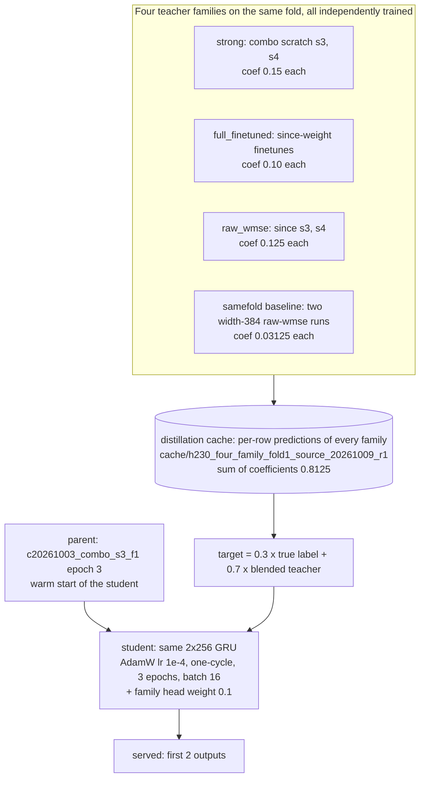

# Current best local solution, explained (2026-10-10)

Scope: what the best local-validation model is, how the data become predictions, how it is trained and distilled, what HPO does, and what the numbers do and do not support. Everything cited is a file in this repository; plots are generated by [`scripts/make_solution_report.py`](../../../../../scripts/make_solution_report.py) and [`scripts/extract_train_loss.py`](../../../../../scripts/extract_train_loss.py) from saved predictions, logs and ledgers (nothing is redrawn by hand).

**One-sentence summary.** A 2-layer GRU (width 256, no attention) over 211 per-row inputs is first trained from scratch as a *teacher* (Muon on the recurrent matrices, one-cycle schedule, weighted-MSE on the official metric weights), then a *student* with the same architecture is warm-started from a teacher and fine-tuned for 3 epochs on a blend of the true labels (30%) and the averaged predictions of four teacher families (70%). The student is what is served (one core, about 74 µs/row in the native int16 kernel).

---

## 1. Data and what the 112 columns are

* Each sequence is 20,000 rows × 112 anonymous float columns; two targets (t0, t1) per row; the metric is scored only on rows ≥ 99 and where the official mask is true. Data: `datasets/train.parquet` (about 10.6k sequences), `datasets/valid.parquet` (1,873 sequences, 4 component-disjoint folds, fold 1 = 457 evaluation sequences in 149 components (older notes say 468)). Sequences are consecutive 20k-row chunks of 3,288 continuous streams ([findings](../../../../../research/findings-2026-09-26.md)).
* The column layout is an **order book of two instruments** ([`src/wnn/data.py`](../../../../../src/wnn/data.py)): per instrument 11 bid prices, 11 ask prices, 11 bid volumes, 11 ask volumes, 4 trade prices, 4 trade volumes (52 columns; instruments at offsets 0 and 52) plus 8 extra columns (104-111). Prices and volumes are quantile-transformed; many columns are held constant between updates (multi-rate clocks: blocks update on 12%, 15%, 31%, 40%, 70% or 100% of rows).
* Targets are trade PnLs against a common future price F: `t0 = F - ask`, `t1 = bid - F`; the label is piecewise constant in time (mean run 9.5 rows) and defined by the **future** book. A teacher that may see future rows scores far higher (section 9).
* Metric `global_wp_clip2_v1` ([`src/wnn/gmetric.py`](../../../../../src/wnn/gmetric.py)): Pearson pooled over rows and both targets with weights |clip(y, 2)|, both prediction and target clipped to ±2.

### Event features (99 per row; [`src/wnn/features.py`](../../../../../src/wnn/features.py))
First differences of the instrument-0 price block, instrument-0 volume block and instrument-1 price block (22 + 22 + 22), eight event flags (price move, bid/ask volume change, trade price/volume, instrument-1 price/volume/trade), three "rows since last event" counters, and the last non-zero price difference (22). They are computed causally inside the trainer (`event_features_torch`) and by the native engine at serving. Inputs total 112 + 99 = **211** (the `normalization_identity` shape in every `history.json`).

## 2. Architecture (and the attention question)

* **No attention in the best model.** Source: [`RNNModel` in `src/wnn/nn.py`](../../../../../research/campaign_2026-10-06/bandit_continuation/continuous_execution_E529/h230_source_v6_lead/src/wnn/nn.py) with `enc=linear`. A token-attention encoder (`enc=tokens`, PyTorch `nn.TransformerEncoderLayer`, per-block tokens with a CLS token) and a causal conv encoder exist as research options; they are not in the served model (the native engine supports the linear encoder only) and did not help.
* **Encoder:** `Linear(211 -> 256)` then GELU (`z`). Input normalisation uses a fit-set mean/std buffer; at export the normalisation is folded into this layer so zero raw inputs can be skipped column by column.
* **Recurrent core:** PyTorch `nn.GRU(256, 256, num_layers=2, batch_first=True)` (cuDNN fused). **State:** the initial hidden state is zero (`h=None`); it is reset at the start of every sequence; during training a sequence is processed in chunks of 1000-2000 rows with the state carried from chunk to chunk and **detached** (truncated BPTT), so gradients reach back one chunk only. At serving the native engine carries the state row by row and resets it at the sequence boundary.
* **Head:** `[GRU output ; encoder output z] -> Linear(512,256) -> GELU -> Linear(256, n_out)`. `n_out` is 2 plus training-only auxiliary columns (structure head, next-change head, and for students a four-family head); only the first two outputs are served.
* **Size:** about 1.04 M parameters at width 256 (log line `params 1.04M`). Width 384 is about 2.2× the cost per row and is not servable on the current kernel (733 µs/row vs 74 µs/row).

## 3. Teacher training (from scratch)

Recipe of the default "scratch teacher" (`DEFAULTS` in [`hpo/space.py`](../../../../../hpo/space.py), a launched command in [`local_queue_r1/done/66_f0ep3s5-fit.json`](../local_queue_r1/done/66_f0ep3s5-fit.json)):

| Item | Value |
|---|---|
| Optimizer | **Muon on the GRU weight matrices** (`weight_ih`, `weight_hh`; Newton-Schulz orthogonalisation, 5 steps, bf16; scope `rnn`) and **AdamW** for the input layer, head and biases (`MuonAdamW` in `src/wnn/optim.py`); lr 1e-3, weight decay 0.01, Muon lr multiplier 1 |
| Schedule | OneCycle, 5% warm-up to the max lr, cosine decay to max_lr/(25·100) ([plot](plots/lr_schedules.png)); 3-4 epochs |
| Batch | 32 sequences per step, chunk 1000 rows (20 optimizer steps per sequence), 373 batches and 7,460 optimizer steps per epoch (11,949 sampled sequences), fp16 autocast with GradScaler (about 5 skipped updates per epoch) |
| Loss | weighted MSE on `y` clipped to ±2 with weights |clip(y,2)| (`--loss wmse`, chunk-normalised), the same weights as the metric; plus auxiliary structure (0.3) and next-change (0.3) heads |
| Row weighting | `--propensity`, `--valid-true-mask`: the official scored mask is only known for valid sequences, so training rows are weighted by an estimated probability of being scored (power 2, floor 0.03) and valid sequences use the true mask |
| Time | about 560-620 s per epoch on the local GPU, about 45 min for 3 epochs |

**What the logs and checkpoints keep.** Every run directory in `artifacts/runs/<run>/` (9.3 GB total) holds `model_ep{E}.pt` per epoch, `model.pt`, `training_state.pt`, `history.json` (per-epoch seconds, optimizer attempts/skipped steps, sample-order and normalisation hashes) and `provenance.json` (source and split hashes). **Validation is deliberately not computed during fitting** (`--no-eval-during-fit`: campaign rule), so `history.json` says `evaluation: withheld`; the learning curve is rebuilt afterwards from saved snapshots with [`scripts/snapshot_curve.py`](../../../../../scripts/snapshot_curve.py) ([plot](plots/learning_curves.png)). Training loss lives only in the text logs (`runtime/logs/*.log`, one line per 20 batches); until now it was not structured, so [`scripts/extract_train_loss.py`](../../../../../scripts/extract_train_loss.py) now parses it to CSV ([`train_loss_csv/`](train_loss_csv/), [plot](plots/train_loss.png)). Gap I recommend closing: persist the train loss in `history.json` per epoch.

Reading the curves: on fold 1 the default run reaches 0.666 by epoch 2-3; the 6-epoch run peaks at 0.6671 at the end of epoch 3 and then drops (0.662, 0.649), i.e. memorisation, not under-training. Mid-epoch snapshots are as good as epoch ends.

## 4. Student and distillation (the top local model)

* Recipe (launch file: [`done/72_h230-f1-s3-ep3-chunk1000-fit-r1.json`](../local_queue_r1/done/72_h230-f1-s3-ep3-chunk1000-fit-r1.json); the best student `h230_f1_s3_ep3` uses chunk 2000): `--init c20261003_combo_s3_f1@ep3`, `--distill-alpha 0.7`, `--distill-family-head --distill-family-weight 0.1 --distill-family-target-mode raw`, `--optim adamw --lr 1e-4 --sched onecycle --epochs 3 --batch 16`, no bootstrap substitution (`--distill-boot-h 0`).
* Why it works at all: the student is a *warm-started* copy of a good scratch teacher, then pulled toward the average of several differently trained teachers (their errors are only partly shared: pairwise correlation 0.95-0.99). It gains about +0.003 over a scratch teacher; the gain comes from the chain (parent + blended targets), not from the student knob settings (twelve variants span 0.0010, see [LOOP_LOG](../LOOP_LOG_20261010.md), student-stage evidence entry). Distilling wider (384) or ensemble teachers into the 256 student did **not** transfer.
* Files: cache builder [`scripts/build_distill_cache.py`](../../../../../scripts/build_distill_cache.py), pipeline [`scripts/distill_pipeline.py`](../../../../../scripts/distill_pipeline.py), cache metadata [`metadata.json`](../../../../../cache/h230_four_family_fold1_source_20261009_r1/metadata.json).

## 5. Validation: how scores are produced and how far to trust them

* **Folds:** 4 component-disjoint folds of the 1,873 valid sequences (a component = a chain of consecutive chunks of one stream, so no neighbour leaks). A fold-k run trains on `train` plus the valid sequences of the other folds and evaluates on fold k only ([`splits/fold1.json`](../../../../../research/campaign_2026-09-29/artifacts/splits/fold1.json)). Fold levels differ: about 0.668 / 0.679 / 0.703 / 0.707.
* **Noise (measured, [`hpo/VALIDATION_PROTOCOL.md`](../../../../../hpo/VALIDATION_PROTOCOL.md)):** seed-to-seed sd 0.0010; evaluation-unit noise of a paired difference sd 0.0018; one-run one-fold A/B comparison sd about 0.0022 (95% ±0.0043). Hardware drift about 0.0002.
* **Tiers:** T0 screen (fold 1, 1 run: kills disasters only), T1 dev (folds 1 and 0, fold-difficulty adjusted), T2 confirm (folds 2 and 3 reserved, one evaluation per finalist), T3 train-holdout veto, T4 public (lineage level only).

## 6. HPO: what it is, what it tunes, how it is validated

* **Yes, hyper-parameter optimisation:** Optuna TPE with durable SQLite + event log ([`hpo/studies/teacher_v2/`](../../../../../hpo/studies/teacher_v2/), code in [`hpo/`](../../../../../hpo/)), a MedianPruner, ask/tell over Vast lane B, a duplicate-proposal guard and per-tick seeding.
* **Parameters (space v2, [`hpo/space.py`](../../../../../hpo/space.py)):** optimizer (`muon_rnn` / `muon_hidden`), lr 6e-4..2e-3, Muon multiplier 0.5..2, weight decay 3e-3..6e-2, schedule (`onecycle`, `wsd_sqrt`, `wsd_linear`, `sgdr`) with its conditional knobs, epochs {2,3,4,5}, width {256,320,384}, layers {2,3}, RNN init (`default`, `chrono`, `orth`, `chrono_orth`), loss (`wmse`, `wmse_gcorr`, `mix`), class-3 weight 0.7..2.5, weight averaging (none/EMA/SWA), dropout 0..0.25. Seeds are never searched.
* **Validation inside HPO:** each trial runs on dev fold 1, then fold 0; the objective is the mean of the two with fold 0 reduced by the fold-difficulty offset (prior 0.0131, re-estimated from trials that have both). Pruning compares after fold 1. Folds 2 and 3 are **never** used for search; `orchestrator confirm` runs the top finalists once on them (pre-registered rule: confirm if mean delta ≥ 0 and class-3 delta ≥ 0).
* **State today (56 asked, 50 told: 18 complete, 28 pruned, 4 failed):** best by objective: trial 35 (0.66876: muon_hidden, lr 1e-3, WSD-linear, h384, dropout 0.16, SWA), 27 (0.66779, 3 layers, wmse_gcorr, class-3 weight 2.45), 46, 41, 13. T2: trial 2 (h384) 0.70737 on fold 3; trial 27 0.70249 on fold 2.

### The "delta +0.002" evidence ([`hpo/evidence/scratch_effects_fold1.json`](../../../../../hpo/evidence/scratch_effects_fold1.json), [`scripts/evidence_report.py`](../../../../../scripts/evidence_report.py))
It compares 47 scratch models on fold 1 against the mean of four default-recipe runs (0.66642, seed sd 0.00106). The largest raw deltas are +0.0028 (h384 with dropout 0.2), +0.0022 (gated), +0.0017 (h384 fixed-mix), +0.0016 (h384). **All 95% intervals cover zero** (about ±0.005: component bootstrap and seed noise in quadrature), and after empirical-Bayes shrinkage (true-effect sd 0.0015 vs measurement sd 0.0024) they are +0.0003..+0.0006. They are therefore *hypotheses*, not findings.

How we use it: (1) it set the decision thresholds and narrowed the HPO space (epochs ≤ 5, no corr/Huber/TCN, width ≤ 384); (2) the consistent sign of width 384 across **four** folds (mean +0.0012) is the only lever that survived; (3) the high-raw-delta variants (h384+dropout, gated) are the candidates worth a confirmation on reserved folds 2/3 and a place in a *diverse* ensemble, not a ranking claim; (4) it fixes how many runs a claim needs (about 4 folds × 3 seeds per arm for ±0.002).

## 7. Local validation: which result is the best example

Fold 1 (457 evaluation sequences, 149 components; bootstrap over components, 1000 draws; paired intervals against the matched control `r3_ctrl_f1_s3_e3`, produced by [`make_solution_report.py`](../../../../../scripts/make_solution_report.py), table in [`fold1_ci.json`](fold1_ci.json)):

| Model | Fold-1 WP | 95% CI (unpaired) | Δ vs control s3 | 95% CI of Δ (paired) |
|---|---|---|---|---|
| student: distilled from h256 scratch teachers (`vt_f1_dsq_t256`) | 0.66938 | [0.6229, 0.7127] | +0.0033 | [+0.0011, +0.0059] |
| **student: H230 ep3, four teacher families (`h230_f1_s3_ep3`)** | **0.66922** | [0.6220, 0.7125] | **+0.0032** | **[+0.0016, +0.0049]** |
| teacher: scratch h384 chunk500 3 ep | 0.66900 | [0.6217, 0.7113] | +0.0029 | [+0.0004, +0.0057] |
| student ep3 + bootstrap 8 | 0.66821 | [0.6215, 0.7119] | +0.0022 | [+0.0004, +0.0041] |
| teacher: scratch default (v6 trainer) s3 / s4 | 0.66606 / 0.66582 | | 0 / -0.0002 | [-0.0022, +0.0015] |

**Best example to explain: `h230_f1_s3_ep3`** (fold-1 WP 0.66922). It is the only model whose paired improvement over the control is large relative to its interval (+0.0032, lower bound +0.0016) and it has the cleanest provenance (one declared parent, four independently trained teacher families, fixed coefficients). The unpaired intervals (±0.045) are wide because sequences differ hugely in difficulty; paired differences are what matter. Caveats: this is one seed and one fold, the paired interval measures evaluation-unit variation only (add training-seed sd 0.001), the fold is exposed after many selections, and the public score of the corresponding fold-1-held-out student family was 0.6639 (P2) - local differences of +0.003 have not reliably transferred.

## 8. Serving

Native Rust engine ([`native/src/rnn_fast.rs`](../../../../../native/src/rnn_fast.rs), int16 weight panels, AVX2, normalisation folded into the first layer, event features computed in the engine, state reset per sequence, deterministic). About 74 µs/row for width 256 on one core; about 33-37 min for the 39M-row test when run alone on the portal. A package is accepted only after Python 3.11 offline checks, ABI, reset/determinism and prediction agreement (corr ≥ 0.99998 with the GPU model).

## 9. Why the ceiling is where it is (new this session)

With the same GRU and *future* rows visible the score is 0.666 (causal), 0.680 (2 rows ahead), 0.711 (8), 0.780 (32), 0.891 (128), 0.960 (512). The label is a smooth function of a long future path, so the causal model is a price-move **forecaster**; recipe knobs (chunk length, bootstrap, snapping columns, width, epochs) all moved the score by ≤ ±0.001-0.002. See [LOOP_LOG pass 33-38](../LOOP_LOG_20261010.md) and [SANTANDER_LESSONS_AND_SERVING_SPEED](../SANTANDER_LESSONS_AND_SERVING_SPEED_20261010.md).

## 10. Where to read next
* Current state and decisions: [`specs/current-state.md`](../../../../../specs/current-state.md), [`LOOP_LOG_20261010.md`](../LOOP_LOG_20261010.md), [`CONTRACT_R3_TEACHER_CEILING_20261010.md`](../CONTRACT_R3_TEACHER_CEILING_20261010.md).
* Hypotheses H-321..H-339: [`research/hypotheses.jsonl`](../../../../../research/hypotheses.jsonl).
* Ideator outputs: [`external_ideation_20261010/`](../external_ideation_20261010/) (SYNTHESIS, round 2 and 3, BNP and own-notes mining).
