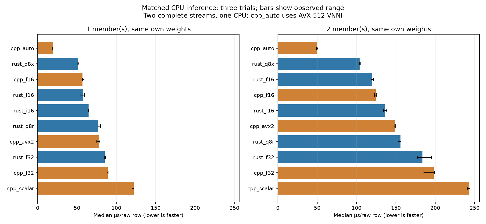

# E525 — CPU engines, GPU training utilization and research throughput

The measured recommendation is to keep our Rust serving engine, improve its independently written quantized kernels, and keep PyTorch/cuDNN as the GPU training baseline. Switching implementation language has not demonstrated a meaningful advantage at the same floating-point precision. The large measured C++ integer8 advantage is chiefly a different numerical policy and a hardware-specific VNNI path. For training, input delivery and recurrent backward work offer much more measured opportunity than optimizer arithmetic.

This report separates completed measurements, hardware-supported options, and experiments still needed. No training-quality improvement or public-score forecast follows from an engine timing. Our public best remains 0.6660. The C1 single-model ZIPs are separately validated candidates, not publicly scored results.

## What was actually compared

The CPU benchmark used our independently trained C1 seed3 and seed4 GRU256×2 weights, the identical two complete 20,000-row raw streams, one pinned CPU, row-at-a-time `step`, complete sequence resets, equal fixed ensemble weights, 128-row warmup, and three trials with rotated/reversed case order. All repeated complete outputs were bitwise identical within each engine. Reference output came from our own CPU float32 Torch model.

Our production Rust ABI3 library came from the existing public-best package. An audited own Python3.11-compatible q8 repair library supplied the additional Rust q8 paths. Maxim's reference engine was built outside our project from commit `833aaf541155c591e930bbc6c640b8817e01a536`, wave16/native-sparse, which the inspected later build script uses. It received **our weights**, not teammate weights. Its source/library is isolated reference material; no teammate implementation is added to our production source or submission.

The host is an Intel i9-11900H with AVX2 and AVX-512 VNNI. C++ was built with GCC12.2, `-O3 -march=x86-64-v3 -mtune=generic`, plus its runtime ISA dispatch. Python3.11.16, NumPy2.2.6 and PyArrow19.0.1 were used. CPU support tasks ran within one CPU and at most1.5GB RAM. These compare the delivered implementations on this host, rather than prove a language-wide ranking or a public scorer runtime. There was no gradients/optimizer work in this CPU benchmark.

Exact weights/data/library/source hashes and every trial are in [matched float/16-bit results](matched_engines_v1.json), [quantized results](matched_quant_engines_v2.json), and their executed scripts. The v1 executed source is preserved separately as `benchmark_engines_v1.py`; the additional quantized run used `benchmark_engines.py`. Original v1 prediction files were preserved before the second run reused the historical output names.

## Measured CPU timing

Median microseconds per raw row; lower is better. Parentheses show the three-trial observed range where provided. Whole-sequence warmup/reset behavior and Python call cost are included in the native step replay; the full competition callback/archive path is not included.

| Engine / policy | One member | Two members | Maximum output error versus own CPU float32, one member |
|---|---:|---:|---:|
| Rust float32 |85.17 (85.04–86.12)|183.80 (177.31–195.43)|0.00000149|
| C++ float32 |88.89 (88.18–89.73)|197.89 (185.65–199.02)|0.00000131|
| Rust float16 weight storage |57.49 (54.85–59.73)|119.81 (118.53–121.71)|0.0004265|
| C++ float16 weight storage |57.06 (57.01–59.08)|124.36 (122.97–125.43)|0.0003594|
| Rust i16 weight storage |64.79 (64.37–64.93)|136.18 (134.23–138.28)|0.00007534|
| Rust q8r: byte weights, int16 activations |76.91|155.68|0.01613|
| Rust q8x: byte weights, int16 activations |51.38|103.75|0.01726|
| C++ dynamic int8, automatic VNNI |19.33|49.49|0.07182|
| Same C++ dynamic int8, forced AVX2 |77.86|149.09|0.07182|
| Same C++ dynamic int8, scalar |122.02|243.30|0.07182|

The first measurement of C++ automatic int8 was17.43/50.21µs; the separate quantized cohort measured19.33/49.49µs. Report cohort variation rather than select the fastest result. For the same C++ quantized policy, forcing AVX2 costs about4.0× for one member and3.0× for two versus automatic VNNI. Rust q8x is about1.52×/1.44× faster than that C++ AVX2 path, while C++ VNNI is about2.66×/2.10× faster than Rust q8x. These cross-engine integer comparisons use different activation precisions; they are implementation tradeoffs, not exact equal-precision arithmetic tests.

### Exact floating-point policy matters

Float32 is a genuinely aligned complete-matrix precision comparison: both implementations closely match the same CPU reference. Rust's medians are a little lower here, but three trials on one host with frequency/cache effects do not establish a universal language advantage.

Both nominal float16 paths store their recurrent and first-readout matrices as IEEE binary16 and perform arithmetic/state updates in float32. **They are not GPU FP16 arithmetic.** The existing Rust path additionally rounds the folded input projection; the C++ path normally keeps that projection float32. Therefore the initial float16 table compares current production policies, not perfectly identical per-layer precision assignments. A separate strict policy run removes this difference: fold normalization once, set mean0/std1, and give both engines identical represented binary16 input/recurrent/first-head matrices with float32 biases/state/final head. Its medians were **57.42 vs59.65µs** for one member and **116.02 vs121.34µs** for two (Rust vsC++); maximum cross-engine differences were4.77e−7 and3.58e−7. Its exact results are in [STRICT_FP16_POLICY_COMPARISON_V1.json](STRICT_FP16_POLICY_COMPARISON_V1.json). This is the decisive same-precision follow-up, rather than concealing the initial policy difference.

The current Rust i16 path stores per-row-scaled signed16 weights but widens them into float32 multiplication. Its smaller observed error than binary16 costs latency here. That is a useful precision/runtime option for robust serving. Integer8 weights are neither FP8 floats nor a universal precision-equivalent alternative. Quantized activation scale, accumulation type, layer exclusions, clipping, rounding and state dtype must be declared alongside bit width.

All precision candidates were additionally evaluated under the official fixed mask on these same two exposed sequences: [precision-quality diagnostic](PRECISION_QUALITY_DIAGNOSTIC_V2.json). Tiny WP differences, including positive C++ int8 differences, are diagnostics only; this small sample cannot select a new public champion. Maximum error and metric effect answer different questions. A candidate need not reproduce float32 to3e−4 if it is deliberately a different quantized model, but it must validate its own intended representation and its served quality. Both f32 engines pass that numerical reference gate. The existing i16 C1 delivery gate also passed separately.

### What profiling says to optimize

Four15-second native sampling profiles are saved in [plots/](plots/): Rust i16, Rust q8x, C++ VNNI and C++ AVX2. They can be opened with [Speedscope](https://www.speedscope.app/). [NATIVE_PROFILE_SUMMARY_V1.json](NATIVE_PROFILE_SUMMARY_V1.json) preserves weighted leaf-frame counts. About84% of Rust samples land in inlined recurrent matrix/state closures; in C++ VNNI about70% land in its matrix-vector kernel and12% in the input projection. The AVX2 C++ run places about65% in GEMV and32% in the enclosing predictor. Startup is included, and inlining prevents a clean decomposition of every Rust closure into matrix, activation and packing costs.

This supports a narrow, independently written Rust integer8/VNNI dispatch experiment, retaining AVX2/scalar fallbacks, plus profiling layout/reuse of activation quantization across matrices. It does not support rewriting the entire project into C++. Before promotion: scalar integer oracle, overflow/rounding tests, actual full-sequence quality, forced fallback tests, CPU-only Python3.11 ZIP validation and runtime on the scoring hardware class. The scoring CPU's ISA is not established by this laptop. Preserve i16 as a conservative candidate until those comparisons land.

## Measured training utilization: current local H230 profile

The own heterogeneous-distillation student profile completed: GRU256×2,31 outputs, batch16,20,000 rows/sequence,2,000-row chunks,fp16,zero loader workers,3warmup+20timed batches. This was resource-only: no checkpoint, fit or score. [Exact resource/timing receipt](../wide_baseline_heterogeneous_H230/H230_PROFILE_RESULT_V1.json).

| Quantity | Measured median / peak | Implication |
|---|---:|---|
| End-to-end outer-batch interval |1095.08ms;14.61sequences/s|Useful whole-step baseline; p90 was not emitted.|
| CUDA event total |675.80ms|Device-stage timing, not hardware utilization percentage.|
| Forward |245.16ms|Recurrent path and attached representation/readout need trace attribution.|
| Backward |404.99ms|Largest measured device phase; inference-only optimizations do not solve it.|
| Optimizer stage |2.43ms|About0.36% of event total; arithmetic-only optimizer acceleration has little obvious throughput upside.|
| Inputs / loss |9.33 /6.72ms|Potential fusion targets, smaller than recurrent backward.|
| Host loader wait |418.46ms|Large delivery opportunity; includes cache/data/target loading.|
| Observed GPU memory |2.226GB|Ample margin below the5GB observed local limit; larger batch still needs measured RAM/gradient checks.|
| Worker / parent RAM peak |6.500 /9.927GB|Worker reached its page-rounded cap, parent remained below18GB high; noOOM. Anonymous/file split at peak was not persisted.|

Event phases and host waits can overlap, and separate medians are not additive. `gpu_total/step_wall` is not an SM occupancy estimate. CUDA traces are the follow-up for precise kernel/idle attribution. The student fit need not wait for that diagnostic; its owner has a bounded trace assignment between healthy stages. The newer managed shell cannot access hostGPU/systemd; current fit liveness is unverified and no fit attempt is yet evidenced in the local durable receipts. New per-fit resource admission records live anonymous/file/inactive-file usage, not a claim that cache pressure is harmless.

Earlier compact GRU128 local profiles found batch16→32 gave only1.94% more throughput while using81.94% more observed VRAM; one loader worker gave4.42% more throughput. Those profiles had different models/targets from H230 and are not directly comparable scientific variants. A two-loader-worker attempt hit its scoped RAM cap and was killed; it is retained as execution failure, not a model result. Raising workers blindly is not the optimization plan.

## GPU FP8, FP16/BF16 and FP32: where each can win

| Policy | When it can be better | Costs and appropriate test |
|---|---|---|
| FP32 reference |Numerical audits, losses/reductions, difficult gradients, small models where cast overhead dominates|Larger activation bandwidth/storage. Explicitly control TF32 when an actual full-mantissa reference is needed. Compare real cuDNN support on the selected device.|
| AMP FP16 + FP32 parameters/updates |Current local RTX3060 and Kaggle T4 baseline; tensor-core-supported work and reduced activation memory|Loss scaling and overflow skips matter. Keep unscaling before clipping and record actual successful updates. Do not cast the entire optimizer/model state to half as an equivalent shortcut.|
| AMP BF16 + FP32 parameters/updates |Ampere/Ada/Hopper or TPU when backend supports the relevant operations; wider exponent range can avoid FP16 overflow|Less mantissa resolution than FP16. No demonstrated speed or score advantage for this recipe; T4 lacks native BF16 tensor-core support. Verify actual GRU/backend path.|
| FP8 eligible matrix blocks + higher-precision recurrent state/reductions |Ada/Hopper/Blackwell experiments with compatible kernels and sufficiently large matrix work|FP8 is not integer8. Scaling/calibration and casts cost time; recurrence can accumulate error. A generic transformer library does not replace cuDNN GRU. Test forwards, gradients, optimizer steps and fixed endpoints.|
| INT8/q8 serving or teacher cache representation |CPU inference size/bandwidth and cheap cached targets when measured error is acceptable|Not ordinary differentiable training. Declare QAT/STE if used; cache quantization changes teacher supervision. Our CPU measurements do not demonstrate GPU FP8 training.|

[NVIDIA T4 specifications](https://www.nvidia.com/en-au/data-center/tesla-t4/) identify its FP16/INT8/INT4 tensor formats. [NVIDIA Transformer Engine](https://github.com/NVIDIA/TransformerEngine) targets FP8 on Ada/Hopper/Blackwell. These establish hardware/software options, not this model's throughput. Local RTX3060 and T4 do not provide a native FP8 tensor-core acceleration path. [NVIDIA's FP8 guide](https://nvidia.github.io/TransformerEngine/examples/fp8_primer.html) also documents shape restrictions for its Linear path. Do not extrapolate advertised transformer GEMM throughput to a256-wide sequential GRU.

For FP8-capable rental hardware, a useful exploratory recipe is FP8 input/large readout matrices with FP16/BF16 recurrent kernels and FP32 state or reductions, versus the fully mixed16-bit baseline. Separately try a parallelizable teacher architecture that can actually use FP8 kernels, while keeping the served student fixed. This keeps the direction open without pretending all layers support one globaldtype switch.

## Gradients, optimizer clocks and storage

Our current trainer uses AMP around forwards, scaled backward, unscale, gradient diagnostics/clipping, optimizer step, scale update, scheduler step and declared EMA updates. Hidden state is carried causally and detached at the declared TBPTT boundary. The2,000-row chunk is a gradient-horizon/update choice; it is not simply a free memory setting.

| Object / change | Default for research | When an alternative earns a test |
|---|---|---|
| Parameters and Adam moments |FP32; checkpoint exact state for resumable fits|Lower-bit optimizer states only if parameter-state memory matters and endpoint quality is checked.|
| Gradients |FP32 parameter-gradient storage in the existing AMP recipe; clear with `set_to_none=True`|Accumulate microbatches to match the declared effective update batch when VRAM limits larger physical batches. Normalize weighted loss over the intended whole update window.|
| Activations |AMP dtype for eligible operations; bounded TBPTT retained|Checkpoint/recompute if it unlocks an otherwise useful larger model/batch. It trades extra backward work for memory, rather than intrinsically speeding a fit.|
| Recurrent carry |Preserve equation/state dtype/reset/truncation policy|FP32 carry in a lower-precision cell or extended gradient horizon are independent scientific variants.|
| Optimizer steps |Record successful/skipped updates, schedule and EMA clocks|Fewer steps/larger batch, Muon or delayed gradients may change quality; compare both equal-training-work and equal-time endpoints.|
| Frozen teacher predictions |Immutable streamed/memmap arrays, masks/order/ancestry and hashes|FP16 or calibrated block-scaled storage can reduce IO; quantify target error and downstream student effect separately.|
| Hidden-state caches |Stream or retain only declared low-dimensional projections / bounded whole-sequence screens|A full256-wide float32 cache for10,535×20,000 rows is about215.76GB before metadata: unsuitable for our RAM and current local disk headroom.|
| Checkpoints |Resume: model, optimizer, scheduler, scaler, EMA, RNG, sampler/order/progress, provenance|Serving: fixed weights/config only; strip optimizer state after retaining the resumable artifact elsewhere.|
| Evaluation/export |Fixed checkpoint rule, immutable predictions and membership; avoid redundant exports|Withhold epoch-by-epoch full-fold evaluation in fixed-endpoint screens when the recipe permits; changing checkpoint selection must be declared.|

The current C1 model has approximately975k learned parameters, so FP32 parameters+gradients+two Adam moments are roughly15.6MB; EMA adds3.9MB. Activation/workspace/data footprints dominate the observed GB-scale memory. Actual auxiliary-head parameter counts differ slightly. An8-bit optimizer is not a compelling memory-first fix for this small parameter footprint. Gradient accumulation rules and AMP ordering are documented in [PyTorch's AMP examples](https://docs.pytorch.org/docs/stable/notes/amp_examples.html); recipe-specific loss denominators and update clocks are governed by our implementation.

For exact restart equivalence, persist states at a declared boundary or preserve partial accumulation/carry too. Do not save huge input/activation copies merely to say a run is reproducible. Array caches need dtype/shape/layout, group ordering, masks, parent-checkpoint identities, source hashes and finite checks. Float64 centered evaluation statistics stay separate from training dtype.

## Kaggle-native optimization priorities

1. **Get verified useful CUDA work through the actual execution boundary.** Duplicate raw hashing was removed with an audited same-worker verified handoff. V10 confirmed raw identities and live CUDA→NVML binding, then failed because a staged split's relative path was resolved from the wrong working directory. It performed no useful profile. The trainer is called in-process with the inherited Kaggle working directory. V11 passes an absolute staged split path, and its independent-child-process real-file fixture reproduces that cwd boundary (the trainer itself is not a subprocess). GPU availability cannot repair this class of software failure.
2. **Amortize startup per cohort.** Verify byte identity once per same-worker cohort, then profiles/seeds/exports share that verified identity with fail-closed changed-file checks. Keep compiler/context/data warm when possible, while maintaining independent model/RNG state. Report initial hashing, setup, fitting, export and collection separately.
3. **Use the actual assigned devices.** T4 baseline: FP16 cuDNN/fused optimizer, aligned dimensions and safe pinned prefetch. On a two-T4 session, two independent seeds/arms can avoid small-GRU communication overhead; first profile combined CPU, RAM, pinned buffers, mounts and watchdogs. More GPU workers can worsen a shared loader bottleneck. No automatic2× throughput claim.
4. **Measure one loader and storage layout.** Zero workers remains the safety baseline. H230's418ms loader wait makes bounded worker/prefetch or more sequential cache reads attractive. Keep input identities and sampling fixed; measure cold/warm IO and anonymous/file pressure. Do not multiply all13.37GB family caches per worker.
5. **Compile/fuse only measured targets.** Preserve cuDNN GRU first. Consider feature/loss/readout pointwise fusion and static-shape launch reduction; count compile time and memory. A custom GRU backward must beat a tuned baseline with gradient/step/reset parity, not only an isolated forward GEMM. A static CUDA graph is a new execution variant requiring compatible scaler/optimizer/RNG/carry behavior.
6. **Allocate complementary architectures to hardware.** TCN/parallel scan/state-space teachers may batch more effectively than a sequential GRU. Their scientific utility is fixed-student or fixed-blend contribution. TPU recurrent input projection hoisting, scan tuning and one independent model/chip remain candidates. The synthetic real-device systems/finitegradient/reload stage has passed; fullobjective Torch/JAX parity, unequal realdata shard reductions and warmed profiles remain to be measured.

## TPU result now landed

[E463v3 terminal evidence](../../cloud_preflight/tpu_terminal_v3.json) confirms eight actualv5e devices, synthetic fullshapeB16/perchipB2/chunk2000, finite outputs/states/gradients/losses/updated parameters, oneAdamW update per replica and export/reload prediction error0. The4.261s interval includes the first compiled `pmap` call and finite checks; it is not a warmed repeated step benchmark. Inputs are replicated synthetic data, not a scientifically trained sharded cohort. No Torch-versus-JAX gradient parity or realdata global weighted-loss reduction equivalence is established. It cannot be compared directly with H230's different head, sequence length, update clocks and warmed outer-batch timings.

This stage opens a realdevice parity/reduction test and timed warmed profiles, then H214 input-hoisting/H215 independent-model-perchip/H216 parallel-teacher descendants. Do not spend an eight-chip production fit on the assumption that a perchipbatch2 diagnostic efficiently uses its hardware.

## Vast: what to rent when access is supplied

There is no current rental or offer benchmark. The read-only credential recheck returned401; the user will supply working access later. No credit was spent. Existing20-dollar credit can help provide one persistent, controlled cohort with local dataset/cache reuse, or unblock queue-dependent hardware experiments. It should purchase completed evidence, not repeated preflight failures.

| Candidate hardware class | Especially useful for | Why it might be a poor purchase |
|---|---|---|
| RTX3090 / A40-class Ampere |24/48GB-class memory for wider teachers, larger safe batches, FP16/BF16 trials; potentially economical persistent seed cohorts|No native FP8 tensor-core path; shared/slow host IO can erase compute advantage.|
| RTX4090 / L4 / Ada class |Strong16-bit kernels and an FP8-eligible exploration route; consumer vs datacenter memory/power tradeoffs|Library/operation support and tiny sequential kernels may limit advertised gains; verify rentable device and actual shape.|
| A100 class |Large HBM/bandwidth and BF16 for activation-heavy wider or parallel teachers|Small GRU may not occupy it well; higher hourly price needs measured end-to-end savings. No native FP8 tensor format.|
| H100 / newer FP8-capable class |Dedicated FP8 numerical/kernel study and larger dense parallelizable teachers|Premium price/compile/calibration can dominate a short20-dollar campaign. Not automatically best experiments/dollar.|

For each real offer measure a cold startup+data transfer,20–50 representative update steps, observed memory/loader waits, and one export slice. Rank by **completed fixed-endpoint experiments per dollar** and useful wall-clock latency; include failure/restart risk and all setup/export time. Compare at the same recipe first, then separately test a changed width/batch/architecture. If the small model is host-bound, more CPU/RAM and local NVMe may beat a nominally faster GPU.

Cost accounting must include compute, retained disks and network transfers; stopped instances can still incur storage charges. [Vast's pricing documentation](https://github.com/vast-ai/docs/blob/main/guides/instances/pricing.mdx), [billing details](https://github.com/vast-ai/docs/blob/main/guides/reference/faq/billing.mdx). Exact current offer prices and authentication are not yet available. The proposed credit split is a small representative profile budget, one selected cohort, and a failure reserve; it is not a completed hardware selection.

## New literature and research arms

The user-linked [one-step delayed-gradient paper](https://arxiv.org/abs/2606.30634) concerns asynchronous multi-stage pipeline parallelism, optimizer sensitivity, Muon and an error-feedback correction. Its findings suggest an optimizer/staleness interaction experiment when communication or pipeline bubbles are actually relevant. Our present one-GPU small GRU does not have those multi-stage bubbles. It remains a creative scientific lead; its optimizer results should not be treated as a free systems speedup. The full applicability note, including the user's second website and implementation pointers, is maintained separately in [LITERATURE_OPTIMIZATION_APPLICABILITY.md](LITERATURE_OPTIMIZATION_APPLICABILITY.md), completed after primary-source inspection.

`review_2.txt` was read completely and preserved. Seven source-grounded cards are registered as H-233–H-239 with unknown numerical priors: conditional low-rank residuals; monotone pre-contrast transforms; learned multiscale EMA; fixed-query discounted state pooling; shared-trunk readout ensembles; causal innovations retaining regime context; and width×feature factorial/fixed-student teacher testing. [Cards and source checks](../ideation/review2_reframe_E526/E526_REVIEW2_REFRAME_CARDS_V1.md). These are independently usable components rather than a wholesale Transformer rewrite. H-235 refines existing H-148; H-239 explicitly links H-212/H-232. Cheap causal/reset/gradient oracles and bounded streaming readout screens precede costly fits; no family is rejected merely because an older parent lost.

## Decision and remaining evidence

Keep Rust for serving; keep PyTorch/cuDNN for GPU training. Prioritize correct cloud admission paths, cohort setup reuse and loader overlap; then recurrent forward/backward kernels and hardware-suited independent teachers. Retain FP32 audit/reference artifacts and FP16 mixed training with FP32 update state; test BF16 on native supporting hardware. Treat FP8 as a hardware+kernel+numerical experiment, not an integer8 alias. Test an independently written Rust VNNI route while maintaining measured portable fallbacks and served-quality checks.

Still needed before claiming these changes improve research throughput: actual corrected Kaggle device profile, detailed CUDA trace, two-GPU combined-resource measurement, same-recipe real Vast offer timing/cost once credentials arrive, full validation of a new served quantized policy, and fixed-endpoint quality comparisons for numerical/optimizer/architecture changes. This comparison delivers measured CPU results and measured local training-stage priorities; it does not claim every proposed optimization is implemented or universally faster.
