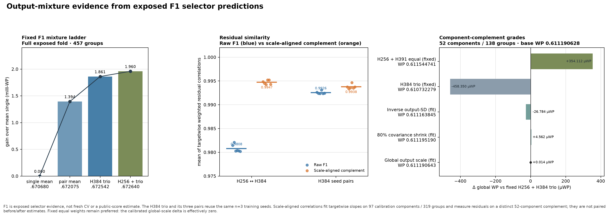

# Fixed-blend output EDA (R1)



The figure summarizes output-scale and mixture evidence from the pinned selector metrics, using the official `global_wp_clip2_v1` metric. The input is `F1_SELECTOR_METRICS_R1.json` (SHA256 `e030f8914aafa7bb172824577552d059a6e101ea7fc5c1ab97b1c2b9d33ff1f5`); the generator is `plot_f1_blend_eda.py` (SHA256 `2d91480302f18596233c7a6f180ab5ae710ab60f8a3b09403fc7f322e3179205`). The first panel uses all 457 already-exposed F1 groups. These are selector observations, not fresh cross-validation, public validation, or a public-score estimate.

The three H384 single seeds average 0.67068046 WP. Their three equal pair mixtures average 0.67207490, the equal three-seed mixture scores 0.67254162, and the 50/50 H256 plus H384-trio mixture scores 0.67264009. The incremental gains are +0.00139444, +0.00046672, and +0.00009847 WP, respectively. The three pairs reuse the same three fitted seeds, so they are not independent replications. The H256 addition has little marginal value after the H384 trio. Among the other fixed blends, H256 + H384 seed 5 scores 0.67257427; H256 + H391 scores 0.67176654 on the full exposed fold. Their 52-component complement scores are not interchangeable with this full-fold ordering.

Raw weighted residual correlations on the exposed fold average about 0.9808 between H256 and the H384 seeds, and about 0.9926 between H384 seed pairs. Weighted raw-output standard deviations also differ materially: roughly 0.76–0.79 for H256 versus 0.91–0.96 for H384, depending on target. After fitting a targetwise zero-intercept output scale on 97 calibration components (319 groups) and measuring residual correlation on the disjoint 52-component complement (138 groups), the means are about 0.9947 for H256↔H384 and 0.9938 for H384 seed pairs. The raw and scale-aligned correlations use different scopes and are not a paired before/after estimate. Both remain high, so this output evidence does not show large independent residual directions.

On the component complement, the fixed H256+H384-trio reference scores 0.61119063 WP. The fixed H256+H391 equal blend scores 0.61154474 (+354.112 micro-WP there), while the fixed H384 trio scores 0.61073228. The first complement result is a useful robustness observation but its full-fold score is below the H256+H384 seed-5 blend and the four-member H256+trio blend. It does not support replacing the cross-fold candidate ranking on its own.

Calibration provided no reliable improvement over the fixed equal-weight reference. Inverse output-SD weights scored 0.61116384 (−26.784 micro-WP); an 80%-shrunk nonnegative residual-covariance proposal scored 0.61119519 (+4.562 micro-WP); and the targetwise global output-scale fit scored 0.61119064 (+0.014 micro-WP). The scale delta bootstrap over the same 52 components has a 95% interval of −0.104 to +0.167 micro-WP. Keep the equal weights as the stable fixed recipe; do not use the tiny fitted difference as evidence for a learned weighting rule.

The tested fixed pool and calibration remain exposed to selection: the component split is useful for checking complement behavior, not a pristine final holdout. Mixture effects are conditional on the exact source-qualified models in the metrics receipt. No prediction, training run, future feature, label-regime feature, or public score entered this analysis.

Reproduce the artifact from the project root with:

```sh
WNN_SLICE=wnn-campaign.slice WNN_CPU_QUOTA=100% WNN_THREADS=1 \
WNN_MEM_MAX=1000000000 WNN_RUNTIME_MAX=120s \
scripts/limited .venv/bin/python \
  /home/vlad/development/wunder/wnn_old_pipeline_reconstruct_20261011_r1/research/campaign_2026-10-06/bandit_continuation/submission_selector_20261011_r1/generated_r6/plot_f1_blend_eda.py \
  --metrics research/campaign_2026-10-06/bandit_continuation/submission_selector_20261011_r1/generated_r6/F1_SELECTOR_METRICS_R1.json \
  --output-dir /home/vlad/development/wunder/wnn_old_pipeline_reconstruct_20261011_r1/research/campaign_2026-10-06/bandit_continuation/submission_selector_20261011_r1/generated_r6
```

Artifact hashes are recorded in `F1_BLEND_OUTPUT_EDA_R1_RECEIPT.json`: PNG `5a97dd7b685ccb4f133fce8dc179756f7c1da876c70a48cd91f23e83b80ecfb8`; SVG `c04e82dab5d3152c31109897a5ab4eec5b26f4cb33b999c42943ccb62d8ad32e`.
