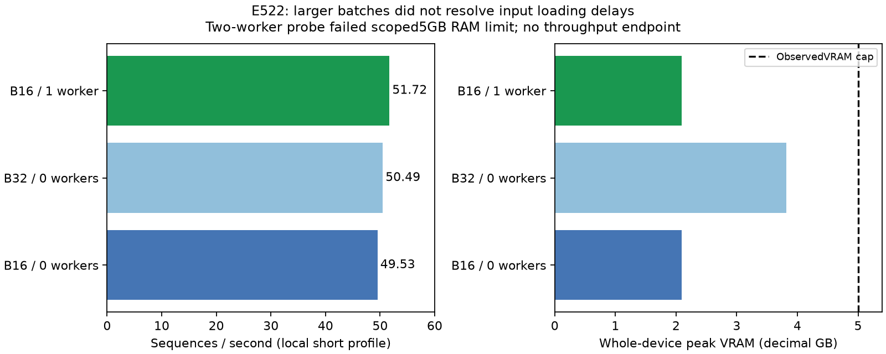

# E522 resource utilization audit and optimization

The strongest measured bottleneck is cloud input verification before CUDA. E520v6
spent795.47s hashing train and188.75s hashing valid, then748.68s rehashing train in
`verify_portable_source`; the repeat valid pass started before the1800s internal cap
terminated the worker. It performed no GPU profiling or fitting. Host/cgroup RAM
headroom remained ample; this attempt was a time-cap failure rather than OOM.
See the operator's immutable [phase diagnosis](../own_baseline_E520/E520_PROFILE_V6_PHASE_DIAGNOSIS_20261007T1225Z.json).

Implemented optimization candidate: a worker-local verified digest handoff for exact
canonical paths and stat identities, authorized only after actual bytes match both
expected source and sealed portable-registry SHA. It must reject changed/mismatched
sources and preserve original verifier fallback for unverified paths. Frozen E520v6
is unchanged. Source implementation, independent review and cloud integration receipts
will live beside this report; deployment remains pending those receipts.

## Measured laptop probes

All use compact scratchGRU128x2, full20000-row sequences/chunk2000,fp16/fusedAdam,
4warmup24timed batches. They are resource profiles with no checkpoint or score.

| Batch / workers / CPU reservation | Sequences/s | Whole-device VRAM | Outcome |
|---|---:|---:|---|
|16 /0 /3|49.53|2.096GB|exit0, zeroOOM|
|32 /0 /3|50.49|3.814GB|exit0, zeroOOM|
|16 /1 /3|51.72|2.096GB|exit0, zeroOOM|
|16 /2 /4|unavailable|2.096GB|scoped5GB RAM OOM; exit−9|

Batch32 increased throughput1.94% while increasing observedVRAM81.94%. One loader
worker increased throughput4.42%. Neither result is a cloud speedup claim. Larger
batches change optimizer update counts/sampler behavior; loader changes can change
RNG consumption. They require a separately frozen recipe comparison before fitting.
The existing fp16, fused optimizer, pinned buffers and CUDA-stream prefetch are already
active. A framework/kernel rewrite has no demonstrated priority over fixing data IO.

The two-worker probe was not safely budgeted: root underestimated full worker/prefetch
memory. Scoped OOM counters increased5 and killed3 processes; aggregate observedpeak
was16.658GB, below the20GB parent cap. It has no terminal throughput measurement and
must not be treated as a negative architecture/scientific result. No automatic retry
or two-worker promotion. All raw failure receipts/logs remain in runtime.

B16 device sampling began after completion and supplies no active utilization evidence.
B32 samples show alternating busy/idle periods, but are coarse one-second observations
rather than a GPU profiler trace. CPU loader timing, GPU-event timing and wall timing
may overlap; do not add them as disjoint phase costs.

## Next execution priorities

1. Eliminate the measured duplicate verified hash pass, independently review and run
   a newly identified cloud packet; report phase time and actual device profile.
2. Validate once per cohort and reuse the verified inputs across profile/seed fits,
   amortizing roughly16.4min initial hashing. Never silently skip fresh identity checks.
3. Reuse existing `scripts/kaggle_gpu_runner.py` for independent jobs per measured GPU.
   Inventory actual devices first; profile combined CPU/RAM/cache pressure and maintain
   separate per-seed RNG, outputs and watchdogs. SerialE520 recipe stays frozen until
   a new parallel execution recipe passes audit. No claimed2x gain or assumed hardware.
4. Recheck loader overlap with a safe measured memory envelope on Kaggle; retain the
   matched training batch until a declared larger-batch arm is evaluated.
5. Only profile compile/custom kernels after useful CUDA work is measured. Existing
   cuDNN recurrent path is the baseline; compile startup/memory and numerical drift
   must be included in experiments/hour, not just steady-state kernel timing.

Primary tooling guidance: [PyTorch performance tuning](https://docs.pytorch.org/tutorials/recipes/recipes/tuning_guide)
and [Kaggle notebook resources](https://www.kaggle.com/docs/notebooks). Their options
are research candidates, not evidence of speedups for this pipeline.
