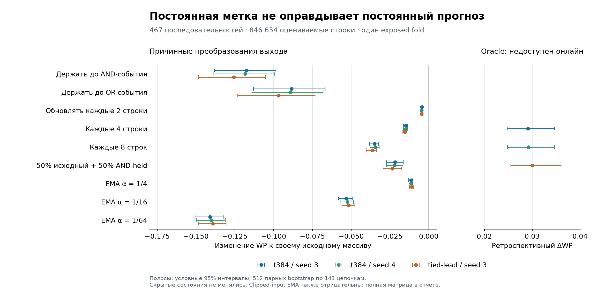

# Второй разбор: редкие исключения, движение прогноза и реальные различия идей

**Главный результат:** редкие clock-исключения практически малы, но удержание
прогноза между событиями резко ухудшает сохранённые предсказания. Эти два факта
совместимы: постоянный таргет не требует постоянной причинной оценки.

Ты прав: 1 253 исключения сами по себе не оправдывали прежний акцент. Это около
0,000502% всех 249,6 млн строк и 0,003765% need-eligible строк с изменением
хотя бы одного таргета. Формулировка «правило не выполняется абсолютно всегда» верна, но не
отвечает на практически важный вопрос о качестве модели.

В этом раунде мы отдельно проверили редкость, размер и длительность исключений;
пересчитали реальные сохранённые предсказания; разобрали математически, что
именно измеряет каждый эффект; и проверили новые идеи по исходникам прежних
экспериментов. Обучения, подбора коэффициентов и нового model inference нет.
Три подзадачи вели отдельные агенты; их согласие не считается статистической
репликацией. Все оценочные панели уже использовались в исследованиях.

## 1. Исключения — плохое объяснение основного отставания

Во всех 1 253 сохранённых исключениях следующее совместное изменение `i0_p0`
и `i0_p11` наступает через 1–3 строки; медиана — одна строка. В valid максимум
две строки. Исключения распределены по 688 train-последовательностям и 203
valid-последовательностям, поэтому это не одна испорченная последовательность.

На 92 оцениваемых valid-строках с исключением сумма двух весов `|clip(y)|`
равна 155,280399 при общем весе 4 895 308,008: **0,003172%**. Это доля веса,
а не верхняя граница изменения Pearson. Для практического вопроса дополнительно
нужно учитывать строки после пропущенного изменения — их измеряет отдельная
реконструкция истинных меток по событиям. Полный пересчёт теперь завершён:
при восстановлении clipped-метки из последнего AND-события ошибки затрагивают
лишь 61 оцениваемую строку для t0 и 59 для t1. Их доли веса — **0,001874% и
0,002030%** соответственно; объединённая доля — **0,001953%**. Это
ретроспективный label-only диагностический тест, не прогноз. Среди need-eligible
строк участки ошибки имеют длину максимум 3 строки на train и 2 на valid;
длинного накопления ошибки здесь нет.

Есть важная асимметрия: recall clock относительно сырых изменений метки
составляет 99,9965% на train и 99,9952% на valid, но precision всего 62,26%
и 62,63%. То есть clock почти не пропускает изменения, однако многие его
срабатывания не сопровождаются изменением метки. Это не взаимно однозначный
генератор label-последовательности.

Это не погрешность float: в каждой строке-исключении хотя бы один сырой таргет
изменился не менее чем на 0,125433, и ни одна такая строка не исчезает при
пороге 1e-4. Но после официального clipping оба таргета вообще не меняются в
63 train- и 23 valid-исключениях. Наибольшее число исключений принадлежит
ретроспективному классу 1, тогда как в valid-классе 3 найдено только одно.
Класс здесь — описание по меткам, не допустимый признак для serving.

Источник: [полный аудит исключений](exception_audit/README.md), включая исходные
записи, знаменатели, чувствительность к clipping, концентрацию и длительность
ошибки реконструкции. Это полный проход по выбранным колонкам всех строк,
не новый полный проход по всем 112 входным признакам.

## 2. Почти точный clock не означает, что надо держать прогноз постоянным

Выбраны три существующих массива по происхождению до просмотра score. Два
покрывают все 1 873 valid-последовательности; третий имеет полные конечные
предсказания только на 467. Сравнение использует строго их общее покрытие:
**467 последовательностей, 846 654 оцениваемых строки, 143 chain-компоненты,
один ранее использованный fold 0**. Никакие отдельные неудобные строки не
удаляются. Названия файлов не доказывают историческое происхождение массива;
точная связь с checkpoint/source остаётся неполной.

У модели сохраняется вся исходная работа скрытого состояния. Меняется только
выдаваемый выход: удержание до AND/OR-события, фиксированная периодичность,
50/50 исходный и удержанный выход, EMA с заранее заданными коэффициентами.
Обработка начинается с нулевой строки, состояние каждого преобразования
сбрасывается между последовательностями; официальный mask и scorer неизменны.

| Вариант | t384 s3 | t384 s4 | dftt tied-lead s3 |
|---|---:|---:|---:|
| Исходный WP | 0,701304 | 0,702173 | 0,706250 |
| Держать выход до AND-события: Δ | −0,117720 | −0,118358 | −0,125650 |
| Держать до OR-события: Δ | −0,088484 | −0,089271 | −0,096824 |
| Обновлять через строку: Δ | −0,004458 | −0,004549 | −0,004600 |
| Обновлять каждую четвёртую строку: Δ | −0,014824 | −0,014840 | −0,015540 |
| EMA, α=1/4: Δ | −0,011498 | −0,011262 | −0,011149 |
| 50/50 исходный и AND-held выход: Δ | −0,021790 | −0,022062 | −0,023452 |
| Недоступный онлайн label-run oracle: Δ | +0,029115 | +0,029180 | +0,030070 |

Все 12 допустимых причинных преобразований дают отрицательный point estimate
на всех трёх массивах. Здесь нет выбора «удачного» коэффициента. Полная матрица
содержит также cadence 8 и обе очередности clipping/EMA для τ=4,16,64.
Последняя строка таблицы использует будущую информацию и не является кандидатом.

Этот результат намного содержательнее счёта исключений: изменение исходного
прогноза между выбранными событиями существенно для его качества. Однако он
**не доказывает**, что каждое изменение входа полезно, и не проверяет отключение
обновлений hidden state. Возможны как минимум два объяснения:

- новые наблюдения внутри участка с постоянным таргетом уточняют его оценку;
- рекуррентному состоянию нужны дополнительные шаги, чтобы обработать уже
  пришедшее изменение; выход на первой строке события ещё переходный.

Обе причины могут действовать вместе. Удержание выхода на первой строке события
не различает их. У модели уже есть путь текущего encoder `z` прямо в readout;
предлагать «добавить отсутствующий быстрый вход» без проверки кода неверно.

Источник: [полная матрица и проверки](prediction_audit/README.md). Условные
chain-bootstrap интервалы относятся к этим фиксированным массивам, не к
вариативности обучения, новым данным или ожидаемому public score.
Например, для t384 s3 AND-hold имеет Δ −0,117720 и условный 95% интервал
[−0,138135; −0,098412]; cadence 2 — Δ −0,004458 с интервалом
[−0,004927; −0,004069]. Во всех 36 причинных сравнениях верхняя граница
такого интервала ниже нуля.

## 3. Почему oracle даёт около +0,03, но это не обещанный прирост

Для каждого таргета отдельно разбиваем последовательность на участки с
постоянным **clipped** истинным значением. Заменяем clipped-предсказания их
средним по оцениваемым строкам того же участка. Такая операция сохраняет
взвешенную ковариацию с таргетом и удаляет часть дисперсии предсказания.
При положительной исходной корреляции score поэтому закономерно возрастает.

Это точная алгебра, а не открытие новой доступной информации. Границы участков,
их будущие предсказания и выбранные строки недоступны онлайн. Даже идеальный
причинный estimator может постепенно уточнять оценку постоянной скрытой
величины; oracle усредняет эти оценки задним числом. Его разрыв нельзя считать
устранимым шумом, запасом для causal-фильтра или потолком задачи.

Дополнительный вывод: обычный weighted MSE уже содержит штраф за колебания
внутри участка с постоянной меткой. Generic consistency-loss не добавляет
ранее отсутствовавший член — он меняет его относительный вес. В проекте также
уже есть future-teacher bootstrap, reanchor и TD-пути; их прежние отрицательные
результаты сохранены в новом разборе.

Источник: [вывод формул](theory/PERSISTENCE_AND_PREDICTION.md) и численные
проверки oracle в отчёте предсказаний. Удаляемая внутриучастковая компонента
составляет **7,6–8,1% взвешенной дисперсии прогнозов** на шести сочетаниях
модель × таргет; это дисперсия прогнозов, не доля устранимой ошибки.

### Колебания почти одинаковы у трёх моделей

Дополнительный проход сопоставил колебания вокруг среднего того же участка
постоянной clipped-метки. Их взвешенная корреляция между парами моделей —
**0,960–0,963**. Полные clipped-прогнозы коррелируют на 0,991–0,993, ошибки
относительно таргета — на 0,990–0,992. В последнем числе участвует общий Y,
поэтому само по себе оно не доказывает одинаковую модельную ошибку.

Высокая согласованность именно внутриучастковых колебаний — аргумент против
объяснения oracle-gap независимым шумом разных seed. По ковариационной матрице
равномерное среднее этих колебаний сохраняет около **97,5%** средней
индивидуальной дисперсии. Это алгебра сохранённых статистик, а не оценка нового
ансамбля. Общая реакция может быть как полезным уточнением, так и общей ошибкой;
без вмешательства в входы и состояние различить их нельзя.

Источник: [дополнительная диагностика](prediction_audit/FOLLOWUP_DIAGNOSTICS.json).

## 4. Что скрывает один общий score

Для каждого таргета глобальная взвешенная ковариация точно раскладывается на
ковариацию внутри последовательностей и ковариацию их средних. Делим обе части
на **один и тот же глобальный знаменатель**; их сумма равна официальному WP.
Это не среднее отдельных sequence-корреляций.

У t384 s3 для t0 получаем `0,701887 = 0,508110 + 0,193777`, а для t1 —
`0,700720 = 0,501041 + 0,199679`. Между последовательностями находится около
18,7% дисперсии таргета и 25,6–28,1% дисперсии предсказания. Межпоследовательная
часть ковариации даёт около 28% этих нормированных сумм.

Это существенная часть картины: нельзя считать последовательности одинаковыми
после вычитания их уровня и ожидать, что задача осталась прежней. Но эти числа
сами по себе не доказывают переобучение или пользу нормализации. У предложенной
prefix-normalization нужно сохранять путь абсолютного уровня; истинное среднее
таргета последовательности нельзя использовать при inference.

Источник: [разложение по сохранённым sufficient statistics](theory/README.md).

Отдельная разбивка ошибки по возрасту после AND-события и ретроспективному
классу показывает неоднородную картину. Например, у t384 s3 для t0 в классе 3
на возрасте 512+ строк weighted MSE равен **2,1559** против **2,5079** при
удержании выхода; в этой ячейке 11 699 оцениваемых строк. В других классах
дальние интервалы гораздо меньше, а возрастная зависимость не монотонна.
Агрегированный график «старше → труднее» смешивал бы разные режимы и масштаб
таргета. Эти описательные ячейки не доказывают причинный эффект возраста или
доступный выигрыш duration-модели. Поле `weighted_target_variance_sum` в сырой
таблице суммирует **внутрипоследовательные** центрированные суммы, а не полную
дисперсию объединённой ячейки; делить MSE на него как на pooled variance неверно.

## 5. Как изменился портфель идей

Полный пересмотр всех 25 карточек находится в [третьем раунде решений](reflection/ROUND3_EDA_DECISIONS.md).
Главные изменения:

1. **Снять приоритет с ремонта редких clock-исключений.** Приблизительный clock
   остаётся полезной структурой для анализа. Эти исключения не обосновывают
   новый memory block или объяснение основного разрыва качества.
2. **Понизить простой output hold и generic smoothing.** Прямые вмешательства
   дают крупный минус. Это не запрет обучаемого input-responsive readout,
   но ему нужна другая проверяемая причина, а не только постоянство метки.
3. **Разделить усвоение нового наблюдения и память.** Следующая диагностическая
   развилка — frozen-checkpoint replay: реальные quiet-входы против удержанных
   входов после одного и того же события, с одинаковым состоянием на границе.
   Сначала необходимо точно привязать checkpoint, preprocessing и исходный
   прогноз. При изменении raw 112 надо заново причинно построить производные
   признаки; заморозка всего 211-вектора также замораживает age и является
   другим вмешательством. Такой replay пока не выполнен.
4. **Не продавать прежние механизмы как новые.** Belief v2 уже имел posterior,
   survival на quiet-строках, возраст и dense GRU. DualClock уже совмещал row GRU
   с редкими обновлениями отдельной памяти. Будущий duration-механизм должен
   отличаться конкретным переходным оператором. Просто два clock — повтор.
5. **Сохранить ёмкость и перенос teacher→student как отдельную сильную ветку.**
   Сравнение wide/shallow и deep/узкой модели, output KD и проверяемых hidden
   hints не зависит от редких исключений. Новое EDA не доказывает их выигрыша,
   но и не снижает соответствующие основания из истории.
6. **Сузить семантическое промежуточное KD.** Предсказывать заранее определённые
   будущие входные события на нескольких горизонтах вместо копирования всего
   произвольного hidden vector — содержательный вариант только там, где он
   отличается от уже сделанных next-event/quote/future-moment auxiliary.
   Это уточнение существующих карточек, а не гарантированно новая семья.

Rao–Blackwell-фильтр остаётся идеей с высоким риском и низким текущим приоритетом:
нужна явная условно разрешимая часть состояния. Красивое название и мультимодальные
метки такого разложения не дают. Mamba/xLSTM/attention/TTT не получили новых
баллов только от этого EDA; их будущая ценность должна проявиться в конечном
student и полной процедуре оценки.

При финальной синхронизации в `main` и `research-team` уже появились результаты
[отдельного исследования геометрии признаков](../moment_geometry_r1/README.md).
Его 33 коротких tiny-GRU запуска имеют отдельное пользовательское разрешение;
они не запускались этим EDA-раундом. Там причинные moment/scale-каналы и
дискретная occupancy/dwell-ветка дали положительные средние на малой панели,
но знаки и величины зависят от fold/seed. Простая конкатенация обеих веток
оказалась хуже moment/scale, тогда как фиксированное смешивание отдельных
моделей было полезнее. Это делает содержательнее взаимодействие карточек
02/04/06/23: **отдельные представления → разные учителя → один student**.
Сам перенос ещё не проверен; tiny-панель не предсказывает выигрыш полной модели.

Приоритеты таблицы — распределение ближайшего внимания, не запрет на смелые
архитектуры. Отсутствие поддержки от clock-EDA не является отрицательным тестом
Mamba, xLSTM или world-model. Для дальнейшего исследования остаются две разные
линии: выяснить причину общей динамики текущих прогнозов и искать представления,
чьи ошибки действительно отличаются. Только добавление seed к близкой семье
второй вопрос не решает.

## 6. Что проверили и что осталось неизвестным

Два основных анализа на сервере были ограничены одним CPU каждый. Они читали
готовые данные и предсказания. Дополнительная проверка cache alignment сверила
все **9,34 млн строк** общей панели с Parquet: sequence ID, step, таргеты,
need-mask и официальный score-mask совпали. Это проверка кеша данных, а не
доказательство исторического порядка строк prediction producer.

В отчётном коде исправлены неоднозначное название bootstrap mean, счётчик
изменённых строк и недостаточная проверка oracle-дисперсии. Сырые результаты
сохранены, исправленное представление и отдельные проверки лежат рядом;
официальные score от этих поправок не изменились. Независимое восстановление
84 target-score из sufficient statistics совпало с записанными значениями
с максимальным расхождением **5,6e-16**. Восемь чисто численных тестов прошли,
включая 100 случайных синтетических наборов с масками для разложения; optimizer не вызывался.

Два первых прохода завершили
расчёт, но упали при формировании финальных файлов отчёта; ошибки выгрузки
исправлены, логи сохранены, расчёты повторены. Это ошибки нового EDA harness,
а не обнаруженные причины прежних плохих training-экспериментов.

R2 не восполняет отсутствующую историческую связь prediction cache с точным
producer checkpoint/source, не делает использованный fold свежим и не даёт
оценки private leaderboard. Он меняет приоритеты на основании проверяемых
наблюдений. Полный [контракт](CONTRACT.json) сохраняет запрет на обучение и
подбор параметров.
