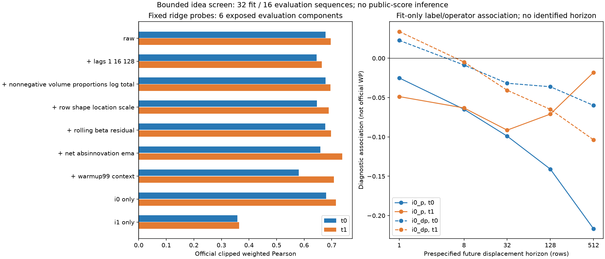

# Первый измеренный проход по 25 идеям

Проверили предпосылки на 48 полных последовательностях и обучили девять фиксированных простых моделей. Получили конкретные отрицательные результаты и два направления для следующего различающего теста. **Устойчивого улучшения полноценной модели пока нет.**

## Что именно считали

Canonical F0, seed19019, выбор компонент без просмотра меток. Fit:32 последовательности/14 компонент,640000 строк истории; линейный ridge использовал13247 разрешённых fit-строк с фиксированным шагом40 после вычисления полной причинной истории. Evaluation:16 последовательностей/6 других компонент,35467 исходных scored-строк. Нормализация только по fit, ridge1.0, без подбора по evaluation. Все девять вариантов заданы до результатов. Это маленькая exposed-панель с неравными вероятностями включения компонент, не полный F0, CP30 или оценка public.

Все числа ниже посчитаны одной canonical `global_wp_clip2_v1`: clipping±2, исходный scored mask, вес по модулю clipped label, глобальное объединение моментов. Для ridge использовалась float64 линейная алгебра; это CPU-analysis, не новая strict-FP32 training recipe.

| Простой predictor | t0 | t1 | Средний WP | Разница к raw |
|---|---:|---:|---:|---:|
| Raw112 | .677691 | .696810 | .687250 | — |
| Raw + лаги1/16/128 | .645731 | .664649 | .655190 | −.032060 |
| Raw + неотрицательные пропорции объёмов | .677569 | .695164 | .686367 | −.000884 |
| Raw + форма/положение/масштаб строки | .646096 | .689668 | .667882 | −.019368 |
| Raw + rolling beta/residual | .676672 | .697108 | .686890 | −.000360 |
| Raw + EMA приращений и модуля инновации | .658792 | .738085 | .698439 | +.011189 |
| Raw + контекст первых99строк | .580047 | .707708 | .643878 | −.043372 |
| Только i0 | .679473 | .715748 | .697610 | +.010360 |
| Только i1 | .357853 | .364438 | .361145 | −.326105 |

Для масштаба сравнили **уже сохранённые текущие FP32 F0 GRU predictions на точно тех же35467строках**: wide=.807598, deep=.804993. Проверено побитовое совпадение исходных labels/order/component IDs. Это не equal-budget сравнение: GRU обучались на намного большем объёме, чем ridge. Число .687 на этой маленькой панели нельзя сравнивать с .67 на полном фолде или leaderboard. Весов не восстанавливали, inference не повторяли.

## Что изменилось в оценке идей

**Сглаженная история — сигнал для разбирательства, но не победитель.** У EMA t0 хуже raw на.01890, t1 лучше на.04128. По отдельным компонентам положительных разниц3, отрицательных3. Компонента995 даёт64.2% evaluation-строк; при её исключении pooled delta меняет знак с+.01119 на−.03823. Это пересчёт уже фиксированных прогнозов, не retraining или независимая проверка. Следующий вопрос — какая часть EMA нужна и повторяется ли её польза при другой смеси компонент.

**i1 способен мешать маленькому совместному линейному fit.** i0-only лучше raw на.01036, причём все шесть drop-one pooled разниц положительны [.00849,.01429]. Но отдельные компонентные разницы смешаны, fit-панель мала и регуляризация фиксирована. Это не доказательство бесполезности i1: сам i1 даёт ненулевой WP. Надо отличить нехватку регуляризации/данных от необходимости отдельной обработки межинструментного сигнала.

**Добавить больше признаков недостаточно.** Явные лаги хуже raw во всех шести компонентных сравнениях; добавление начального контекста ухудшает общий результат во всех drop-one пересчётах. Эти конкретные признаки/ridge1.0 на13247fit-строках не прошли первый screen. Это не опровержение длинной памяти, warmup-контекста или рекуррентного обучения вообще.

**Положительная композиция объёмов почти нигде не определена.** Для каждого из двух22-канальных v-блоков evaluation содержит0 полностью положительных строк из320000. В fit таких строк771 и1097 из640000. Простой log-ratio над исходными значениями неприменим почти повсюду. Реально исполненный proportion-view — отдельно названный nonnegative v+dv proxy с нулевыми добавками на недопустимых строках, а не проверка предполагаемой физической композиции. Его tiny delta не устанавливает никакой пользы этого механизма.

**Оператор таргета не установлен.** Проверили10 заранее фиксированных формул будущей разности среднего p/dp на горизонтах1/8/32/128/512, только на fitting-компонентах. Выбранные на остальных fit-компонентах корреляции на отложенной fit-компоненте меняют знак; у каждой цели положительный знак был3/14, отрицательный11/14. Это узкая ретроспективная диагностика анонимного измерения, не онлайн-признак, не официальный WP и не восстановленный горизонт метки. Первое прохождение барьера и будущие экстремумы ещё не проверялись.

## Решение на следующий дешёвый шаг

1. Сравнить raw/i0-only/EMA и явные лаги с **регуляризацией, выбираемой только по внутренним fit-компонентам**. Это отделит плохое оценивание лишних коэффициентов от отсутствия сигнала. Новая exploratory волна должна сохранить текущую историю отбора; эта evaluation-панель уже использована.
2. Разделить EMA на signed и absolute-innovation части, сохранив matched controls. Текущий joint-view не доказывает вклад конкретно модуля инноваций.
3. Проверить чувствительность к составу компонент на большем заранее зафиксированном panel. Повторный выбор удобных компонент или объявление этой панели fresh запрещён.

Не запускаем25полных тренировок. Для остальных пунктов есть [карта статусов всех25](STATUS_25.md): некоторые требуют sparse factor model, отдельных голов, gradients или recurrent state, которых у линейного probe нет. Непроверенное не считается опровергнутым.

## Проверка, стоимость и артефакты

[Независимая проверка результата](RESULT_REVIEW.md) воспроизвела все9 global scores из шести компонентных сумм; максимальное расхождение3.4e−16. Она проверила source/result/sample bindings, структуру выборки и неоднородность эффекта. Не было независимого refit или новой нетронутой выборки.

Sample materialization:12.09s, EDA:27.40s/501188KiB peak RSS, девять ridge:76.73s/641728KiB, reference+график:5.90s/133460KiB. Всё исполнено последовательно на Beleriand под0.5CPU/1.5GB/no-swap, CUDA hidden. Все четыре units exited0/captured/stopped. Sample совпал с ростом hierarchical memory.high events177→757; max561/OOM0 и parent-local events0 не изменились. EDA/ridge/report после sample не добавили событий. Это не training OOM. Большие sample arrays остались только на B; на Mac скопированы JSON и PNG/SVG.

Числа: [ridge](records/RIDGE_RESULT.json), [EDA](records/EDA_RESULT.json), [same-panel reference](records/REPORT_REFERENCE.json), [sample manifest](records/SAMPLE.json). Полная связь источников/выходов и launch/capture records — в [README](README.md).
