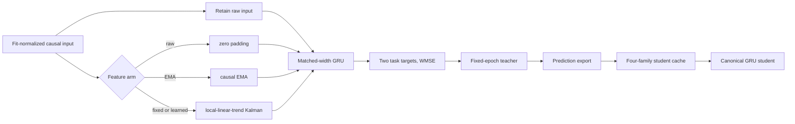

# Causal smoother teachers and GRU distillation on B300

**Status:** implementation draft; no B300 profile or task fit has been run from
this branch. The four-channel NumPy receipt is synthetic-only and is not a
model-quality result. A separate fixed-GRU replay on 16 selected exposed-F0
groups has a +0.000338 local-trend point change with a conditional interval
crossing zero; it is only motivation and is not teacher/student evidence.
Hypothesis `H-KALMAN-LOCAL-TREND-20261018`; experiment
`E-KALMAN-LOCAL-TREND-B300-20261018`.

Published as [draft PR #17](https://github.com/VladKochetov007/WunderFunder/pull/17)
to `research-team`.

The experiment compares causal smoother features against a parameter-shape-
matched raw-input control and a steady-state EMA control, then tests whether a
learned local-trend teacher improves the existing four-family GRU student
cache. It predicts the two original competition targets with canonical WMSE;
there is no next-input reconstruction objective. Final grades use the unchanged
`global_wp_clip2_v1` metric.

The competition payoff is through a better fixed-size GRU student, not a
teacher-only score: a Kalman teacher must beat the matched four-family student
cache, with the final served quality/runtime/package-size tradeoff measured
before any submission claim.

## Architecture and evidence



- [English PR body](PR.md) answers the eleven repository draft questions.
- [Frozen recipe](recipe.json) records the 11-arm/330-fit paired matrix, two channel scopes,
  FP32 policy, B300 profile gate, source-cache requirements, exact commands,
  mounts, statistics and artifact receipts.
- [`src/wnn/kalman_local_trend.py`](../../../src/wnn/kalman_local_trend.py)
  implements the zero-padded raw control, EMA and two-state local-trend
  features, state carry/reset interface and GRU wrapper. All trend channels
  share one positive scalar per state family (`Q_level`, `Q_slope`, `R`);
  this is a deliberately small parameterization, not per-channel fitting.
- [`scripts/train_kalman_teacher.py`](../../../scripts/train_kalman_teacher.py)
  adapts the canonical modular trainer. `--kalman-arm` selects `raw`, `ema`,
  `fixed` or `learned`; `--kalman-channels` selects the local 4-channel pilot
  or all 112 raw channels. Its synthetic smoke is available but has not been
  run in this task.
- [`scripts/predict_run.py`](../../../scripts/predict_run.py) reconstructs
  adapter-marked checkpoints for the existing prediction export.
- [`scripts/build_distill_cache.py`](../../../scripts/build_distill_cache.py)
  validates adapter identity, arm, channel scope, filter state, dimensions,
  split membership, checkpoint bytes, and for adapted teachers the exact
  prediction-driver and current filter/GRU-core source hashes against both
  training provenance and each prediction sidecar before accepting the teacher
  into the existing four-family cache.
- [`evidence/kalman_numpy_prototype.py`](evidence/kalman_numpy_prototype.py)
  and [`evidence/numpy_synthetic_receipt.json`](evidence/numpy_synthetic_receipt.json)
  preserve the predecessor NumPy-only synthetic checks. Their hashes are
  `c867df3aa80375e19cf6f7354b78abf3fede7d7b66ad1fab20c3f91f8320200a` and
  `c3f715b0742b24dd4bc7016893ed8d331ce57e79ed17884581c4e7818269aa15`.
  The receipt records causal-prefix, reset, finite-value, PSD, streaming and
  scalar random-walk-KF/EMA checks on synthetic values only. It reports peak
  RSS 841,376 KiB, above the intended 500 MiB support bound; resource
  verification is therefore unconfirmed. It is not a PyTorch implementation
  parity check, task-data result, or quality evidence.
- [Source assessment](../../unified/sources/KALMAN_LOCAL_TREND_DISTILLATION_B300_20261018.md)
  summarizes the primary literature and local prototype provenance.
- [Local frozen-GRU screen](https://github.com/VladKochetov007/WunderFunder/blob/main/research/campaign_2026-10-18/online_features_r1/kalman_filter_probe/RESULTS_R2.md)
  motivates retaining raw inputs and adding trainable smoother features; its
  exposed-panel result does not establish a teacher or student gain.

## Mechanism and controls

For each selected raw channel, the EMA and local-trend arms append four causal
features: posterior/smoothed level, first difference, standardized innovation,
and log innovation variance. The input is globally normalized using the
canonical fit-only training statistics; the transformed features use only the
current and preceding observations. The raw input remains present.

The EMA gain is the steady-state scalar random-walk Kalman gain for fixed
`Q=0.01, R=0.1`: `alpha=(-q/r + sqrt((q/r)^2+4q/r))/2`, approximately
`0.270156`. This makes the comparison target the added local-trend state and
learned process/measurement uncertainty, rather than generic smoothing. The
fixed local-trend arm uses `Q_level=0.01, Q_slope=0.001, R=0.1`. The learned
arm starts from those same values and learns positive scalar parameters through
`softplus(log_value)+1e-6`; one scalar per state family is tied across whichever
channel scope is selected. The symmetric covariance update is Joseph form.

The raw control appends the same number of constant-zero channels as its
scope-specific smoother arms. Thus all four models within a scope have the
same H1024×2 GRU and first-projection dimensions; the zero-padded input columns
remain uninformative by construction. The canonical raw/event input width is
211, and the adapter rejects alternate feature assembly. `pilot4` appends 16 columns and uses raw
indices `[0,3,52,55]`; `all112` appends 448 columns. The pilot indices are
anonymous and locally selected; they have no asserted physical semantics. The
four-channel arm is a local screening scope; all112 is the expanded channel-
scope comparison. Both are predeclared and, after the mandatory all112 profile
passes, run with their full paired matrices. Pilot scores do not gate all112
inclusion; all112 is not a pristine holdout. Results do not transfer
automatically between scopes.

The local-trend state starts from each sequence's first normalized observation,
zero slope and a fixed diagonal covariance prior; it carries over the trainer's
chunk boundaries and is reset with sequence state. Neural weights, model/input
tensors, filter state, loss, gradients and optimizer use FP32, with autocast and
TF32 disabled. The canonical metric's internal centered-moment accumulation
may use FP64. No future-row or per-sequence normalization is introduced.

## Paired matrix and estimands

All folds are previously exposed development folds. Use F0/F1 seeds 1001–1008
and F2/F3 seeds 1001–1007, paired by exact fold manifest and seed identity. Each
arm has 30 cells. Each direct teacher arm uses H1024×2; each student uses
H256×2.

| Arm group | Arms | Scope | Cells per arm |
|---|---|---|---:|
| Direct teachers | `raw`, `ema`, `fixed`, `learned` | each of `pilot4`, `all112` | 30 |
| Student control | existing matched four-family cache | scope-neutral | 30 |
| Student treatments | replace only `samefold_baseline` with `learned` teacher | `pilot4`, `all112` | 30 each |

This is 11 arms / 330 fits, or 42 waves of up to eight independent fits.
Launch one fit per visible B300 and pair its fold/seed cell across arms. DDP is
not implemented or useful for these small independent fits. Larger recurrent
teachers and teacher-side DDP are a future scaling direction, not this runner.
The runtime is unknown; the real-shape B300 profile is a hard admission gate.

The four direct primary contrasts are learned versus EMA and learned versus
fixed local trend, evaluated separately at both channel scopes. Secondary
contrasts compare each learned teacher with its scope-matched zero-padded raw
control, and each Kalman-source student with the matched-cache student. Apply
Holm correction across all eight declared contrasts if all are reported. The
estimand is the equal-fold mean of paired seed means; use a crossed seed-
identity bootstrap and a separate paired source-component bootstrap. Report
fold and seed variation separately. Intervals condition on these four exposed
folds and do not represent unseen-fold uncertainty.

## Student-cache path and ancestry

The existing cache builder requires four families in order
`strong`, `full_finetuned`, `raw_wmse`, `samefold_baseline`, with source
coefficients summing to `0.8125`. For each fold/seed, freeze clean-fold source
run IDs, fixed epochs, coefficients, split-manifest SHA and checkpoint hashes
before cache creation. The control and treatment use identical first three
families and coefficients. The treatment replaces only the fourth family with
the corresponding same-fold learned smoother teacher at the exact original
coefficient. The clean fit-group validator excludes evaluation groups from all
teacher ancestry. The standard student uses the builder's two-epoch fixed
`model_ep1` convention and `--distill-alpha 0.5`; target/cache source scales
must remain identical within each pair.

The registry is intentionally not guessed or embedded. Student fits are
blocked until the operator supplies and verifies those per-cell source bindings.
No student cache or student run is included in this code draft.

## B300 profile, run commands and outputs

Before admitting fits, use the actual eight-B300 host and profile the full 112-
channel learned arm at the planned shape. Record GPU/driver/CUDA/PyTorch versions,
peak host/GPU memory, input/read and projection costs, warmed finite update
latency, forward/backward throughput and strict-FP32/TF32 flags. Because the
filter currently uses a Python loop over time, reject or resize the recipe if
measured throughput or headroom is inadequate. Any resized configuration must
be frozen and applied identically to all arms. No B300 latency is estimated in
this packet.

From the project checkout, with the branch installed in the compatible
`.venv`, bind `WNN_PROJECT_ROOT` to a writable project data/artifact namespace.
Bind the source checkout read-only at the same revision; use physical worker
scratch for cache, logs, checkpoints and temporary predictions. The project
namespace must contain `datasets/train.parquet`, `datasets/valid.parquet`,
`cache/train_targets.npz`, `cache/valid_targets.npz`, fold manifests, `cache/`
and `artifacts/runs/`. Do not use `/tmp` or `/dev/shm` for scratch.

Synthetic adapter check (available, not run here):

```sh
scripts/limited .venv/bin/python scripts/train_kalman_teacher.py \
  --synthetic-smoke --kalman-arm learned --kalman-channels all112
```

Profile gate, using an actual source-qualified fold manifest and one assigned
GPU (four measured profile updates after one warmup; engineering evidence, not
quality cells):

```sh
export WNN_PROJECT_ROOT="$DATA_ROOT"
CUDA_VISIBLE_DEVICES="$GPU" scripts/limited .venv/bin/python \
  scripts/train_kalman_teacher.py --kalman-arm learned --kalman-channels all112 \
  --name kalman_profile_f0_s1001 --split-manifest "$F0_MANIFEST" \
  --hidden 1024 --layers 2 --batch 16 --chunk 2000 --loss wmse \
  --epochs 2 --checkpoint-policy fixed --checkpoint-epoch 1 \
  --no-eval-during-fit --precision fp32 --grad-stats --optim adamw \
  --lr 0.001 --wd 0.01 --sched onecycle --clip 1 \
  --profile-warmup 1 --profile-steps 4
```

A scientific teacher cell uses one process per GPU. Set `$ARM` to one of
`raw`, `ema`, `fixed`, `learned`, `$SCOPE` to `pilot4` or `all112`, and `$RUN`,
`$FOLD_MANIFEST`, `$SEED` to a frozen cell entry:

```sh
WNN_PROJECT_ROOT="$DATA_ROOT" CUDA_VISIBLE_DEVICES="$GPU" \
  scripts/limited .venv/bin/python scripts/train_kalman_teacher.py \
  --kalman-arm "$ARM" --kalman-channels "$SCOPE" --name "$RUN" \
  --split-manifest "$FOLD_MANIFEST" --hidden 1024 --layers 2 \
  --batch 16 --chunk 2000 --loss wmse --optim adamw --lr 0.001 --wd 0.01 \
  --clip 1 --epochs 2 --checkpoint-policy fixed --checkpoint-epoch 1 \
  --no-eval-during-fit --precision fp32 --grad-stats --seed "$SEED"
```

For each teacher, export complete target-order train and valid predictions (the
cache builder applies the frozen membership selection), then build a cache with
the explicit four-family registry:

```sh
WNN_PROJECT_ROOT="$DATA_ROOT" scripts/limited .venv/bin/python \
  scripts/predict_run.py "$RUN" train --inference-precision fp32
WNN_PROJECT_ROOT="$DATA_ROOT" scripts/limited .venv/bin/python \
  scripts/predict_run.py "$RUN" valid --inference-precision fp32
WNN_PROJECT_ROOT="$DATA_ROOT" scripts/limited .venv/bin/python \
  scripts/build_distill_cache.py --data-root "$DATA_ROOT" \
  --teacher-cache-root "$DATA_ROOT/cache" \
  --checkpoint-root "$DATA_ROOT/artifacts/runs" \
  --split-manifest "$FOLD_MANIFEST" --output "$CACHE_OUT" \
  --output-profile all \
  --teacher "strong=$STRONG_RUN@ep$STRONG_EPOCH*$STRONG_WEIGHT" \
  --teacher "full_finetuned=$FULL_RUN@ep$FULL_EPOCH*$FULL_WEIGHT" \
  --teacher "raw_wmse=$RAW_RUN@ep$RAW_EPOCH*$RAW_WEIGHT" \
  --teacher "samefold_baseline=$BASE_OR_KF_RUN@ep$BASE_OR_KF_EPOCH*$BASE_WEIGHT"
```

The two student cells differ only in which samefold source occupies the final
family slot. Train each student with the canonical trainer:

```sh
WNN_PROJECT_ROOT="$DATA_ROOT" scripts/limited .venv/bin/python \
  scripts/train_rnn.py --name "$STUDENT_RUN" --split-manifest "$FOLD_MANIFEST" \
  --hidden 256 --layers 2 --batch 16 --chunk 2000 --loss wmse --epochs 2 \
  --checkpoint-policy fixed --checkpoint-epoch 1 --no-eval-during-fit \
  --precision fp32 --grad-stats --seed "$SEED" \
  --distill-cache-root "$CACHE_OUT" --distill-cache-variant source \
  --distill-alpha 0.5
```

Use the frozen project scorer on the fixed evaluation groups; do not select an
epoch or alter the metric using the validation score. Keep update-level loss,
LR, preclip gradient norm and step/nonfinite counters, plus config/source hashes,
fold membership, ancestry, official scores, per-fold deltas, timings, peak memory
and prediction/checkpoint hashes. Store evidence and model weights in separate
archives with file/archive SHA256 and private storage locations in run manifests.

## Interpretation and follow-up

A useful result must improve the fixed task metric over the proper matched
control with compatible fold behavior and measured runtime. `+0.0005` is only a
provisional follow-up prioritization reference, not a universal kill boundary.
A zero-crossing interval is inconclusive. Negative evidence applies to the
specified local-trend state, channel scope, training budget and teacher/student
path; it does not establish that all filtering, alternate state families or
larger teachers fail.

The primary quality-scaling continuation is a fold-clean larger GRU teacher
ladder, followed by matched student-only, teacher-only and combined-feature
students and fixed-target distillation. The current adapter implements only a
GRU teacher plus ordinary prediction export; it does not implement an online
student cache, a new distillation format, DDP, larger-teacher scaling, or final
submission packaging. Those are follow-up engineering tasks gated on profile
and a predeclared source registry.
