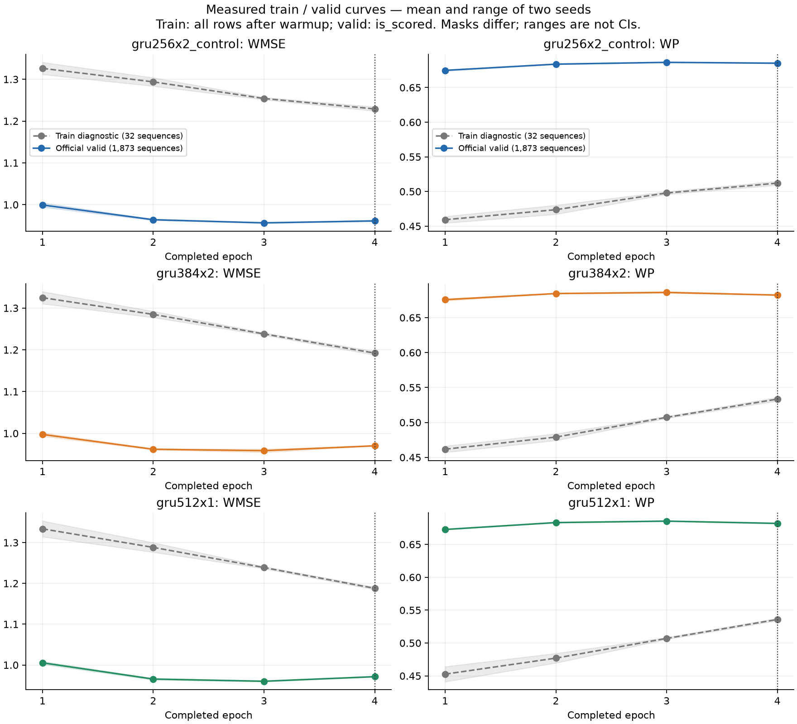
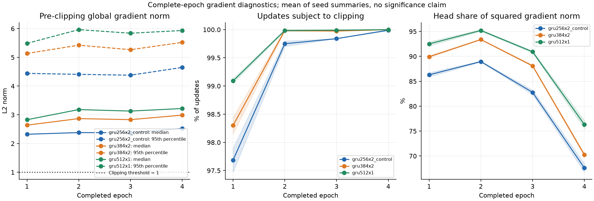

# Completed GRU teachers: fixed endpoint is below the existing W18 anchor

All six fresh GRU teacher fits completed four epochs with zero process exit codes.
Values below come from the captured native history JSON, not terminal rendering.
The earlier conversational claim of a +.003 capacity gain was a terminal-reading
error and is withdrawn. The GitHub comment table was generated from JSON; its
incorrect gain paragraph has been corrected.

| Teacher | Seed1001 fixed ep3 WP | Seed1002 fixed ep3 WP | Mean | Mean delta versus matched scratch control |
|---|---:|---:|---:|---:|
| GRU256x2 control | .68552749 | .68474160 | .68513454 | — |
| GRU384x2 | .68198362 | .68244794 | .68221578 | −.00291876 |
| GRU512x1 | .68157743 | .68223081 | .68190412 | −.00323042 |

Every run's best observed validation checkpoint is zero-based epoch2. These
observations remain separate from the predeclared fixed epoch3 endpoint. Both
validation WP and WMSE deteriorate in the last epoch while the fixed train
diagnostic improves. This is consistent with overfitting or objective mismatch;
these runs do not isolate clipping, LR, or architecture as the cause.

The clean PR60 W18 control mean is .69131307 and fixed TL3 is .69237742. Those
are warm-student/ensemble anchors, not additional fresh-scratch controls. No
new singleton, student, ensemble or public-score improvement is established.
The two Transformer fits and the four predeclared student comparisons have
separate endpoints. Do not replace their fixed teacher epoch with an observed
best checkpoint without a prospective amendment.

The gradients are finite in the completed native diagnostics. Global clipping
at1 acts on almost every update. It preserves the raw gradient direction but
interacts with optimizer momentum/adaptive normalization; a mean clipping
factor is not a measured parameter-update ratio. Gradient norms remain bounded
in the reported epoch quantiles. A paired clip5/clip10 follow-up is proposed,
not admitted to this twelve-fit allocation.

Train diagnostic:32 fitting sequences, all rows after warmup. Official valid:
1,873 sequences,3,528,273 is_scored rows after warmup. Masks and cohort sizes
differ, so the absolute train/valid gap is not directly an overfitting measure.
Lines show means of two seeds; shading shows seed ranges, not confidence intervals.

Gradient curves show means of per-seed epoch summaries. Raw measurements and
source-history hashes are in [GRU_CURVES_COMPLETE_R1.json](GRU_CURVES_COMPLETE_R1.json);
figure hashes are in [the plot receipt](plots/GRU_PLOT_RECEIPT_R1.json).
The original history/checkpoint/provenance artifacts remain on the receiving node.

Training source:27e605aa488651a3ab6cd38d3a1965075c24760f. Primary membership is
the frozen official chronological manifest:10,325 fitting train groups,0 valid
fitting groups, complete official validation. Previously inspected validation
is exposed development. Full-source train inference has10,607 groups; stage2R2
explicitly maps into the10,325 fitting groups and excludes the other282.
