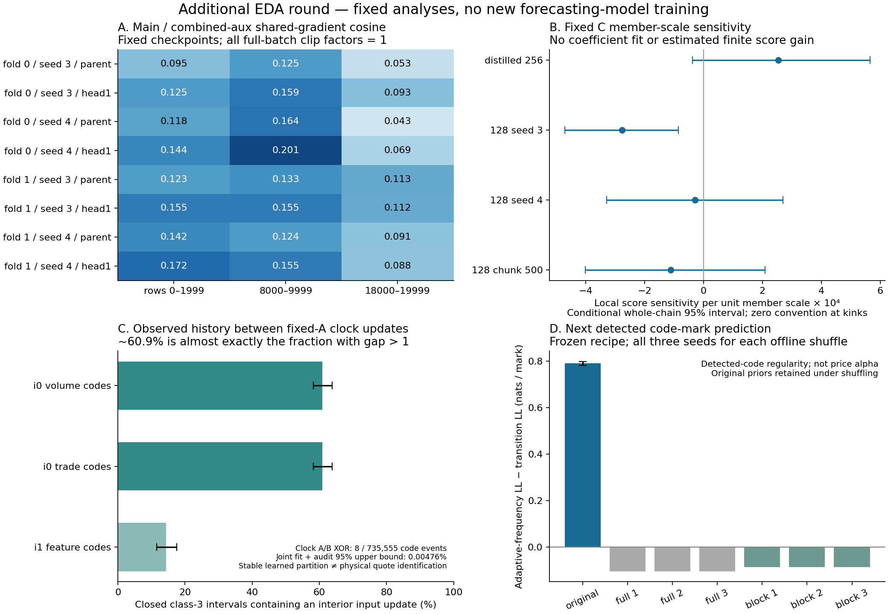

# Дополнительное углубление и статистическая EDA — 1 октября 2026

**Завершены оба раунда:** разбор предпосылок и четыре заранее зафиксированные CPU-диагностики. Главный сдвиг: общее объяснение вреда auxiliary losses стало слабее; бинарный clock оказался существенно устойчивее, чем восстановление величин движений; trade-коды содержат сильную последовательную структуру, но её происхождение пока не отделено от устройства представления и детектора. Ни один результат не устанавливает улучшение competition score.

GitHub-публикации остановлены по просьбе пользователя. Код, планы, результаты, ошибки проверок и независимые рецензии сохранены в локальной рабочей копии и на beleriand. Новых GPU-запусков, обучений ценового прогноза, подборов коэффициентов и submissions нет. Исходная грязная рабочая копия сервера и прежние результаты не изменялись.

## Что именно было сделано

До исходов зафиксированы [общий контракт](contract.json), [разбор предпосылок](deepening-before-results.md) и четыре плана. Авторы веток и проверяющие реализации различались. Проверки запущены последовательно на beleriand с двумя потоками, лимитом 10 GiB и 900 секунд каждая. Все четыре завершились; суммарное время самих скриптов — **234,4 секунды**, максимальный наблюдавшийся RSS — около **1,93 GiB**. Статистические nuisance-оценки — таблицы переходов и частот — разрешены контрактом; новые нейросетевые прогнозы не обучались.

| Диагностика | Наблюдения | Что оценивалось |
|---|---|---|
| TDIAG2 | 4 родителя: 2 seed × 2 fold; их 4 сохранённые головы; 3 окна; 16 цепочек на fold | Геометрия градиентов, стадии, поздний контекст, исключение каждой цепочки |
| CSTAT1 | Фиксированный C: 860 последовательностей, 250 цепочек | Масса метрики, зависимость участников, аналитическая чувствительность масштаба |
| CLOCK2 | По 128 цепочек для двух таблиц; 88 проверочных цепочек | Бинарная воспроизводимость, повторное построение таблиц в bootstrap, содержимое интервалов |
| QMARK | 256 цепочек, по одной последовательности; 681 335 сохранённых меток | Последующая метка против адаптивных частот; полная и блочная перестановки |

Все данные исторически доступны исследованию. Исключение предыдущих выборок и разделение цепочек не создают свежего подтверждающего holdout. Интервалы описательные, без поправки на предыдущий адаптивный поиск. Строки, окна, четыре участника ансамбля и bootstrap-повторы не выдаются за независимые обучения.

## 1. Обучение: широкого конфликта aux с main не обнаружено

В отличие от прошлой выборки с балансировкой классов, TDIAG2 выбирает цепочки без балансировки; внутри цепочки последовательность выбирается фиксированным хэшем. Полный причинный проход по 20 000 строк предшествует окнам 0–1999, 8000–9999 и 18000–19999. Сравниваются родитель epoch3 и фактическая сохранённая head1 на одинаковых наблюдениях; все параметры вне головы проверены на точное равенство. Это **head1, не публичный V1 с head2**.

Суммарный main/aux cosine на общих параметрах головы положителен во всех **24** случаях: **0,0432–0,2009**. В 10 из 12 пар «родитель → head1» сохранённая голова увеличивает его на том же окне. Отдельный next-change компонент может быть отрицательным; складывать признаки компонент вместо их градиентов было бы неверно.

Во всех полных расчётах и вариантах с исключением цепочки коэффициенты глобального clipping равны **1** и для текущего objective, и для main-only. Значит, предыдущий эффект clipping был особенностью прежней выборки, а не показанным общим узким местом. В позднем окне двух родителей fold0 исключение одной и той же цепочки даёт небольшие отрицательные cosine (примерно −0,004/−0,006); у head1 знак остаётся положительным. Это ограничивает переносимость локального знака, но не восстанавливает историю о повсеместном конфликте.

**Изменение приоритета:** aux-off остаётся дешёвой проверяемой абляцией. Оснований обещать, что она исправляет обнаруженный конфликт или активное clipping-ограничение, теперь меньше. При следующем обучении проверять нужно вклад в фиксированный ансамбль с двухэпоховым V1-подобным контролем и парными seed/fold, без обязательного порога по cosine. Эти измерения не воспроизводят состояние Adam, AMP и траекторию обучения.

Полный разбор: [training-statistics.md](training-statistics.md), [результат](training-gradient-result.json), [независимая рецензия](review-training-statistics.md).

## 2. Статистика ансамбля: относительные масштабы важны алгебраически, запас выигрыша не установлен

Единственное воспроизведение базовой метрики дало **C = 0,7024238010052848**, совпадая с зафиксированным значением. Это локальный одноэпоховый C, а не публичные 0,6641 V1. Кандидатные смеси и новые веса не оценивались.

При изменении одного масштаба участника, фиксированных остальных масштабах и коэффициентах ¼ получены следующие локальные чувствительности средней метрики. Значения ниже умножены на 10⁴; это **производные на единицу масштаба, не измеренный или ожидаемый прирост**.

| Участник | Чувствительность ×10⁴ | Условный 95% интервал по цепочкам ×10⁴ |
|---|---:|---:|
| Distilled GRU256 | +2,538 | [−0,373; +5,650] |
| GRU128 seed3 | −2,770 | [−4,713; −0,851] |
| GRU128 seed4 | −0,281 | [−3,292; +2,701] |
| GRU128 chunk500 | −1,120 | [−4,008; +2,082] |

У seed3 знак отрицателен на обоих folds, но интервал fold0 пересекает ноль. Это повод понимать локальную калибровку, а не уменьшать вес без отдельного протокола или удалять участника. Корреляции сырых прогнозов составляют **0,9893–0,9951**: модели очень близки. Кривизна, безопасный шаг и достижимый выигрыш не оценивались. На 7/14 target-строках C находится ровно на границе ±2; там применена заявленная нулевая конвенция, а обычная единственная производная не существует.

EDA метрики показывает ещё два существенных факта:

- Класс3 несёт **43,26% / 45,84%** веса двух целей. Различия средних между классами дают **19,73% / 23,32% общей ковариации** прогноза и цели. Это вклад в ковариацию, не «доля WP» и не доказательство ложного сигнала. Удаление structure-supervision потенциально затрагивает эту часть геометрии, но причинный эффект здесь не измерен.
- Десять самых тяжёлых цепочек несут **18,14% / 18,67%** веса; верхние 10% цепочек — **34,64% / 35,18%**. Концентрационный индекс соответствует примерно 120/118 равновесным массам, но **не является числом независимых наблюдений**.

Без финального clipping глобальный сдвиг одного участника сдвигает ансамбль на константу и оставляет корреляцию неизменной. Поэтому четыре affine-параметра одной головы — не четыре независимые возможности улучшения: глобальные intercept становятся активны из-за clipping или другого, например различного по folds, отображения. Прежние отрицательные class/calibration-эксперименты остаются релевантными. Ensemble-aware loss с замороженными партнёрами сохраняется как отдельная гипотеза; EDA не сделала его доказанным приоритетом.

Детали и формулы: [training-statistics.md](training-statistics.md), [исходная статистика](ensemble-statistics-result.json).

## 3. Архитектура: воспроизводим бинарный clock, а не физические котировки

Две свежие таблицы строились по всем последовательностям раздельных обучающих цепочек. Проверочные labels не читались. На классе3 решения об обновлении состояния различаются в **8 из 735 555 кодовых событий — 0,0010876%**. Joint-bootstrap, повторно строящий таблицы из цепочек и пересэмплирующий аудит, даёт 95% интервал **[0,0004854%; 0,0047643%]**. Новый заранее определённый критерий воспроизводимости бинарного разделения пройден.

При этом на общих ключах **43 из 227 величин signed move различаются**, а бинарных различий на этих ключах **ноль**. Все восемь наблюдаемых расхождений связаны с ключами, известными лишь одной таблице, и fallback. Это объясняет, почему прежний тест восстановления величин провалился, а новый бинарный тест может пройти. Старый провал не отменяется. Низкая чистота modal target-jump также не равна нестабильности бинарного решения; она не становится вероятностью физически правильной котировки.

Обе таблицы убирают примерно **37,85%** proxy-записей класса3; эффект есть на всех 64 его проверочных цепочках. На классах0–2 свежие таблицы ничего не распознают: обе используют один fallback. Их нулевое расхождение — не независимое подтверждение декодирования этих классов.

**Содержательная поправка к архитектурной мотивации.** В 60,8961% закрытых интервалов класса3 есть внутренние обновления volume/trade-кодов. Но среди 456 824 интервалов 178 635 имеют gap=1; почти каждый оставшийся интервал — **278 188 из 278 189** — содержит обновление. Поэтому впечатляющие 60,9% почти целиком отражают наличие промежуточной строки. Это не свидетельство дополнительной полезной памяти и не доказательство недостаточности нынешних 99 event-фичей.

**Что стало допустимее исследовать дальше:** фиксированную воспроизводимую partition как инженерный способ обновления состояния, не как сертифицированный восстановленный quote clock. Следующее архитектурное сравнение должно различать замену clock и замену event-токена `z_t → h_t`, иметь обычный row-GRU контроль, учитывать общий gradient path, корректно замораживать `event_gru` при head-only FT и проверять runtime внутри ансамбля. Ни одно такое обучение в этом раунде не запускалось.

Подробности: [clock.md](clock.md), [результат](clock-output/clock-result.json), [независимая рецензия](clock-independent-review.md).

## 4. Quant: сильная предсказуемость кодовых переходов; происхождение эффекта ещё нужно разделить

На 256 train-only цепочках четыре trade-volume кода преобразованы в 16 категорий посредством центров, оценённых только на противоположной половине. Вероятность следующей метки строится до её наблюдения; частоты обновляются после scoring. Primary-control F адаптирует маргинальные частоты внутри последовательности. T добавляет предыдущую категорию и адаптивные переходы. Текущие labels цены, класс и будущие значения не входят в предиктор.

Средний по цепочкам log-loss составляет **1,9253 у F против 1,1355 у T**. Выигрыш — **0,78976 nats/метку**, условный 95% интервал **[0,78148; 0,79799]**, около **41,0%** потери F. Обе половины и все четыре класса положительны; преимущество есть уже в первых 16 метках. Primary screening проходит.

При полной перестановке меток выигрыш T становится около **−0,1033**, при перестановке внутри блоков128 — **−0,0854**. Все три seed каждого контроля сохранены. Это показывает, что текущая переходная модель использует порядок, но величину «original минус shuffle» нельзя назвать чистой рыночной информацией: prior переходов выучен на исходном порядке и сохранён на переставленных данных. Часть провала контроля может объясняться несовпадением prior с новым процессом.

Дополнительные описательные признаки заставляют серьёзно рассматривать устройство кодов и детектора:

- Доля подряд одинаковых категорий — **5,79%** в исходном порядке против примерно **18,11%** после полной и **20,12%** после блочной перестановки. Детектор по определению отбирает изменения и не-нейтральные состояния; ограничения переходов могут возникать из этого правила.
- Преимущество заметно уже в первых16 событиях, а некоторые категории отсутствуют. Переставленная цепочка категорий не обязана соответствовать допустимому исходному потоку с тем же детектором.
- При смене центров на центры другой половины меняются **4,04%** сохранённых меток; неоднородность по классам велика. Интервалы этого раунда фиксируют центры и priors и не включают неопределённость их оценки.

**Следующая содержательная проверка перед превращением результата в «flow surprise»:** отдельно зафиксировать контроль, учитывающий механические запреты/сбросы детектора, и surrogate, согласованный с процессом наблюдения. Различить пользу transfer-prior, онлайн-адаптации и самого предыдущего контекста. Это следующий план, не добавленная после результата попытка текущего раунда. После такой проверки причинная фича может называться инновацией наблюдаемого кода, но не aggressor flow без идентификации. Её полезность всё равно потребует сравнения с текущим GRU, который уже видит raw history.

Подробности, все классы, cap/encoding-диагностики и ограничения: [quant-mark.md](quant-mark.md), [результат](quant-mark-result.json), [независимая рецензия](review-quant.md).

## Пересмотр порядка дальнейшей работы

| Направление | Что изменил этот раунд | Следующее различающее сравнение |
|---|---|---|
| Quant code innovation | Сильная измеренная структура, но наблюдательный механизм не отделён | Сначала detector/topology-контроль и разбор prior; затем отдельная проверка вклада фичи в ансамбль |
| Бинарный event clock | Основной вопрос воспроизводимости решения снят на этой выборке; quote truth не доказана | Разделить clock-интервенцию и `h_t`-токен; обычный row-GRU, serving-метрика и стоимость |
| Aux-off head FT | Гипотеза общего gradient conflict и clipping bottleneck ослабла | Маленькая парная абляция с V1-подобным контролем; основание — возможная прикладная польза, без обещания механизма |
| Ensemble-aware FT / масштабы | Математическое различие objective реально, практический выигрыш пока не установлен | Отдельный affine-control против полноценного изменения головы; без oracle-headroom и без подбора на этих readouts |
| Sparse volume dictionary | Прежняя геометрическая проверка провалена; новых подтверждений нет | Не возобновлять тот же подбор под новым названием |

Для ближайшего содержательного углубления quant-механизм теперь интереснее простого рассказа о конфликте aux. Для первого дешёвого **обучающего** сравнения aux-off всё ещё может иметь хорошее отношение стоимости к информации. Это разные критерии приоритета. Массовая смена архитектуры, поиски новых весов и новые submission пока не следуют из этих данных.

## Воспроизводимость и сохранение

В этой директории находятся планы, скрипты, immutable JSON с входными идентификаторами, stdout/resource logs и независимые reviews. Synthetic-check исправление и ошибка самого тестового ожидания сохранены в `clock-preexecution-fix.json` и `clock-selftest-failure01.json`; реальные четыре запуска завершились с exit0, без подмены выборок или повторных эмпирических попыток. График строится исключительно из сохранённых JSON через [plot_diagnostics.py](plot_diagnostics.py). [manifest.json](manifest.json) перечисляет контрольные суммы итоговых файлов.

Предыдущий лучший публичный результат остаётся V1 **0,6641**. Этот раунд улучшил обоснованность исследовательских решений и не создаёт нового SOTA-кандидата. Новые материалы сохраняются локально и на beleriand; GitHub не обновлялся.
