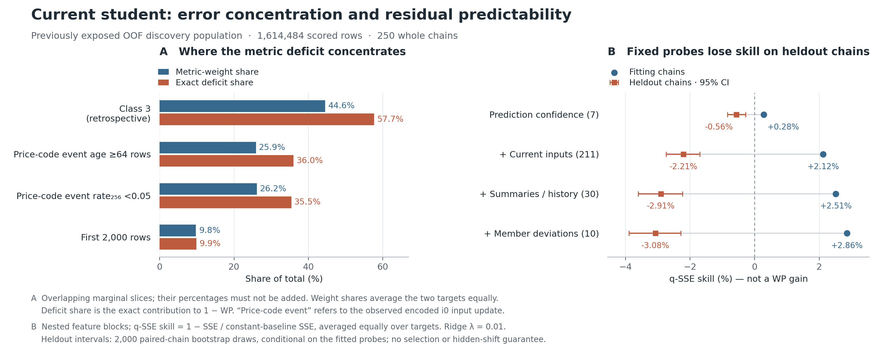

# Что удерживает качество на плато

1 октября 2026. Этот раунд отвечает на запрос разобрать ошибки модели перед следующим обучением. **Нового улучшения прогноза здесь нет. Получен более узкий диагноз: основные модели разделяют ошибку, особенно на малоактивных участках; простые корректоры находят закономерности, которые не переносятся между цепочками.** Общего запаздывания реакции на уже наблюдаемое событие или крупного провала на границах чанков не обнаружено.

Исследование использует 1 614 484 оцениваемые строки, 860 последовательностей и 250 целых цепочек в двух уже многократно использованных OOF-фолдах. Это discovery, а не новое независимое подтверждение. Все прогнозы взяты из согласованных GPU/AMP-кэшей; native и GPU не смешиваются. Контрольный WP текущего student4 воспроизведён как 0.702379667615 с расхождением менее 8.3e-13. План, исходники, отрицательные результаты и численные проверки сохранены; обучение прогнозной модели, подбор нового ансамбля и публичные отправки не выполнялись.

## Что мы делали не так

**Число запусков преувеличивало разнообразие поиска.** Из 52 ночных обучений 44 меняли только головы; это не 52 проверки разных представлений. Последующий однослойный student действительно решил задачу стоимости: сильный ансамбль укладывается в измеренные 44 мин 32 с. Но его разница с прежним сильным ансамблем около нуля. Второй shallow seed также не принёс устойчивой прибавки. Инженерный результат полезен для посылки, но не означает нового предсказательного сигнала.

**Мы неоднократно превращали описание ошибки в идею корректора без проверки доступности информации.** Длинные серии остатка и хорошая корреляция с прогнозом после следующего будущего события не означают, что остаток можно предсказать сейчас. Исторические sign/magnitude, ARMA и future-shift оракулы показывают пространство ошибки; они не дают разрешённых онлайн-признаков. Новая проверка событий специально различает реакцию на уже пришедший вход и появление будущей информации.

**Успех на знакомых цепочках слишком легко принимался за переносимый сигнал.** В новом линейном анализе на одну fitting-половину приходится всего 61–65 цепочек. Миллионы строк сильно зависимы. Старые E235/E236 уже меняли знак при переходе от выбранной части данных к полным фолдам. Поэтому наращивание признаков и последующий подбор регуляризации на том же наборе не являются хорошим ответом на текущий отрицательный результат.

## Где именно теряется метрика

«Доля ошибки» ниже — точный вклад в `1−WP`, а не средний MSE или среднее корреляций по последовательностям. Для каждой цели globally weighted-standardized target и prediction обозначены `u,z`; дефицит равен `¼ Σ_target E_weight[(u−z)²]`. Вклады непересекающихся групп складываются точно.

| Срез | Доля веса метрики | Доля дефицита |
|---|---:|---:|
| Ретроспективный класс 3 | 44.55% | **57.70%** |
| Не было выбранного изменения входного price-кода ≥64 строк | 25.92% | **36.01%** |
| Доля таких событий за 256 строк <5% | 26.18% | **35.45%** |
| Первые 2000 строк после начала последовательности | 9.76% | 9.86% |
| Первые 100 строк условного чанка 2000 | 4.54% | 4.57% |

Срезы пересекаются: проценты строк таблицы нельзя складывать. Ретроспективный класс извлечён из целей и не доступен на inference. Анонимизированные price-коды не считаются физическими ценами; «пауза» здесь означает отсутствие конкретного наблюдаемого изменения кода, при этом остальные входы могут меняться.

После этого результата выполнена одна дополнительная описательная проверка: те же фиксированные возрастные bins внутри класса, фолда и цепочки. **Эффект паузы не объясняется только составом классов.** В классе 3 среди 117 цепочек с положительным весом обеих целей в обеих сравниваемых группах средняя интенсивность `(u−z)²` равна **0.916 при возрасте ≥64 против 0.533 при возрасте 0–15**. Разность положительна в **99 из 117 цепочек**, невзвешенная медиана разностей +0.282; оба фолда имеют положительную медиану. У классов 0/1 медианы также положительны, у класса 2 — около нуля и знаки по фолдам различаются. Это post-readout уточнение локализации, не причинная оценка: строки внутри одной цепочки всё равно отличаются по содержанию и будущим исходам. Полные таблицы и исключённая из paired-сравнения одна цепочка: [conditional-regimes.md](conditional-regimes.md).

Цели t0 и t1 дают близкие доли общего дефицита: 0.15068 и 0.14694. Основания сильно перевзвешивать одну цель нет. Крупнейшие 25 цепочек несут 38.65% дефицита, но также 31.89% веса: это не несколько очевидно испорченных примеров, которые можно удалить.

У класса 3 прогноз имеет меньшую относительную амплитуду, однако простое увеличение масштаба не следует из этого наблюдения: условное среднее закономерно менее изменчиво, чем будущая реализация. После разложения по классам 86.2% всего дефицита приходится на недостаток внутри-классовой ковариации, а не на различие средних и стандартных отклонений. Это **не** оценка доли необратимого шума.

## Что проверка простых объяснений уже исключает

Четыре фиксированных ridge-пробы пытались предсказать компонент ошибки, связанный с локальным улучшением корреляции, с нормировками только на fitting-цепочках. Один заранее выбранный штраф, без подбора. Результат — изменение weighted qSSE относительно константы, **не прибавка WP**:

| Доступные предикторы | Fitting skill | Heldout skill |
|---|---:|---:|
| Прогноз и confidence | +0.283% | **−0.564%** |
| + текущие 211 входов | +2.119% | **−2.208%** |
| + 30 summaries/history | +2.511% | **−2.906%** |
| + отклонения членов ансамбля | +2.856% | **−3.076%** |

У всех четырёх pooled heldout-интервалы лежат ниже нуля. Fitting skill вычислен позднее по уже сохранённым коэффициентам, без нового обучения. Картина согласуется с переобучением/непереносимостью конкретных линейных поправок. Она не опровергает нелинейный сигнал, не доказывает предел информации и не оценивает обобщение всех прежних нейросетей. History-блок смешивает дополнительные summaries и дубли имеющихся входов: это не чистая абляция длинной памяти.

Общий остаток намного больше разногласий компонентов. Для четырёх текущих членов энергия общего остатка — 0.29675, дисперсия стандартизованных прогнозов — 0.00303. Зависимость членов означает, что это не четыре независимых свидетельства о природе ошибки. Однако очередной близкий seed выглядит слабым ответом именно на найденную проблему.

Проверка 55 040 входных событий также не поддержала общий диагноз «GRU запаздывает»: на самом событии прогноз уже существенно меняется, а ориентированная чувствительность метрики мала или имеет разные знаки. Поэтому быстрее обновлять состояние при каждом событии сейчас незачем. В дальней части event-curves меняется состав оцениваемых строк, а quiet-хвост +64 содержит всего 5/14 строк по фолдам. По этим хвостам нельзя объявлять ни задержку, ни избыточную реакцию.

## Следующий опыт и решения по его исходам

**Первым — контролируемое воспроизведение одних и тех же строк с разной глубиной прошлого, без обучения.** Взять текущий shallow256 checkpoint каждого фолда. Заранее фиксированные четыре блока по 512 строк начинаются на позициях 4096, 8192, 12288 и 16384 каждой последовательности. Для каждого блока сравнить обычную историю от начала последовательности со сбросом только рекуррентного состояния за 256 либо 2048 строк до блока. Все 211 входных признаков предварительно вычисляются с настоящего начала последовательности: возраст событий, held deltas и нормировки во всех вариантах идентичны. Остальные три компонента ансамбля и четвертные веса фиксированы.

Проверка рассматривает все оцениваемые строки этих блоков, отдельно тихие участки класса 3 и контрастный класс 2. Оба укороченных контекста сравниваются с одним полным контролем; нет выбора лучшего начала для каждой строки, усреднения удачных вариантов или подбора длины по результату. Сначала требуется численно воспроизвести полный контроль и проверить, что replay с сохранённым настоящим incoming state возвращает тот же suffix-прогноз. Сравнение прогноза, ошибки и её изменения по целым цепочкам важнее одной корреляции состояний. Полный дизайн и исторические ограничения: [next-test-critique.md](next-test-critique.md).

- Если укорочение стабильно уменьшает ошибку, особенно в тихом классе 3, появляется основание для **одного парного полного обучения с рандомизацией начала контекста и неоцениваемым прогревом**. Число supervised-строк и optimizer updates нужно уравнять. Сам reset — непривычное модели состояние, поэтому положительный replay ещё не доказывает пользу такого обучения.
- Если более длинный контекст полезен, периодические сбросы и сокращение истории теряют основание. Это подтверждает использование прошлого, но не означает, что ещё более длинная память улучшит текущую полную модель.
- Если влияние быстро исчезает или не связано с ошибкой, прекращаем эту проверку. Нулевой эффект не различает уже забытый полезный сигнал и отсутствие полезного сигнала в прошлом; нельзя объявлять ни успешную память, ни информационный потолок.

**Резерв для следующего полного обучения — причинная нормализация по прошлому последовательности при сохранении нынешнего parent/EMA/distillation/H2-рецепта.** Её смысл — проверить перенос представления между цепочками. Это возвращение к старому механизму при другом сильном контроле, не новая идея: E258/E259 давали полезную структурную добавку, но E185 имел +0.00113/−0.00051 по фолдам, а поздний B+on128 дал около −0.0002 на fold0. Поэтому сейчас нет основания автоматически запускать эту ветку или прогнозировать ей выигрыш. Полное ensemble-aware residual-обучение также не опровергнуто прежними frozen-head тестами, однако новый разбор не даёт ему приоритета и сохраняется проблема in-sample партнёров.

Глобальное повышение веса тихих строк не выбрано: since-weight уже улучшал общий результат примерно на 0.0008 в E182/E194, хотя низкоактивный терциль в E190 был слабее. Большой бюджет ошибки не равен большой исправимой ошибке, а повторяющиеся исходы могут усиливать переобучение. Новые близкие seed, общий event-update gate, сглаживание и ещё один линейный age-корректор также не выделены в работу.

**В этом раунде следующий forward-only опыт выбран и описан, но ещё не запущен.** Новая архитектура/обучение будут отдельным контролируемым вмешательством после его результата, а не пакетом из нескольких одновременно изменённых идей. Цель выбора — получить ответ, который меняет дальнейшее действие, а не увеличить число завершённых запусков.

## Границы вывода и сохранность

Полная статистика, условные интервалы и определения: [statistical-report.md](statistical-report.md), [analysis-01/results.json](analysis-01/results.json). Событийные кривые и ограничения выборки: [event-response-01/findings.md](event-response-01/findings.md). Что уже проверялось раньше: [historical-error-audit.md](historical-error-audit.md). Исходный контракт: [plan.json](plan.json).

Семь синтетических проверок основного анализа и отдельные проверки причинных признаков, события/маски и производной clipping прошли. Второй агент проверил формулы weighted ridge, исключение целевых колонок из X и chain cross-fit по исходникам. Это проверка расчёта, а не независимая репликация обобщения. Основной анализ занял 28 секунд CPU, извлечение — 175.5 секунды, event-analysis — 10.5 секунды; GPU не использовался. Четыре исходных диагностических NPZ, 376.4 MB, сохранены локально и на beleriand с совпадающими хешами. Квалифицированная посылка и закрытый overnight-архив не изменены. GitHub остаётся выключен.
