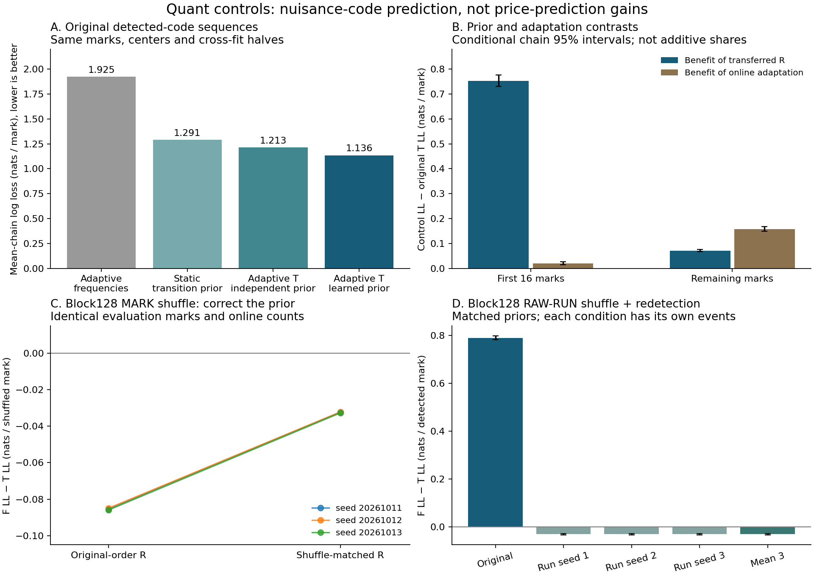

# Quant-контроли: prior и механизм наблюдения — 1 октября 2026

**Оба зарегистрированных контроля завершены.** Несогласованный prior действительно завышал прежний отрицательный результат на перемешанных метках. Однако большая предсказуемость исходных trade-кодов не сводится к этому prior: её значительную часть модель изучает внутри последовательности. Перестановка исходных участков кода с повторным запуском детектора не воспроизводит исходное преимущество. Сохранённых частот значений, длительностей и самого правила детекции недостаточно; существенна структура, разрушенная перестановкой. Её рыночная природа и полезность для прогнозирования цены пока не установлены.

Проведены ровно два CPU-запуска на beleriand, суммарно **44,41 секунды** работы скриптов, с пиком памяти около **1,01 GiB**. Ценовые targets, validation features и prediction caches не читались. Новых GPU/forecasting fits, WP-сравнений, submissions и GitHub-публикаций нет. Все материалы сохранены локально и на beleriand.

## Постановка и достоверность вычислений

Использованы прежние 256 train-only цепочек, по одной последовательности, две половины, фиксированные центры кодирования и первые 4096 обнаруженных событий. Частоты и переходы оцениваются на одной половине, другая служит для оценки; затем направления меняются. Вероятность очередной категории определяется до её наблюдения. Исторические классы нужны только для выборки и отчётности.

Обозначения: **F** — адаптивные частоты категорий; **T** — адаптивная таблица переходов от предыдущей категории; **R** — перенесённый transition-prior. Выигрыш `LL(F) − LL(T)` измеряется в натах на метку: положительный означает преимущество T. Это не competition WP и не измерение дополнительной информации для нынешнего GRU.

[Контракт](contract.json), [исходная критика](critic-before-results.md), [план PRIOR02](prior-plan.json) и [план DETECTOR02](detector-plan.json) зафиксированы до новых результатов. Независимые скалярные реализации проверили вероятности, причинность, точное перемешивание сырых байтов и разные знаменатели. Исходные хэши категорий, priors и потери воспроизведены. Оба эмпирических запуска завершились с exit0, без повторной настройки рецепта.

Все интервалы ниже условные, по 1000 парных bootstrap-перевыборок целых цепочек внутри half×class. Центры, nuisance-таблицы и три перестановки фиксированы. Это продолжение исследования на уже использованных данных, без поправки на адаптивный поиск и без новой проверки переноса на скрытый тест. Независимость программных проверок не делает данные свежими.

## PRIOR02: исправление prior существенно, но исходный эффект сохраняется

В старом контроле категории перемешивались внутри блоков 128, а R оставался обученным на исходном порядке. Теперь для каждого из трёх фиксированных seed R обучен на соответствующей перестановке **обучающей** половины. На проверочной половине сравниваются те же метки и онлайн-счётчики; меняется только R.

| На перемешанных метках, среднее по seed и цепочкам | Выигрыш T относительно F |
|---|---:|
| Старый R, обученный на исходном порядке | −0,085408 |
| R, согласованный с перестановкой | −0,032434 [−0,034928; −0,029580] |
| Улучшение потери T от замены R | **+0,052974 [0,049603; 0,056654]** |

Исправление сокращает примерно **62% прежнего проигрыша T на этих же переставленных данных**. Это арифметическая доля конкретного отрицательного gap, не доля исходного сигнала или эффекта детектора. Улучшение наблюдается на всех трёх seed, обеих половинах и всех классах, однако на полном префиксе T всё ещё проигрывает F.

На исходном порядке также проверены два дополнительных фиксированных варианта:

| Предиктор | Средний log-loss |
|---|---:|
| F: адаптивные маргинальные частоты | 1,925276 |
| Статический перенесённый R, без онлайн-адаптации | 1,291035 |
| T с независимым prior: каждая строка равна глобальному π | 1,212911 |
| T с перенесённым R и онлайн-адаптацией | **1,135520** |

Даже без перенесённой условной структуры T выигрывает у F примерно **0,71237 нат**. Перенесённый R дополнительно улучшает этот T на **0,07739** [0,07240; 0,08285]. Онлайн-адаптация улучшает статический R на **0,15552** [0,14704; 0,16570]. Эти контрасты пересекаются: складывать их как независимые причинные доли нельзя.

В первых 16 метках перенесённый R особенно важен: его преимущество над независимым prior составляет **0,75361**, а адаптация над статическим R добавляет лишь **0,02032**. После первых 16 соответствующие значения — **0,07141** и **0,15658**. Поэтому результат поддерживает сочетание переносимой структуры и обучения переходам внутри последовательности. Приписывать всё эффекту первых событий или готовой таблице неверно.

Нюанс контроля: после согласования R на первых 16 *перемешанных* метках T слегка лучше F (+0,02767), а на последующих хуже (−0,03321). Утверждение об исчезновении преимущества относится к полному префиксу, не ко всем горизонтам. Полные классы, половины и все seed — в [prior.md](prior.md) и [prior-result.json](prior-result.json).

## DETECTOR02: правило наблюдения само по себе не воспроизвело эффект

Построен один заранее определённый surrogate. Максимальные участки побитно одинакового четырёхмерного кода превращаются в пакеты «вектор + длительность». Целые пакеты перемешиваются внутри блоков 128; затем исходный детектор запускается заново. Сохраняются совместные значения четырёх координат, их построчные количества и связь кода с длительностью внутри каждого исходного блока. Положение нейтральных/невалидных состояний, порядок переходов и итоговые максимальные runs не сохраняются. Слияния соседних одинаковых пакетов разрешены и учитываются; отбор «удачных» перестановок отсутствует.

Для каждого seed и половины **и π, и R** заново оценены на соответствующем surrogate обучающей половины. Центры остаются прежними. Это контроль определённого синтетического процесса наблюдения, не физический симулятор рынка и не точный randomization test.

| Условие | Средний выигрыш T относительно F, нат/метку |
|---|---:|
| Исходный порядок | +0,789757 [0,781656; 0,798443] |
| Raw-run surrogate, seed 20261011 | −0,031121 |
| Raw-run surrogate, seed 20261012 | −0,031361 |
| Raw-run surrogate, seed 20261013 | −0,031370 |
| Среднее трёх surrogate | **−0,031284 [−0,033773; −0,028550]** |
| Исходный минус средний surrogate | **+0,821041 [0,812124; 0,830342]** |

Все 256 цепочек остаются в парном сравнении; каждое из восьми strata содержит 32 цепочки. На полном префиксе surrogate-выигрыш отрицателен у каждого seed, в обеих половинах и всех четырёх классах. На первых 16 метках сохраняется небольшое преимущество +0,0247…+0,0285, затем оно отрицательно. Близость итоговых потерь к prior-matched mark shuffle описательна; формальная эквивалентность двух контролей не проверялась.

**Сопоставляются цепочки, а не одни и те же события.** Сохранённых меток стало 670 684 / 670 649 / 670 665 вместо 681 335 — уменьшение примерно на 1,56%. Количество цепочек, достигших cap, снизилось 80→77. Слияния затронули около 87 тысяч границ пакетов; изменились нейтральные переходы, gaps и охваченные участки строк. Поэтому для event-weighted статистики каждый вариант использует собственный знаменатель. Малый сдвиг количества событий не делает наблюдения тождественными и не изолирует чистый эффект порядка.

Вывод узкий, но полезный: **этот набор сохранённых статических свойств вместе с тем же детектором не воспроизводит большое исходное преимущество T**. Простая версия объяснения через него ослабла. Но порядок состояний кодирования или работы источника данных тоже разрушен перестановкой — такие объяснения остаются. Называть разницу 0,821 «рыночной информацией», «долей настоящих сделок» или доказанным alpha нельзя. Подробнее: [detector.md](detector.md), [результат](detector-output/detector-result.json), [независимая рецензия](review-controls.md).

## Что делать дальше

Оснований продолжать поиски ещё одного permutation-контроля меньше, чем оснований проверить **прикладную полезность причинного описания переходов кодов**. Следующий различающий эксперимент — небольшая feature-ablation поверх сохранённого GRU, с фиксированным контролем сопоставимого размера. Предложение сформулировано в [next-feature-study.md](next-feature-study.md); это дизайн следующего опыта, не зарегистрированное или уже запущенное обучение.

Оба варианта должны видеть текущую и предыдущую категории, счётчики и возраст события. Дополнительный блок одинакового размера в контроле содержит вероятности/инновации из адаптивных маргинальных частот F, а в проверяемом варианте — соответствующие каналы из условных переходов T. Бюджет обучения и причинные reset/update правила одинаковы. Это позволяет спросить, помогает ли явная статистика переходов уже имеющейся модели, а не только умеет ли она предсказывать собственные коды. Главный outcome — вклад в фиксированный обслуживаемый ансамбль с корректным двухэпоховым контролем, не standalone log-loss меток.

Физическая идентификация order flow не обязательна для такого соревнования, но честное название фичи и отсутствие утечки обязательны. До ценового сравнения результат остаётся исследованием наблюдаемых кодов. Текущий лучший публичный V1 **0,6641** не изменён.

## Артефакты и воспроизведение

Планы, код и проверки связаны SHA256; [manifest.json](manifest.json) перечисляет все итоговые файлы. [execution-summary.json](execution-summary.json) содержит лимиты и результаты исполнения. Независимые тесты находятся в `independent_prior_check.py` и `independent_detector_check.py`. График воспроизводится из сохранённых JSON через [plot_controls.py](plot_controls.py).

Сохранены два технических эпизода до/вне эмпирического исполнения: несовместимость локального Python3.9 с `zip(strict=True)` в synthetic-test и правка исключительно synthetic-test, пересёкшая уведомление о freeze. Финальный и реально исполненный код имеют одинаковые хэши; научные рецепты не менялись, эмпирических повторов не было. Предыдущие эмпирические результаты неизменны; GitHub не обновлялся.
