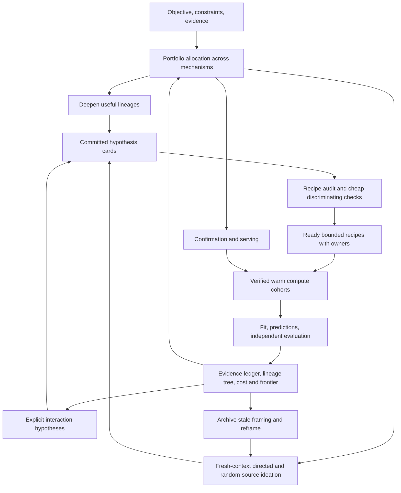

# Research pipeline and portfolio renewal

This is the compact controller entry point. [Research methods](../research/RESEARCH_METHODS.md)
remain the reusable methodology; [AGENTS.md](../AGENTS.md) supplies current tools,
models, ownership boundaries and execution rules. The live frontier and current
receipts determine what is actually running. New user instructions override old
allocations.

## One continuous loop with distinct responsibilities

Allocation is bandit-like, not a single additive reward ranking. Unknown arms start
with qualitative priority/null numbers. Relevant observations update measured cost
and effect; access failures update execution knowledge. Preserve independent
exploration and complete-endpoint confirmation while deepening promising branches.

Every delegated role gets a basis, bounded context, write scope, comparison,
budget and exact deliverable. Initial ideas from different models remain independent
until committed. Critics test concrete claims; graders do not let actors change
the metric or evaluated ancestry. The controller makes final allocation decisions.

## Ideas, combinations and changing direction

Mix different LLM families/harnesses, directed papers and recorded random library
passages. Transfer small useful components instead of demanding the whole paper's
method fit the task. Ask for a serious attempt, structural correspondence and
cheap falsifier; preserve honest non-applicability. Generate across representation,
time, factorization, instrumentation, inversion and surprising residuals.

A component's standalone rank does not settle its conditional value. Register
interactions with parent links, then evaluate the frozen complete combination.
Choose a few combinations from residual/regime/mechanism evidence instead of
blindly enumerating pairs or adding parent gains. Previously inspected validation
remains exposed, including when another agent proposes the combination.

After an informative result, decide whether to deepen, combine, confirm or reframe.
Review overall allocation approximately every two hours during this authorized
continuous campaign, and sooner after a decisive result or execution bottleneck.
Repeated low-information tuning calls for a different question. Archive the stale
recipe and its reopening condition, remove its explanation from fresh ideation
context, and restore the evidence for later audit. A changed representation or
interaction may reopen a direction. Neither an interval crossing zero nor a fitted
family asymptote is a universal rejection rule.

## Compute continuity and scaling

[ADR0022](adr/0022-prepared-successors-and-paid-warm-cohorts.md) makes successor
readiness an explicit controller responsibility: prepare/review an executable
next recipe and independent fallback while the current accelerator job runs.
Start an admitted successor on valid completion without another user prompt.
Keep finite paid warm cohorts productive, then collect and tear down our proven
worker rather than pay to hold data while awaiting code or ideas.

Local GPU, Kaggle GPU/TPU and owned Vast lanes need useful work or an active owner
preparing/repairing their next runnable step within actual access and constraints.
Queueing and staging are real phases, not fitting. Do not claim achieved utilization
from launch intent. For each lane keep the current handle, phase, next recipe,
owner, terminal/repair action, projected cost and remaining lifetime visible.

Warm cohorts amortize data verification/loading/compilation across useful fits and
exports. Stream sources that cannot fit in RAM. Preserve independent model state
and verify preprocessing when changing recipes. Observe aggregate RAM including
file cache, device memory, OOM counters, progress and exit status. Different
providers need their own measured headroom and objective/device checks.

Scale when useful ready work exceeds measured capacity and additional parallelism
buys earlier actionable evidence within authorized spending. Count total transfer,
startup, fit, export and collection cost. Compare one multi-GPU warm host with
multiple hosts before repeating large transfers. Prepare diverse successors before
renting capacity; CPU data throughput and RAM can bottleneck additional GPUs.
The target of 5–6 completed distinct screens/hour is an allocation objective, not
an achieved rate or a requirement to truncate full-model training.

## Skills and concrete handoffs

| Need | Skill / deliverable |
|---|---|
| Long-horizon actor/critic research | `conduct-creative-research`: bounded contract and evidence loop |
| Portfolio renewal and interactions | `research-portfolio-control`: dated allocation and explicit lineage decisions |
| Independent framing | `research-reframe`: committed source-grounded cards from minimal fresh context |
| Equation/source/command fidelity | `research-recipe-audit`: actual recipe audit before costly fits |
| Experiment through artifacts | `research-experiment-delivery`: fit/checkpoint/predictions/terminal handoff |
| Warm sessions and scaleout | `research-compute-throughput`: measured phases, next useful cohort and bounded capacity decision |
| Promotion validity | `research-evidence-review`: independent ancestry/comparison/claim review |
| Human-readable EDA | `marimo-pair`: bounded live-kernel notebook plus lineage `plots/` artifacts |

The two new skills are narrow controller extensions, not additional approval
layers or generic runner frameworks. Read only the relevant skill references.
Use existing tooling first; write a helper only for a concrete gap. Commit source,
recipes, evidence and decisions at meaningful steps. Preserve immutable originals;
keep current summaries compact and link the archive/tree for detail.
