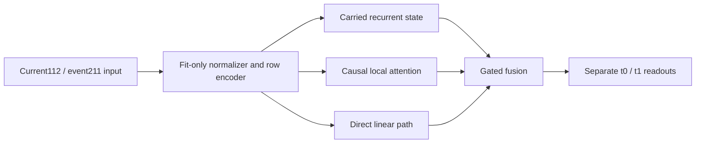

# Architecture portfolio for eight B300 and eight L4

Status: planning and source review,7 November2026. No training, profile, SSH,
data transfer, provider allocation or GitHub write ran in this task.
[Contract](CONTRACT.md), [independent lenses](#independent-lenses),
[arithmetic](PLANNING_ARITHMETIC.json), [sources and non-duplication](SOURCES.md).

## Decision

My highest-upside new architecture is a **causal hybrid of compressed recurrent
memory and local attention**, with a small direct input/EMA path. My first
implementation-backed handoff is **PR67's Transformer trained for its
fixed TL3 contribution**, after receiving acceptance; it has zero new profiles
or fits. These are two different
priorities: a new representation to investigate, and an implemented experiment
closest to the final objective. Neither has established a new score gain.

The portfolio should learn which memory/representation is useful before paying
for billion-parameter teachers. Large training models are allowed, but final
scoring remains CPU-only. Teacher quality, student quality and a complete served
mixture are separate endpoints.

## Refreshed evidence

| Item | Reported outcome | Interpretation |
|---|---:|---|
| Clean train-only TL3, official valid |0.6923774245652725| Primary development reference, exposed |
| Fixed90%TL3+10%LSTM |0.692502063| Small selected local gain; public transfer unconfirmed |
| PR61 GRU256x2 teacher control mean |0.6851345441432545| Teacher-family comparator, not the TL3 mixture |
| PR61 Transformer seeds, reported full-valid WP /4E endpoint |0.6717207056476808 /0.6729531605803009| Operator report; not independently regraded here or a family-wide ceiling |
| PR61 TF student transfer |not_started| Profile identity gate failed before target construction; no KD-quality conclusion |
| PR62 clip5 / late auxiliary anneal |negative| Do not spend another wave repeating these exact variants |
| Public TL3,6 November audit |0.66832| Dated portal observation; not today's live check |
| Final all-labels W18, same audit |0.66453| Submitted recipe lost0.00379 to old TL3; not a clean-valid score |

The [actual terminal PR61 comment](https://github.com/VladKochetov007/WunderFunder/pull/61#issuecomment-6639856413)
reports10/12 fits completed. The proposed R5 final release is absent; previous
published weights remain separate. The [6 November audit](observations/pr67_SUBMISSION_AUDIT.md)
is pinned by [its source receipt](observations/pr67_SUBMISSION_AUDIT_SOURCE.json).
No fresh portal read or independent replay of these public scores occurred here.
PR61's table declares full-valid scores after the configured four-epoch fit;
the exact checkpoint/prediction bytes were not regraded in this review. Use the
values as reported context, not a new matched architectural-effect estimate.

## Ranked architecture cards

All sizes below are proposed starting dimensions, not tested optimal settings.
Use112 raw inputs or the existing211-total input view in an explicitly fixed
comparison. Do not count event211 or previously tested numerical embeddings as
a new discovery.

### A. Long-state/local-attention hybrid: highest new representation priority

Per-row train-fitted normalization and a joint feature stem feed a residual
stack. Start a teacher at `d512,L12`, with four repetitions of
`[Mamba-2 SSD, Mamba-2 SSD, local attention]`; local window256,8 attention heads,
per-row norms, gated FFN and a two-target head. The recurrent and convolution
states carry across every TBPTT chunk and reset only at a complete sequence
boundary. Add a small direct linear input head; an EMA side path is a separately
identified later ablation, not silently bundled into the first comparison.

The memory path can retain a summary of the20k-row prefix; attention can retrieve
recent states without forcing all information through one compressed state.
This is motivated by [Griffin](https://arxiv.org/abs/2402.19427) and the
[SSD hybrid experiments](https://arxiv.org/abs/2405.21060), whose language results
do not establish financial performance. Our dimensions and regression head are
adaptations. A compact `d128,L6` model is a possible L4 screen; exact parameters
and GPU/CPU cost must be measured.

The first B300 version is explicitly teacher-only. The inspected historical
Mamba-2 adapter is CUDA-only; no admitted CPU model exists in that packet. The
first compression comparison would use the existing train-only GRU256x2 student
recipe, with LSTM192x2 a separately frozen alternative. Teacher targets, student
initializers and preprocessing must use fitting members only; student fits and
CPU acceptance are additional work, not implied by a teacher win.

An independent encoder arm can use the documented two instruments' price-like,
volume-like and trade groups plus the eight extra fields, with an asymmetric
i0-query/i1-context interaction. It must preserve stable field identity and
learn interactions rather than assume column order is book depth. This adds
inductive bias, not new information; compare it with the same flat stem under
the same trunk before attributing benefit to structure. Do not assign t0/t1 to
different physical horizons without target-definition evidence.

Mamba-3 MIMO and Gated DeltaNet are distinct successor arms, not interchangeable
names for Mamba-2. Mamba-3 is already in the repository's older proposal tree;
its richer recurrence/state tracking is a plausible B300 exploration, but its
adapter, backward, carried state and serving path remain unqualified here.
Use one such replacement after a baseline works, not every memory operator at
once. Failure to beat a matched control or help a fixed final mixture narrows
the exact operator/recipe; mixed seeds do not prove the whole family useless.

### B. Completed-patch plus immediate-row Transformer: second new priority

Keep a fast current-row/local branch. A slower branch encodes non-overlapping
patches of32 rows, publishing each only after its final row's output. A step
inside patchn can therefore use only patches before n. Attend over64 completed
patches and keep a small GRU summary of older completed context. Fuse fast,
patch and recurrent states into two continuous outputs at every required row.

The independent small proposal uses `d128`, two local-attention blocks/window128,
two patch-attention blocks/window64 and GRU128; arithmetic is approximately0.72M
parameters, not a measured model count. A B300 teacher can widen the same graph
after the compact version establishes useful signal. More patch scales or a
longer patch window are separate follow-ups.

This transfers temporal packing from [PatchTST](https://arxiv.org/abs/2211.14730),
not its complete channel-independent fixed-horizon setup. Full-window
normalization, noncausal patch encoders or broadcasting a completed patch to
earlier rows would leak future information. Compare with a pointwise branch
matched approximately for parameters, then inspect whether the extra history
improves the complete fixed endpoint. Phase-boundary error spikes are a
predeclared diagnostic, not an excuse to choose new validation rows.

### C. GRU/LSTM with a local-attention/linear path: practical compact candidate

Reuse the proven recurrent trunk family: GRU256x2, with a proposed parallel
two-block attention path `d128,4heads,window256`, gated fusion and separate t0/t1
readouts. A direct linear current-input head preserves simple signals. Keep the
same input view, masks, objective and training budget as its fresh GRU control.
This extends the schematic GALAM/recurrent-attention family; it is not an exact
Denis Tomin reconstruction and prior small GALAM/LSTM gains do not predict a
larger gain here.

Use one relative-position choice consistently; QK normalization can be a declared
stability setting or a separate ablation. Retain the diagram's Post-LayerNorm
when reproducing its specific ConvMixer block, rather than silently rewriting
the old reconstruction. This new graph's normalization must be explicit.
The main attraction is a plausible direct CPU model or a student architecture.
Its actual step latency and complete-ensemble contribution decide usefulness.

### D. Modern dense Transformer: strongest existing B300 handoff

PR67 already specifies a causal `d768,L24,12heads,FF3072,window1024` Transformer
with two seeds and two objectives: labels versus fixed90%cleanTL3+10%candidate.
That exact four-fit question is a better first implemented experiment than
assuming a better singleton must improve the mixture.

[PR65](https://github.com/VladKochetov007/WunderFunder/pull/65) adds query/head
gating with an attenuation control; [PR66](https://github.com/VladKochetov007/WunderFunder/pull/66)
adds parameter/work-matched SwiGLU. Test these identified mechanisms separately
before calling their untested union an improved Transformer. RoPE, QK-norm,
feature embeddings, context and gating are not all one clean intervention.

The new PR63–66 descriptions still use F0/F2 component-fold recipes. They must
be adapted and re-frozen to our official train/full-valid policy before primary
use; do not execute them unchanged. PR67 explicitly binds the existing official
manifest. Its in-sample fitting reference remains a limitation, not OOF data.

### E. Causal statistics plus TabM/MLP: an independent cheap regressor

Maintain causal multiscale EMA/difference summaries, combine them with the current
input, and use a small numerical-embedding MLP with parameter-efficient ensemble
heads, for example3x256 with4 members. This is a proposed TabM-style temporal
adaptation, not a claim that the tabular paper solves our sequence task.
It has a different inductive bias from recurrent/attention models and is worth
testing for complete-mixture value. Low prediction correlation alone is not a
selection criterion. State, feature statistics and all numerical embedding bins
must be fitting-only/causal.

Dense four-expert residual heads, xLSTM matrix memory and causal grouped
feature/time attention are reserves. The last can borrow TLOB's factorization,
but ordinary depth-ordered CNNs are not justified by our shuffled feature IDs.
Generic DualClock, output holding, PLE and event flags already have prior code or
tests: retain that negative history rather than relabeling them as new ideas.

These cards are not five independent discoveries: A/B/C are sibling memory and
temporal-representation arms, D is the existing Transformer/objective connection,
and E groups the cheap statistical/residual readouts. The conditional lens's EMA
and expert heads are descendants of E, not extra parallel families. A patch
intervention needs its own local-memory control; it is not an independent
replication of the GRU/attention idea.

## Concrete next allocation proposal

**L4:** four compact families x two fitting seeds =8 fresh fits, one per card:
fresh label-only GRU control, GRU/local-attention candidate, compact Mamba-2,
and causal-statistics/TabM-style candidate. Share the two fresh controls across
the three contrasts only when their exact recipe/runtime matches. They remain
two controls, not six independent replications. Each contrast has two paired
cells; the overall tried set is three candidates. Match the input view and
training policy; the historical auxiliary/KD controls are not exact substitutes.

**B300:** first assess PR67's four declared teacher fits, or a separately frozen
two-family/two-seed teacher screen after the new adapters are ready. Proposed
starting scales are30–200M, with later1.54B scale conditional on useful learning
curves and student/mixture evidence. No existing1.54B result is established by
a preparation PR. Keep an architecture lane distinct from the objective lane.

Four jobs on two B300 each are only a candidate packing. Profile1/2/4 ranks and
select by completed-experiment throughput, total GPU-hours, startup and data
loading. If one B300 is enough and faster per unit of evidence, run independent
fits instead. Current PR67 freezes8 ranks: reducing ranks requires a new runtime
identity/config and acceptance, preserving the declared effective batch,
normalization and training exposure. Do not edit its frozen recipe in place.

Train on fitting labels first, then test useful teachers' compression on L4.
Compare the actual student and fixed mixture against clean TL3. Evaluate a
replacement/compressed mixture when appending a model would exceed CPU cost.
There is no automatic Cartesian optimizer/architecture/seed/fold grid, no
automatic teacher scale-up and no allocated wall-time budget in this plan.

## Validation, optimization and artifact requirements

- Keep the qualified10,325 fitting train members and full1,873 official valid;
  no random-fold substitution or inferred time ordering. Fit loss uses all
  fitting-train rows at indices>=99. Evaluation processes every row, including
  warmup/unscored rows, and scores only `need_prediction AND is_scored`.
  Train has no `is_scored`; never use that signal as an input or selection rule.
  `event211` means112 raw plus99 derived inputs. Validation-discovered
  TARGET_QUANTA cannot initialize a fit or provide a gate oracle.
  Public best/all-labels weights cannot be clean
  validation parents. Validation remains exposed.
- Freeze a primary checkpoint rule and token/epoch budget per matched comparison.
  The old four-epoch result cannot establish that a30-epoch Transformer fails.
  Do not impose one convergence budget on all families and then infer a universal
  capacity ceiling. Short profiles establish resources, not quality.
- Propose BF16 compute on B300 with FP32 master/optimizer and stable recurrent
  accumulators, subject to source/device parity. BF16x9 is an explicit numerical
  policy, not a dtype named BF32 or IEEE-FP32 equivalence. All paired arms share
  precision/backend. Muon must exclude SSM dynamics/decay/vector parameters;
  start new memory models with a stable declared optimizer rather than assuming
  the old GRU matrix grouping applies.
- Preserve train/full-valid loss and WP curves, per-target scores, LR, preclip
  norms/clip fraction, finite/skipped updates, state/gate diagnostics, predictions,
  exact source/config/checkpoint parents and CPU/GPU/RAM/disk telemetry. Snapshot
  best-observed epochs descriptively; they do not silently replace the primary
  configured endpoint. The stage-monitoring contract remains binding.
- Before fitting, verify real full-prefix versus chunk/step causality/reset
  parity, all feature clocks and target masks, and the actual profile-device
  identity. PR61's operational gate failure must not become another blind retry.
- The scorer permits1vCPU,16GB RAM,60minutes and20MB uploaded ZIP. CPU step cost,
  full-set behavior, deterministic reset, offline imports and the actual archive
  must be measured. GPU headroom does not relax these limits.

## Cost basis and missing evidence

At20k steps, the qualified fitting partition processes206.5M rows per epoch.
Materialized float32 raw112 is92.512GB; event211 is174.286GB, excluding labels,
buffers and caches. Use a shared read-only cache/mmap when actual host RAM/disk
permits; never replicate that whole materialization for each of eight workers.
Streaming/prefetch is the fallback. These are arithmetic byte counts, not RSS.

An approximate170M model has680MB of FP32 weights;30 retained epoch copies cost
20.4GB per model before optimizer/resume/prediction artifacts. A1.54B model has
6.16GB of such weights per checkpoint. Plan storage and checkpoint retention
before fitting; small legacy free space cannot support this by assumption.
Real CPU/RAM/VRAM, wall time, throughput, adapter readiness, final metric changes
and public/private transfer remain unmeasured. No numeric gain is forecast.

## Independent lenses

- [State space / delta memory](lenses/STATE_SPACE.md): primary papers, compact
  proposals, state/reset/precision risks and a two-seed screen.
- [Multiscale attention](lenses/MULTISCALE_ATTENTION.md): exact completed-patch
  publication schedule, recurrent/local control and normalization caveats.
- [Conditional residuals](lenses/CONDITIONAL_RESIDUAL.md): cheap correction heads,
  EMA and soft experts. Its illustrative single hidden state is not TL3's actual
  interface: TL3 is a mixture, so extracting member states requires a separately
  specified adapter. Its effective-sample-size conjecture is not established
  evidence against large models.

These independently written proposals used different contexts/source lenses,
not different LLM families. A literature review and agent agreement are not
empirical confirmation. Root's synthesis, dimensions and ranking above are new
testable design choices, not the papers' conclusions.

[The independent review](REVIEW.md) prompted explicit teacher/CPU scope,
zero-fit status, mask and endpoint provenance, and mechanism de-duplication.
Those clarifications are incorporated above. Actual receiving/empirical gates
remain pending; this is a design review, not execution approval.
