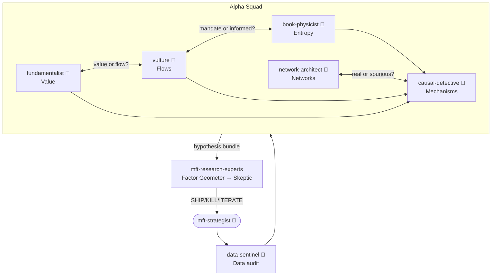

# Alpha Squad

Five optional specialist lenses for testable market hypotheses. Use evidence and task fit to choose the lenses; their names do not imply independent expertise.

## Shared task protocol

The active research contract sets the objective, metric, permitted data, exposure history,
resource limits and stopping rule. Use the [research controller](../../.agents/skills/conduct-creative-research/SKILL.md)
for registration, adaptive-selection controls, uncertainty, grading and evidence records.
These roles supply specialist questions; they do not replace that protocol.

- **Prediction/competition:** validate information availability at inference time, split integrity,
  incremental out-of-sample value on the task metric, and deployment constraints. A useful predictor
  need not identify a causal treatment effect or a losing counterparty.
- **Causal-effect research:** define the intervention, estimand and identification assumptions.
  A DAG records assumptions; agreement with it, residualization or Double ML does not establish
  identification. Instruments are one option, not a universal requirement.
- **Trading:** additionally examine costs, capacity, exposure and a plausible mechanism. Counterparty
  and constraint stories remain hypotheses unless supported by data.
- Distinguish temporal causality (no unavailable future information) from causal identification
  (effects of interventions). Predicting past returns is not itself leakage; negative controls
  need a justified null and a resampling design that respects dependence.
- Select only relevant roles and checks. Mark unavailable or irrelevant fields **unknown/N/A** with
  reasons; do not invent timestamps, venues, corporate actions or institutional identities.
  Use `/venue-expert` only if installed, relevant and supported by the available context.
- Thresholds must be justified for this metric, sample, dependence and decision cost, and registered
  before the comparison. No universal OLS, LARS, R², Sharpe or entropy veto applies. A failed screen
  rejects the tested implementation or narrows the claim; it need not refute the whole mechanism.
- Persona names and shared-model agreement are not independent evidence. Record initial proposals
  separately, scope a critic independently, and decide using reproducible artifacts and the contract.
- Use the contract's worker/compute limits and stop rules; default to one proposal/review cycle,
  not repeated debate until agreement. Additional variants are additional exploratory trials.
- Reuse established authorization and context. Ask the user only for material missing information
  or actions outside authorized scope, not every routine transform or scientific interpretation.
  Approval is not evidence of statistical validity.


## Philosophy

- **Testable rationale** - an observable prediction and falsifier; a DAG when making causal-effect claims
- **Economic context when relevant** - distinguish a supported mechanism from a counterparty story
- **Complementary angles** - value, flows, networks, microstructure, mechanisms
- **Contract governs** - act within authorization, record assumptions and uncertainty
- **Bounded investigation** - stop at the registered evidence or resource limit

## Shared Protocol

Every hypothesis records a prediction, available inputs, baseline comparison, falsifier and cost.
For trading mechanisms, add counterparty, constraint and decay estimates when supported.
Paleologo's five sources are optional idea prompts; unknowns must remain explicit.

## Agents

### fundamentalist - Accounting & Value Lens
Financial statements, earnings quality, capital efficiency. Finds mispricing by understanding what the market misreads in the accounting.

**Key trait**: Accruals revert. Cash flow persists.

---

### vulture - Flows & Constraints Lens
Forced sellers, index reconstitutions, 13F crowding, liquidation signatures. Finds alpha from someone else's mandate, not someone else's mistake.

**Key trait**: Every forced seller has a signature

---

### network-architect - Relationships & Propagation Lens
Customer-supplier networks, lead-lag structures, contagion paths. Models how information travels along network edges.

**Key trait**: Test propagation against common-factor and timing explanations.

---

### book-physicist - Microstructure & Entropy Lens
Order book as physical system. Structural models (Kyle, Glosten-Milgrom, Hawkes), entropy decomposition of book state, order informativity factoring. Finds alpha where information enters the book.

**Key trait**: Entropy changes need a defined estimator and competing explanations.

---

### causal-detective - Mechanisms & Confounding Lens
Examines identification assumptions, information availability and justified negative controls. Uses residualization or Double ML only where their assumptions match the claim.

**Key trait**: Separate predictive association from identified intervention effects.

---

## Flow (only selected, applicable roles)



**Squad Output** (every hypothesis):
- Observable prediction, comparison, falsifier and expected cost
- Evidence-linked rationale and unresolved alternatives
- Required data, availability and exposure status
- Optional causal/trading fields: DAG, counterparty, constraint, decay and source classification

## Venue Context

Use documented venue context when available. An anonymized prediction task may have no identifiable venue; do not block or fabricate one.

## Key Rules

1. **Task fit** - choose relevant lenses and applicable checks.
2. **Evidence required** - make a scoped claim and an observable falsifier.
3. **Bounded review** - one or two proposers and a separately scoped critic, within the contract.
4. **Scoped verdicts** - record uncertainty and what the result does and does not establish.

---

## Color Scheme

💚 CYAN = all squad members (researchers)

## Installation

```bash
/plugin marketplace add git@github.com:DeevsDeevs/agent-system.git
/plugin install alpha-squad@deevs-agent-system
```
