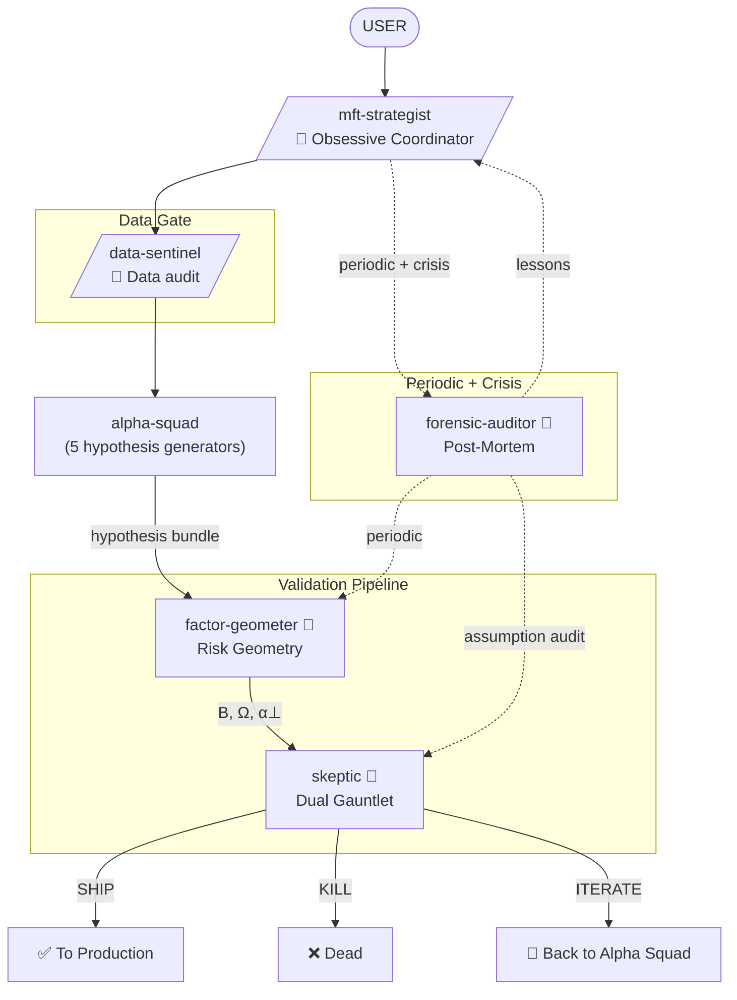

# MFT Research Experts

Orchestration, data validation, risk geometry, hypothesis execution, and forensic audit for quantitative research. The infrastructure that makes alpha-squad's hypotheses real - or kills them.

## Shared task protocol

The active research contract sets the objective, metric, permitted data, exposure history,
resource limits and stopping rule. Use the [research controller](../../.agents/skills/conduct-creative-research/SKILL.md)
for registration, adaptive-selection controls, uncertainty, grading and evidence records.
These roles supply specialist questions; they do not replace that protocol.

- **Prediction/competition:** validate information availability at inference time, split integrity,
  incremental out-of-sample value on the task metric, and deployment constraints. A useful predictor
  need not identify a causal treatment effect or a losing counterparty.
- **Causal-effect research:** define the intervention, estimand and identification assumptions.
  A DAG records assumptions; agreement with it, residualization or Double ML does not establish
  identification. Instruments are one option, not a universal requirement.
- **Trading:** additionally examine costs, capacity, exposure and a plausible mechanism. Counterparty
  and constraint stories remain hypotheses unless supported by data.
- Distinguish temporal causality (no unavailable future information) from causal identification
  (effects of interventions). Predicting past returns is not itself leakage; negative controls
  need a justified null and a resampling design that respects dependence.
- Select only relevant roles and checks. Mark unavailable or irrelevant fields **unknown/N/A** with
  reasons; do not invent timestamps, venues, corporate actions or institutional identities.
  Use `/venue-expert` only if installed, relevant and supported by the available context.
- Thresholds must be justified for this metric, sample, dependence and decision cost, and registered
  before the comparison. No universal OLS, LARS, R², Sharpe or entropy veto applies. A failed screen
  rejects the tested implementation or narrows the claim; it need not refute the whole mechanism.
- Persona names and shared-model agreement are not independent evidence. Record initial proposals
  separately, scope a critic independently, and decide using reproducible artifacts and the contract.
- Use the contract's worker/compute limits and stop rules; default to one proposal/review cycle,
  not repeated debate until agreement. Additional variants are additional exploratory trials.
- Reuse established authorization and context. Ask the user only for material missing information
  or actions outside authorized scope, not every routine transform or scientific interpretation.
  Approval is not evidence of statistical validity.

## Philosophy

- **Data audit first** - verify data relevant to the claim; reuse unchanged, provenance-matched audits
- **Geometry when relevant** - factor exposure is not a prerequisite for every prediction task
- **Claim-specific checks** - predictive validation, temporal availability and causal identification are distinct
- **Stop weak candidates early** - use registered, task-specific evidence and cost gates
- **Audit everything** - assumptions fail silently, find them before they compound
- **Contract governs** - recommendations do not authorize deployment

## Agents

### mft-strategist - Obsessive Coordinator
Coordinates bounded hypothesis generation and verification. Inspects the data audit, selects relevant roles and synthesizes scoped SHIP/KILL/ITERATE recommendations.

**May invoke**: Relevant specialists within the contract budget
**Key trait**: Refuses to let any step proceed without understanding the full chain

---

### data-sentinel - Paranoid Gatekeeper
Checks provenance, information availability and data integrity before fitting or grading. Reuses completed audits and documents transformations within authorized scope.

**Invoked by**: Strategist for new data or material audit gaps; agents with data concerns
**Key trait**: Point-in-time or point-in-lie

---

### factor-geometer - Risk Architect
Builds applicable exposure and covariance diagnostics. A factor-spanned predictor can remain useful for a prediction objective; incremental value and risk constraints determine the decision.

**Invoked by**: Strategist, Alpha Squad (exposure check), Skeptic
**Key trait**: Diagnose exposure and redundancy against the actual objective.

---

### skeptic - Hypothesis Executioner
Checks information availability, registered comparisons and statistical uncertainty. Tests identification only for causal-effect claims; DAGs and orthogonalization alone prove no mechanism.

**Invoked by**: Strategist (after Factor Geometer)
**Key trait**: Your backtest is an adversarial game. I represent your future self.

---

### forensic-auditor - Post-Mortem Investigator
Finds what we believed wrong. Traces assumption failures through the full chain. Runs on schedule AND on crisis. Never trusts "it just stopped working."

**Invoked by**: Strategist (scheduled, crisis), any agent (anomaly)
**Key trait**: Compare explanations against reproducible evidence.

---

## Flow (route only through applicable roles)



## Operating Modes

### Mode 1: Brainstorm & Formalize
```
USER → Strategist → Data Sentinel → Alpha Squad (parallel brainstorm)
  → Record separate proposals → Relevant diagnostics → Skeptic
  → One contracted review cycle → scoped verdict or bounded next experiment
```

### Mode 2: Full Validation
```
Hypothesis Bundle → Data Sentinel (final data check)
  → Factor Geometer if exposure/risk matters → Skeptic (applicable checks)
  → SHIP / KILL / ITERATE
```

### Mode 3: Pipeline Scavenge
```
Contracted audit → Forensic Auditor → Only relevant specialists
  → Auditor synthesizes → Prioritized findings
  → Strategist assigns fixes
```

### Mode 4: Crisis Response
```
Anomaly detected → Forensic Auditor (lead)
  → Data Sentinel (data chain) → Factor Geometer (structure check)
  → Alpha Squad (mechanism review) → Root cause → Fix + Monitor
```

## Venue Context

Use supplied venue context when relevant. A missing `/venue-expert` or anonymized venue is not itself a reason to block a prediction study.

## Key Rules

1. **Audit data** before fitting/grading; reuse a valid existing audit.
2. **Select applicable roles** within the worker and compute budgets.
3. **Match checks to claims**; do not require causal identification for predictive utility.
4. **Audit failures** on a material anomaly or the agreed schedule.
5. **Register gates** and stop rules before observing the comparison.
6. **Scope verdicts** to tested candidates and preserve uncertainty.

---

## Color Scheme

❤️ RED = `mft-strategist` (orchestrator)
💚 CYAN = `data-sentinel`, `factor-geometer` (researchers)
💛 YELLOW = `skeptic`, `forensic-auditor` (validators)

## Installation

```bash
/plugin marketplace add git@github.com:DeevsDeevs/agent-system.git
/plugin install mft-research-experts@deevs-agent-system
```
